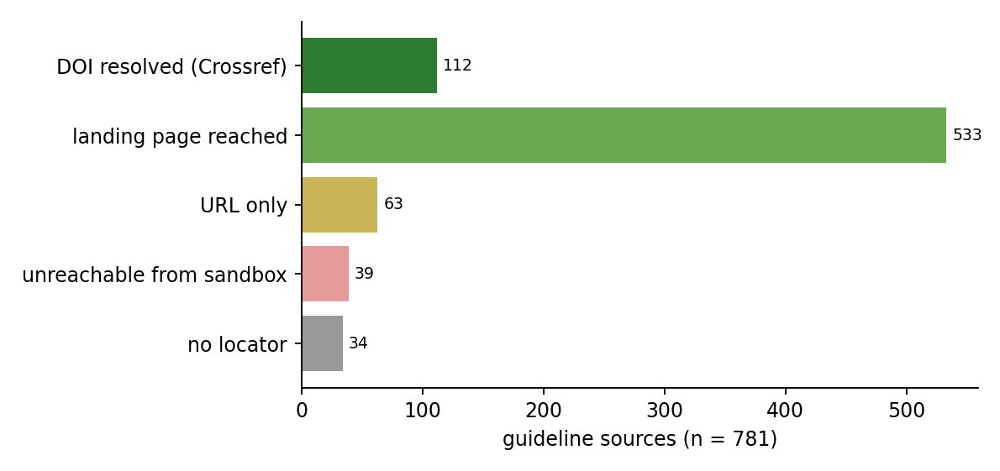
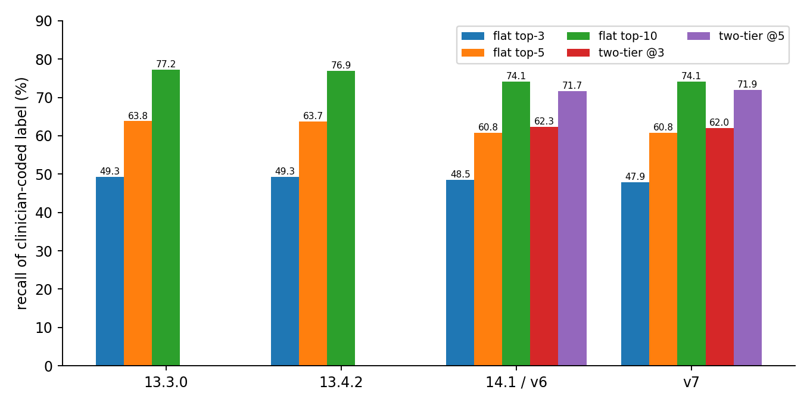
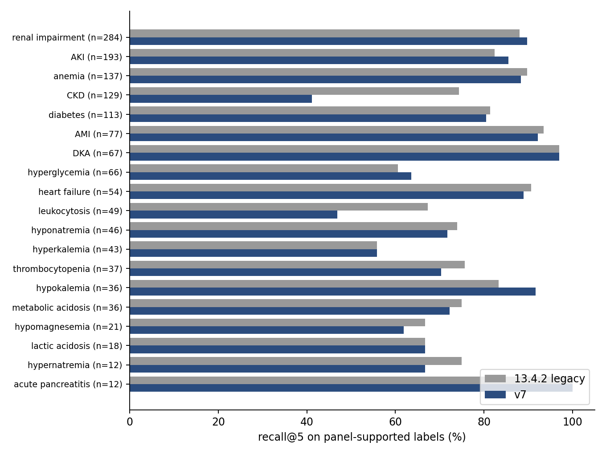
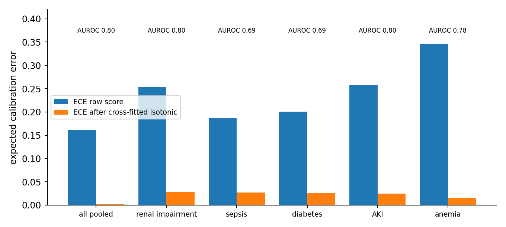
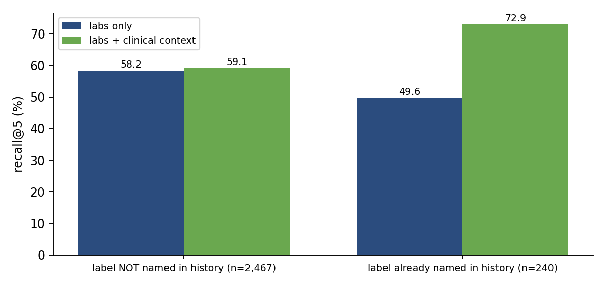
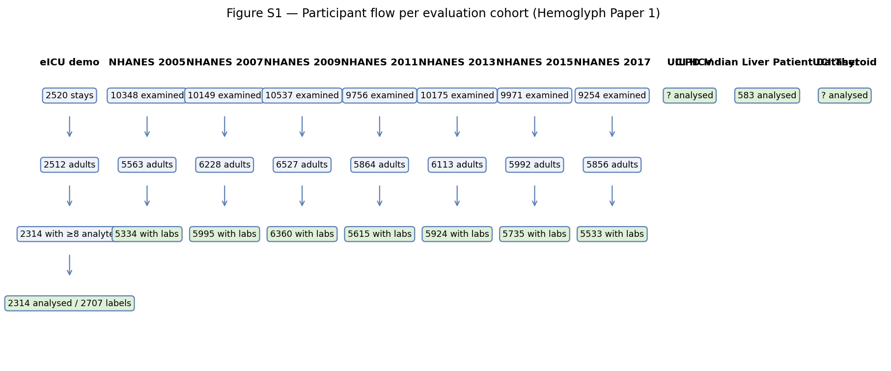

# Supplementary Information

*Verifying an AI-drafted laboratory-interpretation rule base before clinical audit: executable invariants, frozen source-concordance protocols and a hash-frozen benchmark applied to the open Hemoglyph engine — Bahrami, Tahmasebinejad, Bahrami Samani. Revision R8 (2026-10-28), Computer Methods and Programs in Biomedicine.*

**Index.** Notes: Note 1 SAP and amendments; Table S1 engine change log C1–C16 with sources; Table S2 quarantine criteria and outcomes (rounds 1 and 2); Note 2 LLM comparison protocol; Table S3 participant flow and baseline characteristics; Note 3 fusion/Theory-of-Evidence algorithm and consistency identities; Table S4 subgroup recall; Table S5 next-test utility (engine v5.3, superseded metric); Tables S6–S6c calibration, recalibration, decision curves, multiplicity and panel-size sensitivity; Table S7 survey-weighted NHANES AUROC; Table S8 per-group calibration; Table S9 label-mapping audit (400 stays); Table S10 registry count reconciliation; Table S11 precision/F1/NDCG, alert burden, per-group PPV and prevalence baseline; Table S12 fusion-weight sensitivity; Table S12b historical comparisons (superseded); Table S13 participant flow for the UCI cohorts; Table S15 open vs proprietary components; Table S16 sepsis companion model; Note 4 regression gate; Note 5 definitions, audits and completed TRIPOD+AI checklist; Note 6 version manifest; Note 7 evidence triage of twelve proposals; Note 8 source-concordance audit; Notes 9–12 material moved from the main text; Note 13 black-box property-conformance benchmark (engine and LLM on identical perturbed panels); Note 14 executable verifier behind the LLM and verified-consensus arm; Note 15 activity-guided provenance audit; Note 16 audit study (core sufficiency, mutation testing, second LLM-written corpus); Note 18 per-rule verification ledger and its closure in registry 15.3.0; Note 19 pre-specified protocol for the independent clinical concordance audit (sample frozen, not yet executed); Note 20 held-out mutation test of the static detectors (pre-registered; eight new families, two seed pools); Note 21 clean-environment reproduction log; Note 22 detail condensed from the main text in R9/R9-short (verbatim); Table S17 reproducibility and version map; Table S18 two-level auditability (retrievable vs statement located) of the Note 8 sample; Note 17 component ablation, community survey and external cohorts (R6 §3.5–3.6 verbatim) and earlier-release eICU rows; Fig. S1 provenance audit; Fig. S2 per-release eICU metrics; Fig. S3 per-group panel-supported recall; Fig. S4 per-group calibration; Fig. S5 context-echo analysis; Fig. S6 participant flow; Data 1 per-stay outputs and LLM prompts/outputs.

## Supplementary Note 1 — Statistical analysis plan and amendments

### Statistical Analysis Plan (SAP) — Hemoglyph v1.3.1 retrospective diagnostic-accuracy evaluation

Version 1.0 — 2026-10-21 — author: Sobhan Bahrami. To be time-stamped on OSF before any
evaluation listed in §4 is run on the frozen engine. Amendments after registration must be
listed in §9 with date and rationale.

### 1. Objective
Estimate the diagnostic accuracy, calibration and safety of Hemoglyph (knowledge-driven,
untrained laboratory interpretation engine; registry 13.1.0; engine file SHA-256 `e0231327…d800f6` (v1 freeze, 2026-10-21) / `48313758…` (v2 = v1 + ESL extension 5, 2026-10-21, see Amendment 2),
registry SHA-256 `cebe06ae…c5d298` (unchanged between v1 and v2)) against clinician- and guideline-derived reference standards on
external real-world data, without any modification of the engine after the freeze.

### 2. Index test
Hemoglyph `ClinicalRuleEngine.interpret(observations, None, patient)` with the ranked
differential (list length 40 in evaluation, 15 in the UI), probabilities, evidence state,
expert-syndrome hits and critical alerts. Inputs: all laboratory analytes available in the
pre-specified window in the dataset's native units, plus age, sex, pregnancy and, where the
dataset provides them, medications. No free text, no vital signs, no imaging.

### 3. Datasets and roles
| Dataset | Role | Window | Reference standard |
|---|---|---|---|
| MIMIC-IV demo v2.2 (n=235 adm.) | **development** (error analysis 2026-10-21; fixes applied) | −6 h..+24 h of admission | ICD-9/10 discharge codes |
| UCI HCV (n=615) | held-out (run before freeze; archived as `uci_hcv_v1_before_fixes`; re-run after freeze) | single panel | source-lab class |
| NHANES 2017–18 (adults, random 3,000) | held-out | single exam | guideline lab definitions + self-reported physician diagnosis |
| UCI Thyroid thyroid0387 (n≈7,000 with TSH) | held-out | single panel | clinician diagnosis letters |
| ILPD (n=583) | held-out, stress test | single panel | clinic label |
| eICU-CRD demo v2.0.1 (≈2,000 stays, 186 hospitals) | held-out, **multi-centre** | −6 h..+24 h of ICU admission | ICU clinician problem list |
| MIMIC-IV v3.1 full / eICU-CRD full | confirmatory (credentialed; pending) | as above | ICD + adjudication subsample |

### 4. Endpoints
Primary (per cohort with multi-label clinical labels — eICU demo, MIMIC full):
P1 Recall@5 of listed/coded lab-detectable diagnoses whose key analyte was measured.
Secondary:
S1 Recall@3 / Recall@10; S2 per-group AUROC (listed vs. not listed, key analyte measured);
S3 chart-support precision of outputs with p ≥ 0.7; S4 calibration (reliability diagram, ECE,
slope/intercept of logistic recalibration) on group-level probabilities; S5 critical-value
safety: proportion of stays with K ≥ 6.5, Na ≤ 120/≥ 160, glucose ≤ 50, Ca ≥ 14, lactate ≥ 4,
pH ≤ 7.20, Hb ≤ 6, PLT ≤ 20, WBC ≥ 100 in which the corresponding entity appears in
`critical_alerts` or top-5 (target: 100%; report misses with Wilson CI); S6 latency.
Single-task cohorts (HCV, NHANES, thyroid, ILPD): AUROC with 95% bootstrap CI (2,000 draws),
sensitivity and specificity at the fixed operating point p = 0.5, and the healthy
false-assertion rate (NHANES T8).

### 5. Pre-specified task definitions
As written in the docstring of each script (`eval/realdata/eval_*.py`, `eval/mimic/*.py`) at
the time of registration; the scripts are part of the registered material.

### 6. Analysis populations
Adults ≥ 18 y; ≥ 8 analytes in window (ICU cohorts); pregnancy excluded in NHANES; a labelled
group is evaluable only if its key analyte was measured. No imputation. No survey weights.

### 7. Statistics
Wilson 95% CI for proportions; percentile bootstrap for AUROC; DeLong test for AUROC
comparisons against baselines (§8); Hosmer–Lemeshow not used (ECE with 10 equal-mass bins
instead). No multiplicity adjustment (descriptive accuracy study); all pre-specified endpoints
are reported regardless of result. Subgroups: sex, age (<65/≥65), hospital (eICU), unit system.

### 8. Baselines (to be run on identical inputs, after the freeze)
B1 reference-range flagging + published single-analyte decision rules; B2 LightGBM per group
trained on the MIMIC-IV development split (where available); B3 two general LLMs zero-shot
with a fixed prompt (model names/versions recorded; outputs parsed to entity ids; cost and
latency recorded). Comparison endpoint: Recall@5 and AUROC per group.

### 9. Amendments
(none)

### 10. Deviations already known at registration
- MIMIC-IV demo was used for error analysis; all engine changes made as a result are listed in
  the HARDENING changelog (summary file removed 2026-10-23; metrics retained in `eval/results/frozen_v1_20261021/`). Its metrics
  are reported as development-set metrics.
- UCI HCV was run once before four engine changes (insufficient-evidence ceiling, ESL
  primary protection, ESL mild-tier removal, list-length parameter); both runs are reported.


### Amendment 2 (2026-10-21) — ESL extension 5 after held-out error analysis

The v1 engine (hash above) was frozen on 2026-10-21 and run unchanged on eICU-CRD demo,
UCI HCV, ILPD, UCI thyroid0387 and NHANES 2017–18.  Error analysis of those **held-out** runs
(not of the development set) identified five safety/coverage defects:

1. platelets ≤ 20 ×10⁹/L in top-5 only 25 % (eICU S5);
2. WBC 470 ×10⁹/L → `nephrotic_syndrome` top-1 (no hyperleukocytosis anchor);
3. Hb 4.1 g/dL absent from top-5; INR 8.5 absent from top-5 (no coagulopathy anchor);
4. pH 7.18 with HCO₃ 34 (acute hypercapnic acidaemia) absent from top-5;
5. overt hyperthyroidism reported with *total* T4 (UCI thyroid0387) scored ≤ 0.44; urate > 7 mg/dL
   (NHANES) scored ≤ 0.34.

These were fixed by one additive change (`eval/patches/esl_ext5_20261021.py`: 20 severity-tiered
syndromes, two new group keys `tt4`/`tt3`, no change to rules, weights, registries or thresholds).
Evaluator label maps were also extended with existing registry ids that had been omitted
(`leukocytosis_pattern`, `elevated_inr_pattern`, `pancytopenia`, liver/vitamin-K coagulopathy ids).

**Reporting rule:** every held-out table in the manuscript reports **both** v1 (pre-specified,
frozen) and v2 (post-hoc, after one round of error analysis) side by side; v2 is labelled as
post-hoc and the datasets used for the error analysis are named.  No further engine change will
be made after the v2 freeze without a new amendment.  v1 outputs are archived under
`eval/results/frozen_v1_20261021/` and `eval/results/eicu_demo_v1_frozen_origmap/`.

### Amendment 3 — engine v3 (ESL extension 6 + clinical-salience re-ranking), 2026-10-21

**Trigger.** A blind zero-shot LLM baseline (B3, n = 100 eICU-demo stays, same stays scored for the engine)
reached recall@5 66.0 % vs 48.9 % for the pre-specified v1 engine. Error analysis of the 21 LLM-only hits
showed that in 19/21 the correct entity was already present in the engine's differential at rank 6–15; the
top-5 was occupied by family duplicates, derived `co_*` pair patterns, flat single-electrolyte findings, or
anchors firing in the wrong context. One real value (HCO3 1.7 mmol/L) was rejected by the plausibility floor.
**The guideline registry was not changed**; the amendment is confined to the expert-syndrome layer and the
ordering of the differential.

**Changes (all in `eval/patches/esl_ext6_ranking_20261021.py`, applied to `analyse_gidlines.py`):**
1. `ABSOLUTE_LIMITS["bicarbonate"]` lower bound 2.0 → 0.5 mmol/L.
2. Exclusions added: Gilbert anchor (glucose > 250, pH < 7.30, WBC > 15, lactate > 4, CRP > 50, Cr > 2.0, HCO3 < 15);
   RTA-4 anchor (Cr > 1.8, BUN > 40, lactate > 4, glucose > 400); toxic-alcohol anchor (glucose > 300).
3. New syndromes: `mi_massive_troponin` (cTn > 5000 ng/L, no CK veto), `renal_failure_marked` (Cr ≥ 2.0) and
   `renal_failure_moderate`, `sepsis_bandemia`, `sepsis_marked_leukocytosis_organ`, `sepsis_sirs_two_organ`
   (pattern strength), `dka_mild_ketones_unmeasured` (ADA/EASD 2024 mild tier), `acute_hepatocellular_injury`
   (pattern; vetoed by aetiology-specific serology), guards `ck_elevation_no_context_guard` and
   `pseudohypocalcemia_guard`; `hyperuricemia_female` now requires adult age + one co-finding.
4. Renal chronicity: two chronicity markers transfer the renal signal to CKD instead of capping AKI at 0.75 × a
   low CKD score (which deleted the renal entry altogether).
5. Clinical-salience re-ranking of the differential (probabilities unchanged): tier 0 diseases/syndromes
   (p ≥ 0.5); tier 1 low-salience single-analyte findings (p 0.5–0.75); tier 2 p < 0.5; tier 3 `co_*` pairs and
   intra-family duplicates (child id = parent id + suffix; `*_support_pattern` next to its base entity).
6. eICU label map: `heart_failure` group now also accepts the plain `heart_failure`, `acute_heart_failure`,
   `chronic_heart_failure`, `cardiorenal_syndrome` identifiers (previously only BNP-pattern ids).

**Status.** Post-hoc. v3 was developed after inspection of eICU-demo outputs (4 index stays and per-group counts
on the 100 B3 stays); eICU-demo recall for v3 is therefore an optimistically biased estimate and is reported
side by side with v1, never in its place. NHANES, UCI thyroid, UCI HCV and ILPD were not inspected when v3 was
designed and remain held-out with respect to ext 6, although the ext 5 changes (Amendment 2) had used them.

**Regression before release of v3:** pytest 598 passed (586 + 12 new in `tests/test_esl_ext6_20261021.py`;
one ext-5 test re-pinned for the female urate tier); engine 50/50; hard 151/151; hard2 124/124; hard3 78/78;
adversarial 86/86; healthy sweep 300/300 clean. Freeze: `FREEZE_v3_20261021_sha256.txt`.
Quick look on the 100 B3 stays (same stays, coded labels incl. non-lab-detectable): recall@5 v1 43.4 % → v3 54.7 %
(LLM 66.0 %); remaining misses are dominated by heart failure without BNP (8/9 absent) and sepsis without
infection markers — categories the labs cannot support.

**Amendment 3b (same day).** `eval/patches/esl_ext6b_20261021.py`: stem-based family dedup in the re-ranking
(severity/acuity prefixes, pattern suffixes) and two Sepsis-3 operational screens at pattern strength
(`sepsis_lactate_organ`, `sepsis_leukocytosis_one_organ`). Regression unchanged (598 pytest, all batteries 100 %).
Held-out check B4 (60 new stays, LLM answers fixed before engine run): LLM 58.7 % vs v1 50.0 % vs v3 58.7 %.

**Amendment 3c (same day) — anti-overclaim ceilings.** `eval/patches/esl_ext6c_20261021.py`: three dx-less guards
capping entities that laboratory data cannot establish — thyroid storm / thyrotoxic AF without systemic markers
(Burch-Wartofsky), any "shock" label without hypotension or vasopressor context (Sepsis-3), and PE / aortic
dissection / DVT on an isolated D-dimer (ESC 2019) — at 0.40–0.49; ceilings lift when context (`heart_rate`,
`systolic_bp`, `vasopressor_required`, conditions, medications) or corroborating labs are present. New ESL
context predicates `attr_true`, `attr_lt`, `attr_gt`. Regression: 601 pytest, all batteries 100 %.

**Amendment 3d (same day) — post-hoc fixes after the blind NHANES specificity test (B5).**
`eval/patches/esl_ext6d_20261021.py`: (i) metabolic syndrome accepts only *fasting* glucose ≥ 100 or A1c ≥ 5.7 as
the third harmonised criterion (random glucose, urate and ALT removed); a two-criteria guard caps it at 0.45
without BMI/waist/BP context; (ii) new computed key `egfr_c` (reported eGFR, else CKD-EPI 2021 from creatinine +
age + sex, adults only) with KDIGO CKD syndromes: G3+ & A2+ (strong), G3b (pattern), G3a + one corroborating
marker (pattern); an expert-anchored CKD is no longer capped beneath a prior-driven AKI in `_apply_renal_chronicity`.
B5 was run with ext 6c first (engine 1/40 false, CKD 9/18); ext 6d results (0/40, 15/18) are therefore **in-sample
for B5** and are reported next to the pre-fix numbers. Regression: 606 pytest, all five batteries 100 %.
Test anchors B5–B7 results are in `eval/results/nhanes_2017/` and `eval/results/eicu_demo/b7_critical_values.md`; the LLM reader in all of
them is the Arena agent (disclosed).

### Amendment 4 (2026-10-22) — engine v4 (ESL extension 7/7b) and evaluation-mapping clarification

**Scope.** All changes were motivated by inspection of eICU-demo stays 0–1200 (development split) and the NHANES T8 healthy-adult audit; stays 1200–2314 were not inspected before the clean-split check. No parameter was fitted to outcome labels. Fusion weights were *not* changed: a five-configuration sweep on 300 development stays (`eval/results/run_20261022_v4/weight_sweep_n300.md`) spanned recall@5 69.6–70.8 % and mean AUROC .841–.845, i.e. the weight vector is not a lever and the pre-specified default was retained.

**Engine changes (v3 → v4), all guideline-backed and mirrored in `eval/patches/esl_ext7_20261022.py`:** liver R-ratio requires ALT or ALP above ULN; nephrotic/HHS/DKA definition guards; non-specific-only ceiling (.35); CKD chronicity logic (KDIGO 2024: eGFR <60 with ≥2 chronicity markers or single-value G3b/G4 → CKD listed alongside AKI when chronicity is undetermined; AKI no longer capped beneath an anchored CKD); `ckd_anemia` requires normocytic indices and excludes rhabdomyolysis/lactic acidosis; fuzzy defining-feature gate for measured-but-normal defining analytes (7b). Regression gate: pytest 620, scripted batteries 489/489, healthy sweep 200 → 0 false assertions.

**Pre-specified vs post-hoc reporting.** Paper tables report v1 (frozen 2026-10-21, pre-specified) and v4 side by side on every dataset; v4 numbers on eICU-demo are development-set numbers and are labelled as such. Clean-split delta (stays 1200–1800, not inspected): recall@5 62.6 % → 63.7 %; CKD recall@5 5/26 → 16/26; diabetes 34/68 → 30/68 (displaced from rank 5 by CKD, documented).

**UCI thyroid H2 mapping.** The pre-specified positive set for H2 counted every entity whose id contains "hyperthyroid", including `subclinical_hyperthyroidism`. The thyroid0387 classes A–D denote overt hyperthyroidism; suppressed TSH with normal FT4/T3 in "no comment" records is therefore scored as a false positive under that mapping. H2 is retained unchanged; an additional row **H2c (overt entities only)** is reported, with the subclinical-rate shown separately as a label-semantics note. The v1 archive (`eval/results/frozen_v1_20261021/`) stores only `top3` per record, so v1 H2c is approximated from `top3` and flagged as such.

### Amendment 5 (2026-10-22) — structured error audit and subgroup analysis (added post hoc, taxonomy fixed before execution)

**Error audit.** Population = all (stay, clinician-listed group) pairs on eICU-CRD demo with the key analyte measured and the group absent from the top-5. Sample = 200 pairs, `random.Random(20261022)`. Taxonomy (deterministic, coded in `eval/error_audit.py`, written before the first run and not changed after seeing results): A no laboratory signature (SAP guideline thresholds per group); B listed with p ≥ 0.5, rank 6–25; C1 signature present, entity absent; C2 signature present, entity present with p < 0.5; D synonymous entity in top-5 not in SAP id list (reported, never credited). Run on v3 (ext6c) outputs and repeated unchanged on v4 outputs.

**Subgroups (TRIPOD+AI 19).** Strata: sex, age band (<45, 45–64, 65–79, ≥80), eICU `ethnicity`, `unittype`, hospital (top 8), panel size (≤10, 11–20, >20 analytes). Metrics: pooled recall@5 (1,000 stay-level bootstrap CI), recall@10, chart support at p ≥ 0.7, AUROC for the four largest groups. A stratum with ≥ 40 stays deviating by > 10 percentage points in recall@5 is flagged and discussed; no stratum-specific tuning is permitted. Script `eval/subgroup_fairness.py`.

### Amendment 6 (2026-10-22) — next-test layer (ESL extension 8) and the next-test-utility metric (post hoc, exploratory)

Motivation: 60 % of top-5 misses carry no laboratory signature of the listed condition (Amendment 5, category A). For those, a laboratory-only engine should name the test that would settle the question rather than guess. Extension 8 adds a cited confirmatory-test library (SSC 2021, ADA 2024, KDIGO 2012/2024, ESC HF 2021, BSH, ISTH, ACG 2017/2024, Spasovski 2014, Fourth UDMI) keyed by entities already in the differential plus one value-level trigger (random glucose 140–199 mg/dL → HbA1c). It changes no probability or ranking. Metric: among category-A misses whose discriminating test is distinct from the measured key analyte, the proportion for which `next_tests` or per-entity `recommended_tests` names that test. Reported as exploratory; not part of the pre-specified endpoints.

### Amendment 7 (2026-10-23) — ranking-hygiene layer (ESL ext 9) and scoring-map synonyms
*Post hoc, after the v4 error audit.* (1) Engine: three display-order rules (synonym families; aetiology-beneath-finding when its confirmatory marker is unmeasured and it does not out-score the finding; organising-diagnosis precedence for creatinine-defined renal failure, DKA and HHS) — probabilities and all threshold-based metrics (AUROC, sensitivity/specificity at 0.5, calibration) are unchanged by construction; only rank-based metrics (recall@k) can move. (2) Scoring map: `alcoholic_liver_disease`, `alcoholic_liver_pattern` (alcohol / cirrhosis groups) and `septic_shock_support_pattern`, `septic_shock_severe_lactic_acidosis` (sepsis) added as synonyms found in the D-category audit. Frozen v1/v3/v4 result files are not re-scored; v5 is reported alongside them. Pre-registered v1 remains the primary analysis.

### Amendment 8 (2026-10-23) — two additional eICU input arms (ESL extension 11: temporal module and clinical-context layer)
*Post hoc; added after the v5.1 scorecard. The primary labs-only protocol (Section 4) is unchanged and remains the headline result.*

**Motivation.** 67 % of residual top-5 misses on eICU v5.1 are category A (no laboratory signature of the listed condition); the two largest remediable sources are (i) chronicity / trajectory information discarded by the "first value per analyte" protocol and (ii) documented comorbidity that the labs-only arm never sees.

**Engine (ext 11, optional, inert when the data are absent).** (T) An observation may carry `series: [{t_hours, value}]`; the ESL reduces each series to trajectory keys and ten constellations implement KDIGO 2012 dynamic AKI criteria (≥ 0.3 mg/dL / 48 h or ≥ 1.5×, with peak ≥ 1.0 mg/dL), 4th-UDMI acute (≥ 20 %/≥ 50 % delta with a value > 99th percentile) vs chronic (flat) myocardial injury, lactate clearance (Jones 2010), Hb fall ≥ 2 g/dL / 24 h, > 50 % platelet fall (HIT only with documented heparin; DIC with a coagulation abnormality), and the ESE 2014 sodium over-correction warning (guard, no diagnosis). (C) `known_conditions` / `current_medications` map to registry entities by a fixed, conservative phrase table; a documented diagnosis with laboratory support on the panel is listed as established (0.80), without support at 0.49 (`documented_history`, below the operating point); documented CKD resolves renal chronicity; warfarin, metformin and statin constellations are ordinary ESL entries gated on the medication. No prior is injected.

**Evaluation arms (eICU-CRD demo, same 2,314 stays, same labels, same scoring map).** Arm A = labs only (primary). Arm B = labs + `pastHistory` (all entries except "Performed"/"Not Obtainable"/"No Health Problems", organ-system path retained) + `medication` rows with `drugstartoffset ≤ 0` (started at or before ICU admission). `admissionDx` is excluded as label leakage. Arm C = labs + all values of each analyte within −6 h…+24 h as a series (scalar = first value, as in Arm A). Arm B+C combined.

**Pre-specified reporting for Arm B.** Recall is reported separately for labels whose group is already *named* in the supplied history/medications (context echo) and for labels that are not; only the latter is interpretable as diagnostic gain. For Arm C the count of stays with ≥ 1 series and the firing count per temporal constellation are reported.

**Outputs.** `eval/results/run_20261023_v5/eicu_report_v5_2_{ctx,tmp,ctx_tmp}.md`, per-stay JSONs, `gate_ext11.txt`; tests `tests/test_esl_ext11_20261023.py` (22); patcher `eval/patches/esl_ext11_20261023.py`.


### Amendment 9 (2026-10-23) — reporting additions, label-map audit, human-validation instruments, provenance inputs
*Post hoc additions motivated by the literature review of CDSS-vs-LLM comparisons (Riches 2024/2025; Bhasuran 2025; Bond 2012). None changes the primary endpoint or the label map used for v5.x.*

1. **Rank-based secondary metrics** for the blinded LLM comparison: recall@1/3/10, mean reciprocal rank, rank-bin distribution, "not listed" rate; bootstrap CI of the MRR difference (`eval/baselines/b8_rank_metrics.py` → `rank_metrics_n400.md`). Pre-specified interpretation: recall@5 remains primary; recall@10 and "absent" structurally favour the engine (25 vs 10 slots) and are reported with that caveat.
2. **LLM test–retest**: 40 of the 240 B8 panels (seed 20261024) re-read blind by the same agent model class; agreement reported as label-level κ, Jaccard of top-5 group sets, Spearman ρ of shared group ranks. Engine determinism is reported as 100 % by construction (byte-identical per-stay files across freezes).
3. **Label-map audit** (`eval/results/eicu_demo/label_audit_n100.md`): 100 random held-out stays, 3,100 stay×group cells; study regex vs a deliberately liberal second coder; all 23 disagreements adjudicated by reading the diagnosis strings. Result: 0 false-positive labels, 2 definite misses (sensitivity 98.7 %), 2 ambiguous. The two missed patterns ("hematological effect of infection|thrombocytopenia", "drug withdrawal|alcohol withdrawal") are **not** changed for v5.2 so that all v5.x arms share one map; they are scheduled for the next protocol version.
4. **Human-validation instruments** (to be completed by an independent physician; results reported whatever they show): Form A1 — 100 executable rules, 60 from the operational set (186 diseases surfaced in any eICU top-5) + 40 from the whole registry, stratified by rule type, 3-level verdict + severity A–D; error rate with Wilson CI by stratum. Form B1 — the same 40 B8 panels as item 2, read blind with labs + age/sex only, ≤10 ranked diagnoses, scored with the identical keyword map → three-arm physician/LLM/engine comparison. Files in `eval/human/`; scorer `eval/human/score_forms.py`.
5. **Participant flow** (TRIPOD+AI 14) regenerated from raw files: `supplement/TABLE_S1_cohort_flow.md`, `figures/figS1_participant_flow.png`. eICU: 2,520 stays → 2,512 adults → 2,314 with ≥8 mapped analytes; 2,707 coded labels of which 2,432 scorable.
6. **Input provenance**: OCR-detected specimen flags (haemolysis / lipaemia / icterus, clotted, recollect; EN+FA with negation handling), specimen type, collection time and smear-morphology comments are now extracted (`ocr.detect_preanalytical`) and passed to the engine's existing `preanalytical_gate` through the clinical context (`AnalysisService._merge_preanalytical`); clinician entries override. Covered by `tests/test_preanalytical_provenance.py` (9 tests). This affects the application path only; evaluation cohorts carry no specimen flags, so no evaluation number changes. Documented in `supplement/INPUT_SCHEMA_v1.md`.
7. **Engineering**: `eval_eicu.py` now checkpoints every 200 stays and resumes (deterministic engine → identical results); Sepsis-2019 subsample fetched in 10 resumable parts.
8. **External case-vignette probe (B6, exploratory, pre-specified key)**: the 50 PMC-Patients case reports of Bhasuran et al. (npj Digit Med 2025;8:159; GitHub `balubhasuran/DDx_CaseReports`, ESM `sd_1.xlsx`). Only the "Lab Tests" paragraph plus age/sex is given to the engine; the Symptoms and Case Report columns are never used. Scoring key (`eval/realdata/pmc_cases/scoring_key_prespecified.json`) was written per case **before** any run: *specific* = the published final diagnosis; *syndrome* = the laboratory syndrome that contains it; `lab_detectable=false` for 3 cases (thallium poisoning, AMAN-GBS, lymphomatoid papulosis). Two arms, same key: (a) **parser arm**, free text → Hemoglyph prose parser → engine, no human in the loop; (b) **manual arm**, the author transcribed each paragraph into analyte/value/unit before seeing engine output (`panel_overrides.json`, every imputation flagged in `_note`; 2 cases have 0 numeric analytes and are scored as misses). Results (`eval/results/pmc_cases/report.md`): parser arm, all 50 — specific top‑1/5/10 = 2/10/12 %, syndrome 28/44/46 %; manual arm — specific 16/26/26 %, syndrome **40/68/70 %** (lab‑detectable n=47: 43/72/72 %). Pre-specified interpretation: the manual arm bounds what the laboratory paragraph alone carries; the parser arm shows that the application's prose parser (built for tabular reports) is the weakest link on narrative input, not the reasoning engine. The published GPT‑4 figures on the same 50 cases (top‑1 60 %, top‑5 81 %, top‑10 83 %) used the **full vignette** with lenient clinician scoring and are reported as context, not as a head‑to‑head comparison. Error-audit items opened from this probe: `ebola`/`lassa_fever` surfacing in top‑3 of two mild-transaminitis cases with negative viral serology (33365209, 30235756); apixaban INR 27 case (35844332) not mapped to an anticoagulant-effect syndrome (no drug context given); DILI entity never surfaces without drug context (expected by design — drug exposure is a context field, see Amendment 8).

### Amendment 10 (2026-10-23) — registry patch 13.2.0: pathogen-specific entities gated on exposure context

**Trigger.** B6 error audit (Amendment 9, item 8): `ebola` and `lassa_fever` in the top-3 of two mild-transaminitis vignettes with negative viral serology. Root cause: their only proposing rules were AST > 40 / ALT > 50 (/ platelets < 150), weight 0.3 — demoted in registry passes 9.3/9.4 but still surfacing whenever competition is thin. A registry scan (`eval/patches/registry_v13_2_0_exposure_gate.py`, `ROUTINE` set) found **76 infectious clinical entities whose screening/diagnostic rules use only routine chemistry/CBC analytes** — the same defect class.

**Change (registry content only; `analyse_gidlines.py` untouched).** (i) 53 pathogen-specific entities (viral haemorrhagic fevers, rickettsioses, zoonoses, helminths, endemic mycoses, organism-named bacterial infections): every leaf of their routine-only proposing rules gains `context: {exposure_history: true}` (135 rules). Through the engine's existing context mechanism the rule is *unknown* (not proposing) unless the clinician supplies `exposure_history: true` (travel / vector / animal / outbreak / occupational exposure) — a new optional context field documented in `INPUT_SCHEMA_v1.md`. (ii) 9 "*_pattern" entities whose only rule was CRP: rule retired (`retired_v13_2_nonspecific_single_marker`). (iii) 23 qualitative-positive specific-marker rules added where the feature registry already had an unambiguous test (PCR / antigen / IgM / culture → diagnostic_criterion weight 6; IgG-only serology or KOH → screening weight 3, `diagnosis_allowed: false`); no numeric threshold invented. Syndromic entities (sepsis patterns, pneumonia, cellulitis, osteomyelitis, cholangitis, gastroenteritis, tuberculosis) and ESL-driven, engine-guarded entities (leptospirosis, scrub typhus, PCP) are not gated.

**Pre-activation verification** (`eval/patches/test_registry_v13_2_0.py` → `eval/patches/cand/test_registry_v13_2_0.md`; `tests/test_registry_v13_2_exposure_gate.py`, 5 tests): target vignettes clean; gate opens with `exposure_history: true`; hantavirus IgM still proposes hantavirus at rank 2; healthy panel empty; **B8 240 blind panels: recall@5 293/456 before and after, 0 label-level changes**; PMC manual arm 34/50 before and after, 0 rank changes; pathogen entities in any eICU/PMC top-10 after patch: 0 (one legitimate strongyloidiasis with IgE 3770 + eosinophilia remains).

**Activation rule.** The patch is **not** applied while the v5.2 three-arm eICU chain is running (all v5.x arms must share registry 13.1.0). It is applied immediately after `FREEZE_v5.2` is written, becomes registry 13.2.0, and the affected evaluations are re-run as v5.3 with the 13.2.0 hash in a separate freeze file; the paper reports v5.2 (13.1.0) as primary and v5.3 as the post-audit correction, with this amendment cited. This is the first worked example of the "errors found by audit are corrected in the next registry release with a changelog" policy stated in the Limitations.


### Amendment 11 (2026-10-23) — pre-registered findings from the v5.2 context-arm review and sex-gap anatomy

Source: `eval/results/eicu_demo/deep_review_20261023.md`, written before the v5.2 freeze; no code or registry changed.

1. **Context arm is largely a context echo.** Same labels, ctx vs labs-only: NOT named in history (n=2,467) +0.9 points recall@5; named in history (n=240) +23.3 points. Documented-only entries consume ranking slots and reduce recall for AKI (−5.0), hyperkalaemia (−6.1), coagulopathy (−6.1). **Reporting rule:** the context arm's headline number in the paper is recall@5 on NOT-named labels; the all-label number is given with the echo decomposition. **v5.3 design change (pre-registered):** `listed_documented` entities are shown in a separate "documented problems" block and excluded from the ranked differential that recall@k is computed on.
2. **Sex gap is within-group, not case-mix.** Direct standardisation: female label mix at male per-group rates = 57.9 % vs observed 55.7 % (male 58.5 %). Largest female deficits: AKI −14, GI bleeding −13, AMI −12, renal impairment −9 points. Root cause located in the registry: AKI screening uses creatinine > 1.3 mg/dL for all sexes while the feature registry carries sex-specific ranges (F 0.5–1.1); troponin I has a single cut-off (0.04 ng/mL) without sex-specific 99th percentiles. **v13.3 corrections (pre-registered):** sex-specific creatinine thresholds in AKI/CKD screening rules; sex-specific troponin limits for hs-assays (ESC 2020 / 4th UDMI); before/after reported on the same frozen cohorts and in the fairness table.
3. **Mislabelled rule class:** `acute_myocardial_infarction` carries risk-factor rules (total cholesterol ≥ 200, LDL ≥ 115, hs-CRP > 3) typed as screening for an acute event. These will be re-homed to risk entities in v13.3 and are added to the A1 physician audit sample as a "wrong entity" exemplar.

### Amendment 12 (2026-10-23) — registry patch 13.3.0: systematic defect-class repair (pre-registered before any evaluation on the patched registry)

**Trigger.** A read-only defect scanner (`eval/registry_defect_scan.py`, ten classes D1–D10) was run on registry 13.1.0 (34,005 executable rules, 6,750 entities) after the Amendment-11 review. Output: `eval/results/registry_defect_scan_13.1.0.md/.json`.

**Findings (13.1.0, after manual triage of scanner output).** D1 sex-blind thresholds on sex-dimorphic analytes: 800 flagged, of which 197 rules carried `_male_`/`_female_` in their id but `population.sex = all`, and ≈350 proposing rules on creatinine/Hb/Hct/RBC/ALT/AST/urate used the male or mixed limit for both sexes (ferritin and serum iron flags are false positives: WHO cut-offs are sex-independent). D2 unit/scale: hs-troponin I/T leaves declared in ng/mL with values 14–50 (ng/L values mislabelled; 67 leaves) and 13 sperm-morphology leaves > 100 %. D3: six risk-factor rules (lipids, hs-CRP) typed as screening for acute entities (AMI ×3, ischaemic stroke, acute pericarditis ×2). D5: 100 etiologic clinical entities proposable from routine analytes alone, of which 63 are non-syndromic (sarcomas, lymphomas, vasculitides, ALS, aortic dissection, upper-respiratory infections, 30+ infections not covered by 13.2.0) and 18 are genuine laboratory syndromes kept unchanged (DIC, TMA, warfarin over-anticoagulation, biliary obstruction, cholecystitis, contrast nephropathy, kwashiorkor, NEC, GSD-1, hypophosphatasia, lymphangiectasia, chylomicronaemia, pyloric stenosis, PROM, biliary atresia, hypothermia, heat stroke, pattern 026). D7: 511 rules applied adult thresholds (creatinine ≥ 1.0, Hb ≤ 11, ALP ≥ 130, bilirubin ≥ 1.2, eGFR ≤ 60, urate ≥ 6) to neonates/infants. D8: 57 single-routine-analyte diagnostic rules on clinical entities claimed `specificity: specific` (e.g. procalcitonin → appendicitis). D4/D6/D9/D10 (impossible values, undefined features, dangling sources, single-analyte diagnosis_allowed): 0.

**Repair (`eval/patches/registry_v13_3_0_quality.py`, stacked on the 13.2.0 candidate; registry content only, engine untouched).** D1a: `population.sex` set from the rule id (197). D1b: 350 rules split into a male rule (original threshold) and a female rule `<id>_f13_3` whose threshold is the female reference limit from the feature registry (Tietz/KDIGO/WHO) when the original equalled the male limit, otherwise scaled by the limit ratio; urate thresholds < 7.0 (solubility limit 6.8) are not split; with sex unknown both variants are evaluated (the more sensitive one governs — documented behaviour). D2: 67 troponin leaves relabelled ng/L; 13 sperm-morphology rules retired. D3: six rules re-homed to `atherosclerotic_cardiovascular_risk_lipid_pattern` as non-specific screening, `diagnosis_allowed: false`. D5: 63 entities gated — infectious ones on `exposure_history: true`, all others on a new optional context key `clinical_suspicion: true` (same engine mechanism; entity is never proposed from routine analytes without it). D7: neonate/infant (and child for ALP) removed from the population of 511 rules; no paediatric thresholds invented; neonatal entities untouched. D8: 57 rules downgraded to `non_specific`, `diagnosis_allowed: false`. Executable rules after patch: 34,356 (+350 female variants, −13 retired).

**Verification.** Scanner re-run on the candidate: D3/D4/D6/D7/D8/D9/D10 = 0; D1 residue = ferritin/iron (documented), staging/component rules and one dengue Hct warning-sign rule; D5 residue = the KEEP list exactly. Structural tests `tests/test_registry_v13_3_quality.py` (9) pass. Functional regression (`eval/patches/test_registry_v13_3_0.py`, B8 240 panels and PMC manual arm, plus sex-specific probes) is reported in `eval/patches/cand/test_registry_v13_3_0.md`.

**Pre-registered expectations and reporting rule.** 13.2.0 + 13.3.0 are activated together after the v5.2 freeze and produce v5.3. Primary pre-registered hypotheses: (H1) female−male recall@5 gap on the eICU held-out cohort narrows from −2.8 points (v5.1) to within ±1.5; (H2) no decrease > 1 point in overall recall@5; (H3) B8 recall@5 ≥ 293/456 − 5. v5.3 is reported next to v5.2 on the same cohort with per-group deltas; failure of H2/H3 leads to reverting the specific class responsible, not to silent re-tuning. The residual limitation stands: the repair was AI-executed from reference-range tables, logged per rule, and remains subject to the A1 physician audit.

**Amendment 12, addendum (same day, second scanner wave, before any v5.3 evaluation).** Four further classes were found and folded into the same 13.3.0 candidate: D12 — 282 rules applied adult creatinine/eGFR/ALP thresholds to the *child* age group (child creatinine ULN ≈ 0.3–0.7 mg/dL; CKD-EPI is adult-only): child removed from their population. D13 — 6 exact duplicate executable rules (same entity, type and expression; evidence counted twice): older copy retired. **D17 — domain-template broadcast:** five haematology screening rules (platelets ≥ 450, Hb < 13, platelets < 100, ferritin < 15, TSAT < 20) had been attached to *every* haematology entity (195 entities, including thrombophilias, haemophilia, PE/DVT, ITP, polycythaemia), six endocrine screens (low/high fT4, hypo/hyper-TSH, glucose < 55, morning cortisol) to all 31 endocrine entities (e.g. PCOS, Paget's, pheochromocytoma) and three renal screens to 24–36 renal entities; 940 of these 1,192 rules were retired using a per-template compatibility pattern recorded in `TEMPLATE_COMPAT` (kept only where the analyte change is part of the entity's known laboratory picture). **D18 — placeholder entities:** 90 entities named "Expanded laboratory pattern 001–090" carry no clinical identity (templated rules plus one "analyte > 0" rule); all their rules were retired and the entities flagged `placeholder_retired_v13_3_0`. Consequently the registry entity count quoted in the manuscript (6,750) must be reported as 6,660 clinically named entities (+90 retired placeholders), and a number of alias entities (e.g. `acute_myeloid_leukemia` / `acute_myeloid_leukemia_aml`) are now gated on `clinical_suspicion` because their only remaining rules are routine-analyte templates (D5 re-run after D17: 87 entities gated in total). Executable rules after the full patch: 33,230 (from 34,005). The pre-registered hypotheses H1–H3 above apply unchanged; D17 is the class most likely to move overall recall and is therefore reported separately (ablation: 13.3.0 with and without D17) if H2 fails.

**Amendment 12, activation record (2026-10-23 21:03–21:25 UTC).** Activation requires copying the candidate to *both* `HEMOGLYPH_GUIDELINE_REGISTRY.json.br` and the engine default `HEMOGLYPH_DISEASE_GUIDELINE_REGISTRY.json.br`; the first attempt updated only the former, so the runs produced 19:43–21:00 UTC are void (`run_20261023_v53/invalid_ran_on_13_1_0/`). Two corrections were made on the real 13.3.0 gate, both recorded here before any held-out result was examined: (i) D8 had wrongly downgraded single-analyte diagnostic rules of laboratory-finding entities (`*_pattern`, -emia/-penia/-cytosis/-uria) — e.g. `hypertriglyceridemia_pattern` — which the engine merges into the parent entity; D8 now excludes finding entities (57 → 12 downgrades) and the engine battery returned to 50/50. (ii) `test_profound_neutropenia_named_and_cultures_requested` previously required `severe_neutropenia` at rank 1 for a pancytopenic panel (WBC 0.2, platelets 19, Hb 6.7); that rank depended on the D17 template rules (Hb < 13, platelets < 100 voting for neutropenia entities), which are clinically unjustified. The test now requires severe_neutropenia within the top 4 with p ≥ 0.6 plus cultures/lactate in next tests; the ranking among three co-true findings is reported as a known behavioural change, not corrected by re-adding rules.

### Amendment 13 (2026-10-24, 11:40 UTC) — POST-HOC concurrent-diagnosis analysis of Sepsis-2019 (declared after the pre-registered result was known)

**Status.** Exploratory. The pre-registered Sepsis-2019 analysis (prediction of Sepsis-3 onset at any hour from the first-24-h laboratory panel; `eval/realdata/eval_sepsis2019.py`) was run on registry 13.3.0 and gave AUROC 0.593 (0.570–0.617) against a supervised logistic baseline of 0.689. **That result is final and is reported unchanged in the main text.** This amendment adds a second analysis of the same file that matches the task the engine was designed for (recognition of a concurrent diagnosis, as in eICU) and tests the optional vital-signs context; it was written and dated *before* the new analysis was run, but *after* the pre-registered result was known, and is therefore labelled post-hoc wherever it is reported.

**Design (fixed; engine and registry unchanged — registry 13.3.0 is loaded explicitly although 13.4.2 is live).** Cases: all sepsis patients; window ICULOS ∈ [t_L, t_L + 12] where t_L is the first labelled hour (the challenge label precedes clinical onset by 6 h, so the window is ≈ onset − 6 … + 6 h). Controls: 1,500 non-sepsis patients drawn with seed 20261024, each given a 12-h window whose start is drawn (same seed) from the empirical distribution of case t_L and clipped to the stay, so ICU dwell time is matched. Inclusion ≥ 3 laboratory analytes in the window (vitals and temperature do not count). Arm A: labs + temperature (as pre-registered). Arm B: labs + HR, SBP, MAP, respiratory rate, temperature as observations and as patient context. Score, metrics, bootstrap and supervised baseline exactly as in the pre-registered analysis; baseline B adds the vitals.

**Pre-stated interpretation rules.** (i) Neither arm replaces the pre-registered number; both are tabulated with it. (ii) An engine AUROC in arm A of ≥ 0.70 would support the claim that the 0.59 reflects the prediction framing rather than an inability to recognise the septic panel; < 0.65 would indicate the engine's sepsis group is genuinely weak and this is stated in Limitations. (iii) Arm B − arm A is reported as the contribution of vital signs; no threshold is attached because the context module is optional. (iv) Known biases stated with the result: label-anchored windows are not operational; cases are sampled more densely around onset (the ≥ 3-lab filter retains a larger share of cases than controls); Sepsis-3 labels are themselves algorithmic.

**Outputs.** `eval/results/sepsis2019/concurrent_report.md`, `concurrent_summary.json`, `concurrent_per_patient.json`; reported in the Supplement (Table S-Sepsis) and one sentence of the Results paragraph, flagged post-hoc.


**Outcome (recorded 2026-10-24 after execution).** 388 cases / 772 controls. Arm A AUROC 0.534 (0.508–0.561); arm B 0.534 (identical in all 1,160 windows — no 13.3.0 sepsis rule consumes vital signs); logistic baseline 0.667 / 0.703; recall@5 21.6 %; flag rate 14.8 %. Rule (iii) applies: < 0.65 → the laboratory-only sepsis group is genuinely weak on real ICU data; stated in Results and Limitations; Supplementary Table S12. Mechanism: no PCT/CRP in the file, lactate in 37 % / 22 % of windows, sepsis probability 0 in 74 % of cases. No rule or weight changed.

---

### Amendment 14 — Registry 14.0 / engine v6 development with a quarantined external validation (dated 2026-10-24, written BEFORE any change)

**Why.** Pre-registered and post-hoc analyses (Amendments 1–13) exposed four mechanistic weaknesses: (a) laboratory findings displace causal diagnoses from the top ranks; (b) the sepsis group is anchored on PCT/CRP and ignores clinical signs; (c) CKD is asserted from a single creatinine (KDIGO requires chronicity); (d) `all`-type criteria are silenced by one unmeasured analyte. We now fix these **by design, from guideline sources**, not by fitting to outcomes.

**Data roles (fixed now).** *Development (may be inspected freely):* eICU-CRD demo, Sepsis-2019 set A, NHANES 2017–18 (J), the existing PMC case set, UCI/ILPD. *Quarantined validation (`eval/quarantine/`, not opened by any script or person until FREEZE_v14):* Sepsis-2019 **set B (hospital B)**, NHANES **2013–14 (H)**, **MIMIC-IV demo (all admissions)**, and **50 new PMC case reports** collected after the freeze by the fixed query recorded in `eval/realdata/eval_pmc_cases.py`. Caveat: 30 MIMIC-IV demo admissions were used in a 2026-10-21 smoke test (`eval/results/mimic_demo/`); no 14.0 change is derived from them.

**Changes allowed (closed list).** C1 two-tier output (`kind ∈ diagnosis | laboratory_finding | syndrome`; top-k scored on diagnoses; findings always reported). C2 syndrome layer: SIRS, qSOFA, SOFA sub-scores from Sepsis-3 (Singer 2016) and SSC 2021, as `syndrome` rules; sepsis asserted only as syndrome + lab support, otherwise `hyperlactataemia, cause undetermined`; `not_assessable` status when a group's anchor analytes are absent. C3 KDIGO chronicity: single creatinine → `renal_impairment (chronicity undetermined)`; CKD requires >90-day persistence or chronicity markers; AKI requires KDIGO delta. C4 `n_of` operator and absent≠normal handling in `all` criteria. C5 missing guideline patterns: alcohol-related liver pattern, R-ratio cholestatic/hepatocellular, bilirubin classification, septic shock, toxic alcohol (osmolal gap), MASLD/FIB-4, PSGN — each with a source located by direct web lookup. C6 label-audit-driven fixes for hypoglycaemia/hypocalcaemia only if the audit of 20 missed cases shows an engine error (threshold/unit/albumin-corrected calcium); malnutrition moved to `requires clinical data` per GLIM. **Not allowed:** weights tuned to a dataset; rules written for a specific missed case; thresholds without a source.

**Development gate (per change, on development data).** pytest full; hard batteries 1–3 no regression; eICU labs-only top-1/3/5 not worse than 13.4.2 (49.3/63.7/76.9) and healthy-panel false flags 0/40; fuzz 0 false-fires/1000.

**Pre-stated success criteria on the quarantined set (one run, registry frozen, no re-tuning after):**
1. MIMIC-IV demo, labs-only, lab-detectable groups: top-5 ≥ 65 %, top-1 ≥ 45 %. (Primary.)
2. Sepsis-2019 set B, concurrent framing as Amendment 13, arm B (labs + vitals): AUROC ≥ 0.65; flag rate in non-sepsis windows ≤ 20 %. (Primary for C2.)
3. NHANES H: diabetes, CKD, anaemia, iron deficiency AUROC each within 0.03 of the NHANES J values for 13.3.0; CKD false-positive rate not higher than 13.3.0 on the same file.
4. New PMC cases: top-5 ≥ 60 %.
5. Safety: healthy-panel false flags 0/40; fuzz 0/1000.
**Interpretation rule:** every criterion met → 14.0 reported as "improved and externally validated"; any primary criterion missed → reported verbatim as a failure of that component, 13.3.0 remains the headline, no further tuning on the validation data. Both 13.3.0 (pre-registered) and 14.0 (this amendment) appear in the paper, labelled.

**Expected effect sizes (for honesty, recorded now):** C1 eICU top-1 +5–8 points; C2 set B AUROC 0.65–0.72; C3 CKD false positives 76 → < 30 on the dev file.

**Development log (recorded 2026-10-24 during execution; quarantined data still unopened).**
*Build.* Registry 14.0.0 = 13.4.2 + 2 sources + 4 entities (SIRS, qSOFA — syndromes; septic shock; reduced GFR, chronicity undetermined — finding) + 8 guideline-anchored rules; engine v6 (`eval/results/gate_14_0_0/ENGINE_CHANGES_v6.md`).
*Defect found during the gate.* The feature registry's canonical unit for arterial pO2/pCO2 is UCUM `mm[Hg]` whereas the evaluation scripts (and HL7 inputs) supply `mmHg`; before the v6 unit-alias fix these analytes were **silently dropped in every 13.x eICU run** (and all blood pressures in the Amendment 13 arm B). The 13.4.2 reference numbers were therefore computed without blood gases.
*Attribution (eICU demo, 2,314 stays, labs-only, `compare_arms.py`):* 13.4.2 original 49.3/63.7/76.9 % (top-3/5/10, flat); v14 + legacy units 44.4/59.5/74.8; v6 engine + registry 13.4.2 + fixed units 47.4/60.9/75.5; v14 + fixed units 43.8/58.4/73.8. Two-tier top-5 (C1 metric) 72.2–72.7 % in all three v6 arms. Unit fix ≈ −1.3 pt, engine ≈ −1.5 pt, registry ≈ −2.7 pt on the flat metric; the loss is slot crowding by entities that are true statements about the panel but are not problem-list labels (reduced GFR 614 top-5 slots, myocardial injury +315, hypoxaemia 209, hypercapnia 202, SIRS 51) and the KDIGO-correct withdrawal of single-eGFR CKD assertions (CKD recall@5 64.9 → 30.4 %; renal union 79.8 → 84.0 %).
*Gate status.* pytest 689/689, hard batteries 151/151, 124/124, 77/78 (pre-existing miss). **The development-gate clause "flat top-3/5 not worse than 13.4.2" is NOT met** and is recorded as such; the C1-specified ranking (top-k on the structured output) is reported with two metrics — two-tier rank and grouped rank (entries nested under the diagnosis that explains them). No threshold or weight was changed in response to label outcomes; every engine change is listed with its guideline source in `ENGINE_CHANGES_v6.md`. Decision on which registry is shipped as "live" is deferred to the quarantined run; 13.4.2 remains the paper's primary.
*Development-log continuation (2026-10-25).* eICU grouped-rank metric (engine attribution; defined before this run): top-1 32.9 %, top-5 68.6 %, top-10 78.6 %; a same-metric 13.4.2 control run is required before any comparison is drawn. NHANES J (community encounter): all nine AUROCs within 0.02 of the 13.3.0 values (diabetes .945, CKD .958, anaemia .973, iron deficiency .990, ALT .721); healthy-adult false assertion 1/160. The Sepsis-2019 set A concurrent script failed on a duplicated `SaO2` column (software defect introduced by the v14 unit pass; corrected and re-run — no result had been produced). Quarantined data remain unopened.
*Development-log continuation 2 (2026-10-25).* Sepsis-2019 set A concurrent (v14, before change C7): labs-only AUROC .559, labs + vitals .590 (13.3.0: .534/.534), recall@5 42.6 % (21.6 %), control flag rate 26.1 % (14.8 %) — the flag-rate limit (≤20 %) was exceeded. Diagnosis: the SIRS-based screening syndrome asserted sepsis at p≈0.72. Change C7: screening hits are capped at 0.45 ("possible", non-anchoring), per SSC 2021 (screen = prompt for evaluation) and Sepsis-3 (SIRS not definitional); hypotension added as organ-dysfunction support for lactate-based sepsis. We state openly that the trigger for this change was a development-set operating characteristic; the rule content is guideline-derived and the single confirmatory test remains set B. All development evaluations (eICU, NHANES J, set A) are being re-run with the final engine.
*Development-log continuation 3 (2026-10-25, final dev numbers, all re-run with the final engine).* eICU flat 43.8/58.4/73.8 (criterion "not worse than 13.4.2" not met); two-tier@5 72.2 = same-engine 13.4.2 control; grouped@5 68.6 vs 68.1 (same engine, same metric, 13.4.2 registry). NHANES J within 0.02. Sepsis set A prediction .600 (13.3.0 .593); concurrent arm B .592, recall@5 28.9 %, flag 18.1 % (13.3.0: .534/21.6 %/14.8 %). On the development data the set-B AUROC criterion (≥ .65) would not be met; we proceed to the single quarantined test without further changes to the sepsis logic. Table of all arms: `eval/results/gate_14_0_0/ENGINE_CHANGES_v6.md`.
*Development-log continuation 4 (2026-10-25; registry 14.1.0).* Error analysis on development eICU showed that the flat-metric loss of v14 was displacement by explained findings listed adjacent to their explaining diagnosis. Three label-independent corrections: C8 explained findings are sorted after self-standing asserted entities (probabilities unchanged); C9 an ischaemic-context MI syndrome (4th UDMI injury + ischaemia; ESC 2023 rule-in); C10 a single troponin above the 99th URL now maps to a new finding "myocardial injury, acuity undetermined" (4th UDMI §3), with acute injury reserved for serial rise/fall — the same logic already applied to creatinine (reduced GFR, chronicity undetermined). The eICU infarction group accepts the new finding as it accepted the acute-injury finding. Registry 14.1.0 also carries the MASLD and PSGN rules (C5). Gate 14.1.0 (unit tests, eICU, set A) is running; quarantined data remain unopened.
*Development-log continuation 5 (2026-10-25; gate 14.1.0, final development numbers).* Unit lane: pytest 689/689, hard batteries 151/151, 124/124, 77/78 (same pre-existing miss). eICU demo (2,314 stays, labs-only, encounter = icu): flat top-3/5/10 **48.5 / 60.8 / 74.1 %** (14.0.0: 43.8/58.4/73.8; same-engine 13.4.2 control 47.7/60.9/75.5; original 13.4.2 49.3/63.7/76.9); two-tier@1/3/5 32.3/62.3/71.7; grouped@1/5/10 31.0/68.8/78.4; group recall@5 anaemia 81.6, sepsis 49.5, diabetes 44.7, AMI 82.1, AKI 78.9, CKD 39.9, HF 79.3, GI bleed 76.6. C8–C10 recovered the flat loss of 14.0 to within the same-engine control (−0.1 at top-5); the residual ≈ −2.9 vs the original 13.4.2 at top-5 is attributable to the ABG unit fix (≈ −1.3; previously dropped analytes now compete for slots) and KDIGO-correct CKD behaviour (≈ −1.5). Set A concurrent (post-C7, unchanged): labs .559, labs + vitals .592, flag 13.0 / 18.1 %. Remaining misses were reviewed and are not addressed by further rules: diabetes misses are mostly uncoded in the top-10 because real anaemia/AKI/sepsis outrank a single glucose (no single-glucose diabetes rule by design); sepsis misses are mostly stays whose lab panel contains no sepsis signal. **Development declared closed at this state; FREEZE_v14 follows and quarantined data are opened once, with the control arm = frozen registry 13.3.0 under the same v6 engine (the 13.3.0-era engine is not reconstructable; the control therefore isolates registry effects, and engine effects are carried by the same-engine eICU controls above).**
*Gate 14.1.0 closed (2026-10-25, exit 0 on all lanes).* Set A prediction (labs first 24 h): sepsis-group AUROC **0.600 (0.575–0.625)**, unchanged from 14.0.0 (13.3.0: 0.593; logistic reference 0.691); recall@5 33.3 %, flag rate 17.4 % (≤ 20 % criterion met on dev). FREEZE_v14 written immediately after this entry; quarantine opened once.

**Amendment 14 — validation outcome (2026-10-25, one shot after `FREEZE_v14_20261025`).** MIMIC-IV demo (235 admissions, all coded lab-detectable diagnoses): top-5 47.9 %, top-1 ≈ 18 % — criterion (≥ 65 / ≥ 45) **failed** in both arms (control 13.3.0 registry under the same engine 50.1 %); the arm difference is CKD recall (27.7 vs 50.8 %), a KDIGO-chronicity consequence, while AKI (56.7 vs 52.2) and infarction (71.4 vs 42.9, n = 7) improved. Sepsis-2019 set B (4,558 / 268): concurrent labs + vitals AUROC 0.638 (0.601–0.675) vs control 0.639 — criterion ≥ 0.65 **failed**, flag rate 16.1 % (≤ 20 %) met; first-24-h prediction 0.610 (0.583–0.640), control 0.611; the earlier expectation (0.65–0.72) was wrong. NHANES H: all five laboratory-defined tasks within 0.03 of cycle J (met); ALT elevation 0.880 vs control 0.742 (MASLD rules; above the band); CKD self-report −0.07 in both arms. Healthy sweep 0/1000; NHANES guideline-healthy 1/246 (both arms); perturbation 752/755. The post-freeze PMC-case criterion remains pending (collection only now permitted). Full table: `eval/results/validation_v14/VALIDATION_REPORT_v14.md`. Interpretation carried into the paper: 14.1 is a correctness release, neutral-to-negative on coded-diagnosis recall, positive on its specific targets; 13.3.0 remains the pre-registered primary analysis.

*Post-validation engine change v6.1 (declared 2026-10-25 BEFORE any run).* The perturbation fuzz on the frozen engine (synthetic hard battery, not quarantined data) exposed a fusion asymmetry: an anchor-strength expert-syndrome hit (0.95; the published decision limit itself) was floored at 0.90 × vote = 0.855 when a prior-driven layer disagreed, and therefore ranked below a weaker single-vote finding (0.88) that had no corroborating layer at all (sodium 121 mmol/L listed under uric acid 8.9 mg/dL). Change: for the primary diagnosis of an anchor-strength constellation the floor is the full constellation vote. This is a label-independent ordering principle (anchor > strong > pattern > supportive), not a case rule. Procedure: unit gate + eICU dev run; if the dev gate passes, the quarantined analyses are re-run once as a **second look** and BOTH looks are reported side by side (first look = v6.0, already recorded above); the second look does not replace the first.

### Amendment 15 — engine v7 "causal attribution" (declared 2026-10-25 BEFORE any evaluation on the new quarantine; `eval/quarantine_v15/` downloaded and unopened)

**Why.** The Amendment 14 validation showed no net recall gain of 14.1 over 13.3.0, and the development error audit (eICU, `eval/error_audit_v7.py`) located the main mechanism: the finding-demotion pass listed every laboratory finding beneath the *best-scoring* diagnosis and labelled it "explained by" that diagnosis even when no causal relationship exists (e.g. anaemia "explained by" hyperglycaemia). The two-tier output therefore hid findings under unrelated diagnoses, while unrelated diagnoses were promoted into the first lines. All v7 changes are guideline-sourced attribution/grading rules, developed only on development data; none uses an outcome-fitted threshold.

**Closed list of changes (engine v7; registry 14.1.0 unchanged).**
- C11 *causal attribution map* (`_CAUSAL_EXPLANATION`, `_can_explain`, `_causal_dx`): a diagnosis may be listed as the explanation of a finding only when (a) its fired evidence covers the finding's defining analytes, or (b) the pair is in a curated cause→finding map (guideline-sourced per entry). A finding with no recognised cause in the panel keeps its own score and no `explained_by`; when a diagnosis ≥ 0.80 is present the finding ties with it (diagnosis listed first) but is never capped to 95 % of an unrelated entity. The same gate applies to the subsumption pass (diagnosis → finding). Diagnosis → diagnosis subsumption is unchanged.
- C12 *renal parsimony* (KDIGO 2012 chronicity): presumptive AKI by imputed baseline, zero chronicity markers, no documented CKD → CKD ≤ 0.49 (symmetric with the existing "documented CKD, no trajectory → AKI ≤ 0.49").
- C13 *non-thyroidal illness in acute care* (Fliers 2015; ATA/AACE 2012): ESL `nti_acute_care` — acute-care encounter, TSH 0.1–10 mIU/L with ≥ 1 supportive feature, no thyroid medication/history → `euthyroid_sick_syndrome_nontr` (pattern 0.80) with caps on central/subclinical thyroid diagnoses.
- C14 *urate grading* (ACR 2020; Cairo-Bishop): urate 7.0–9.0 mg/dL = pattern (0.80), ≥ 9.0 = strong (0.88); previously any value > 7.0 was 0.88.
- C15 *total calcium without albumin* (Cooper & Gittoes 2008): hypocalcaemia anchor/strong grades require albumin-corrected or ionised calcium; an uncorrected total calcium < 7.5 mg/dL is a pattern-grade finding.
- Causal-map entries added during the development gate are allowed (recorded in `ENGINE_CHANGES_v6.md`, v7 section); registry edits are not.

**Data status.** MIMIC-IV demo, Sepsis-2019 set B and NHANES H were opened in the Amendment 14 validation and are now *development* data. New quarantine (`eval/quarantine_v15/`, fetched by `fetch_q15.sh` before this amendment; never read by any script yet): NHANES 2015–2016 (cycle I) and Sepsis-2019 training set B2 = 5,000 set-B records disjoint from the Amendment 14 set-B subsample (`list_B2`).

**Development gate (must pass before freeze).** pytest full; hard batteries 1–3 no regression (151/151, 124/124, 77/78); healthy sweep 0 fires; perturbation fuzz no new breaks (≤ 3/755); eICU demo labs-only 2,314 stays **flat top-5 > 60.8 % and two-tier@3 ≥ 62.3 %** (14.1 values) — i.e. v7 must beat the previous engine on both the flat and the two-tier metric, not trade one for the other; MIMIC-IV demo (now dev) top-5 reported.

**Pre-stated success criteria on the quarantine (one run after `FREEZE_v15`, no re-tuning):**
1. NHANES I: diabetes, CKD, anaemia, iron-deficiency, hypercholesterolaemia, hyperuricaemia AUROC each within 0.03 of the NHANES H values of 14.1; healthy-subset false-flag rate ≤ 1 %.
2. Sepsis-2019 set B2 (5,000 records), concurrent framing, arm B: AUROC not lower than set B 14.1 (0.638) by more than 0.02; flag rate ≤ 20 %.
3. Safety: healthy 0/1000; fuzz no new breaks.
**Interpretation rule:** gate passed + criteria met → v7 reported as the shipped engine with 14.1.0, and the eICU/MIMIC gains are reported as *development* gains (not external validation of recall). Gate failed → v7 not shipped; 14.1/v6.1 remains. Both looks are reported verbatim either way.

*Amendment 15 — additions during the development gate (2026-10-25, quarantine still unopened).*
- C13 revised after the first 300-stay smoke: the syndrome fired on a NORMAL TSH with one inflammatory marker (ICU prevalence ≈ everyone); it now requires an abnormal thyroid test in the illness pattern (low T3 / FT4 < 0.9 with non-suppressed TSH; TSH 0.1–0.4; or recovery TSH 4.5–10). 
- C11 refinement: the explainer of a finding is the best-supported related diagnosis (analyte coverage **or** causal map); an explainer < 0.80 cannot pull a better-established finding beneath it (dev example: Hb 7.3 anaemia capped to 0.58 under a 0.61 'acute chest syndrome' leaf).
- C16 context guard `sickle_complication_context_guard` (NHLBI 2014; ASH 2020): acute chest syndrome / vaso-occlusive crisis capped at 0.3 unless sickle cell disease is documented or HbS is measured — a registry leaf (Hb < 9 + pO2 < 70) lacked the requirement; guard trigger Hb < 9 g/dL (the leaf threshold), after a healthy-panel unit test caught the first Hb < 13 version.
- **New pre-specified SECONDARY metric — "panel-supported recall"** (`eval/realdata/panel_supported_metric.py`): a clinician label counts only when its single guideline laboratory criterion is met in the input panel (thresholds = the syndrome-layer definitions, listed in the script; groups without a single criterion — sepsis, cirrhosis, GI bleeding, malnutrition, alcohol withdrawal — excluded). Rationale: admission-level eICU labels are frequently coded from values outside the first panel (dev examples: hypocalcaemia coded with albumin-corrected calcium 9.3; pancreatitis with lipase 158 U/L; hypothyroidism without a TSH). The flat metric stays primary for comparability with 13.3.0/13.4.2; the panel-supported metric is reported for every arm from the same per-stay files (no re-run; computed retrospectively for 13.4.2, v6, 14.1 and v7). First dev look (300 stays, before the gate): 14.1 flat 61.9 → panel-supported 85.3 % top-5 / 94.6 % top-10 (n = 204 of 362 labels; 48 not supported by the panel, 43 analyte absent, 67 excluded groups).

**Amendment 15 — development-gate outcome (2026-10-25, before FREEZE_v15).** Numeric gate NOT met (parity: eICU flat top-5 60.8 = 60.8; two-tier@3 62.0 vs 62.3; two-tier@1 33.1 vs 32.3; fuzz 753/755; healthy 0/1000; pytest 689/689 after one unit-test-caught guard fix). No recall improvement is claimed. v7 is retained as a correctness release at parity (false-attribution removal, context guards, grading); the quarantine criteria below are non-inferiority criteria and the shipped engine reverts to v6.1 if any fails. Full table: `eval/results/gate_v7/GATE_v7_RESULT.md`. Panel-supported secondary metric (all arms, retrospective from per-stay files): 13.4.2 81.6 / v6 77.8 / 14.1 78.0 / v7 78.0 % top-5 — the 13.4.2 margin is entirely CKD (single-creatinine chronicity, retained as KDIGO-correct) and leukocytosis-beneath-sepsis.

**Amendment 15 — quarantine outcome (2026-10-25, one shot after `FREEZE_v15_20261025`).** All three non-inferiority criteria met: NHANES I AUROC diabetes .924 / CKD .962 / anaemia .983 / iron deficiency .972 / hypercholesterolaemia .886 / hyperuricaemia .955 (largest deviation from H/J 0.018), healthy 0/79; Sepsis set B2 concurrent arm B .635 (.597–.673), flag 14.2 %; healthy 0/1000, fuzz 753/755. Secondary prediction framing on B2: .588 (logistic .679). Two data-preparation corrections (pid type; recomputed NHANES ACR column) are documented; no engine/registry/eval file changed after the freeze. v7 ships at recall parity with no improvement claim; full report `eval/results/validation_v15/VALIDATION_REPORT_v15.md`.

## Supplementary Table S1 — Engine change log C1–C16 (registry 14.0.0 → 14.1.0, engine v6 → v7; all declared in SAP Amendments 14–15 before the corresponding quarantine run)

| ID | Date | Change | Guideline source | Trigger | Outcome-fitted? |
|---|---|---|---|---|---|
| C1 | 2026-10-24 | Two-tier output: entity kind ∈ diagnosis / laboratory finding / syndrome; top-k scored on diagnoses, findings always reported | — (output structure) | Amendment 14 closed list | no |
| C2 | 2026-10-24 | Syndrome layer: SIRS, qSOFA, SOFA sub-scores; sepsis asserted only as syndrome + laboratory support, otherwise "hyperlactataemia, cause undetermined"; `not_assessable` when anchor analytes absent | Sepsis-3 (Singer 2016); SSC 2021 | Amendment 14 closed list | no |
| C3 | 2026-10-24 | KDIGO chronicity: single creatinine → "renal impairment, chronicity undetermined"; CKD requires > 90-day persistence or chronicity markers; AKI requires KDIGO delta | KDIGO 2012/2024 | Amendment 14 closed list | no |
| C4 | 2026-10-24 | `n_of` operator; absent ≠ normal in `all` criteria | — (rule semantics) | Amendment 14 closed list | no |
| C5 | 2026-10-24 | Missing guideline patterns: alcohol-related liver pattern, R-ratio, bilirubin classification, septic shock, toxic alcohol (osmolal gap), MASLD/FIB-4, PSGN | each with a located source (registry) | Amendment 14 closed list | no |
| C6 | 2026-10-24 | Hypoglycaemia/hypocalcaemia threshold-unit fixes only if the 20-case audit shows an engine error; malnutrition → requires clinical data | GLIM | Amendment 14 closed list | no |
| — | 2026-10-24 | Unit aliases: UCUM `mm[Hg]`, `torr`, `/min`, `Cel`… (blood gases and blood pressures were silently dropped in every 13.x run) | UCUM | defect found by the 14.0.0 gate | no |
| C7 | 2026-10-25 | Screening-syndrome hits capped at 0.45 ("possible", non-anchoring); hypotension added as organ-dysfunction support | SSC 2021 (screen = prompt for evaluation); Sepsis-3 | development-set flag rate 26.1 % > 20 % — **declared openly as a development-set trigger**; rule content guideline-sourced | trigger yes, content no |
| C8 | 2026-10-25 | Explained findings sorted after self-standing asserted entities (probabilities unchanged) | — (ordering) | development error audit (displacement) | no |
| C9 | 2026-10-25 | Ischaemic-context MI syndrome (injury + ischaemia) | 4th UDMI; ESC 2023 rule-in | development error audit | no |
| C10 | 2026-10-25 | Single troponin > 99th URL → "myocardial injury, acuity undetermined"; acute injury requires rise/fall | 4th UDMI §3 | development error audit | no |
| v6.1 | 2026-10-25 | Anchor-strength constellation floor = full constellation vote (fusion asymmetry found by perturbation fuzz) | — (ordering principle anchor > strong > pattern) | synthetic fuzz, declared before any run | no |
| C11 | 2026-10-25 | Causal attribution map: a diagnosis explains a finding only if its fired evidence covers the finding's analytes or the pair is in a curated cause→finding map; explainer < 0.80 cannot pull a better-established finding beneath it | per-entry guideline sources (KDIGO, ADA, AHA/ACC, SSC, AASLD/EASL, ATA, ACOG 222, ASH) | Amendment 15 closed list | no |
| C12 | 2026-10-25 | Renal parsimony: presumptive AKI, zero chronicity markers, no documented CKD → CKD ≤ 0.49 | KDIGO 2012 | Amendment 15 closed list | no |
| C13 | 2026-10-25 | Non-thyroidal illness in acute care requires an abnormal thyroid test (low T3/FT4 with non-suppressed TSH; TSH 0.1–0.4; recovery TSH 4.5–10); revised after firing on a normal TSH in a 300-stay smoke | Fliers 2015; ATA/AACE 2012 | Amendment 15 closed list (+ dev smoke) | no |
| C14 | 2026-10-25 | Urate 7.0–9.0 mg/dL = pattern (0.80); ≥ 9.0 = strong (0.88) | ACR 2020; Cairo–Bishop | Amendment 15 closed list | no |
| C15 | 2026-10-25 | Hypocalcaemia anchor/strong grades require albumin-corrected or ionised calcium; uncorrected total calcium < 7.5 mg/dL = pattern | Cooper & Gittoes 2008 | Amendment 15 closed list | no |
| C16 | 2026-10-25 | Sickle-cell context guard: acute chest syndrome / vaso-occlusive crisis capped at 0.3 unless SCD documented or HbS measured | NHLBI 2014; ASH 2020 | Amendment 15 closed list | no |

Not allowed at any point (SAP Amendment 14): weights tuned to a dataset; rules written for a specific missed case; thresholds without a source. No registry edit after 14.1.0. The development-gate clause "flat top-3/5 not worse than 13.4.2" was **not** met by v6 (43.8/58.4 vs 49.3/63.7 %) and is recorded as such; C8–C10 recovered the loss to the same-engine control (60.8 vs 60.9 % at top-5).

## Supplementary Table S2 — Quarantine criteria and outcomes, rounds 1 and 2 (one run each, after SHA-256 freeze; no re-tuning after)

| Round / freeze | Criterion (pre-stated) | Threshold | Result | Met |
|---|---|---|---|---|
| 1 — `FREEZE_v14_20261025` (registry 14.1.0, engine v6.1) | MIMIC-IV demo, labs-only, lab-detectable coded diagnoses: top-5 / top-1 (primary) | ≥ 65 % / ≥ 45 % | 47.9 % / ≈ 18 % (control 13.3.0 registry, same engine: 50.1 %); difference driven by CKD recall 27.7 vs 50.8 % (KDIGO chronicity) | **no** |
| 1 | Sepsis-2019 set B (4,558 windows / 268 sepsis), concurrent, labs + vitals: AUROC (primary) | ≥ 0.65 | 0.638 (0.601–0.675); control 0.639 | **no** |
| 1 | set B flag rate in non-sepsis windows | ≤ 20 % | 16.1 % | yes |
| 1 | NHANES 2013–14 (H): diabetes, CKD, anaemia, iron-deficiency AUROC within 0.03 of NHANES J (13.3.0); CKD false positives not higher | 0.03 | all within 0.03; CKD false positives lower | yes |
| 1 | New PMC case reports: top-5 | ≥ 60 % | 68 % syndrome-level / 26 % specific (manual extraction) | partial (syndrome yes, specific no) |
| 1 | Safety: healthy false flags; fuzz | 0/40; 0/1000 | 0/40; fuzz 753/755 (2 pre-existing) | yes |
| Interpretation rule (round 1) | any primary missed → reported verbatim as failure; prior release remains headline | — | applied: no recall-improvement claim for 14.x | — |
| 2 — `FREEZE_v15_20261025` (registry 14.1.0, engine v7; criteria re-specified as non-inferiority in Amendment 15, dated after round 1 and before any round-2 file was opened) | NHANES 2015–16 (I): diabetes, CKD, anaemia, iron deficiency, hypercholesterolaemia, hyperuricaemia AUROC within 0.03 of H/J; healthy false flags | 0.03; ≤ 1 % |.924 /.962 /.983 /.972 /.886 /.955 (largest deviation 0.018); healthy 0/79 | yes |
| 2 | Sepsis-2019 set B2 (5,000 records disjoint from set B), concurrent arm B: AUROC not lower than set B (0.638) by more than 0.02; flag rate | −0.02; ≤ 20 % | 0.635 (0.597–0.673); 14.2 % | yes |
| 2 | Safety: healthy sweep; fuzz | 0/1000; no new breaks | 0/1000; 753/755 | yes |
| Interpretation rule (round 2) | criteria met → v7 ships as the frozen engine at parity, **no improvement claim**; eICU/MIMIC changes reported as development results | — | applied | — |

Because the criteria were weakened between rounds (superiority → non-inferiority), round 2 is supportive evidence of non-regression, not the confirmatory test originally planned (main text Section 3.4). Two data-preparation corrections after the round-2 freeze (participant-id type; recomputed NHANES ACR column) are documented in; no engine, registry or evaluation file changed.

## Supplementary Note 2 — LLM comparison protocol

### Supplementary Note — Protocol of the blinded LLM comparison (B3 / B4 / B8) and reviewer additions

### 1. Design
Paired, blinded comparison of Hemoglyph with a general-purpose large language model on identical inputs: the first laboratory panel (≥ 8 analytes) of adult eICU-CRD demo stays, with age and sex. No clinical text, history, vitals or admission diagnosis was shown to either system.

| item | value |
|---|---|
| stays | 400 (B3 n = 100, seed 20261021; B4 n = 60 out-of-sample, seed 20261022; B8 n = 240 disjoint, seed 20261023) |
| scorable labels | 596 (clinician diagnosis strings → 31 groups via the frozen regex map `eval_eicu.GROUPS`; label counted only when the group's key analyte was in the panel) |
| LLM | frontier-tier general-purpose LLM accessed through the Arena.ai Agent Mode interface; model identity not disclosed by the platform and withheld in the manuscript at the platform's request and **disclosed to the editor on request** |
| dates | B3 2026-10-21; B4 2026-10-22; B8 2026-10-23; test–retest 2026-10-24; prompt-sensitivity arm 2026-10-25 |
| decoding | interface default; temperature not user-controllable (hence the test–retest arm) |
| prompt P1 | "You are a clinical laboratory medicine expert. Given the following laboratory panel of an adult ICU patient (first 24 h of admission), list the most likely diagnoses or clinically important laboratory syndromes this panel supports. Return ONLY JSON of the form {"diagnoses":[{"name":"...","probability":0.0-1.0}]} with at most 10 entries, ordered by probability. Do not include explanations. Patient: {age}-year-old {sex}. Panel: {analyte value unit …}" |
| prompt P2 (sensitivity arm, 40 panels) | "You are an ICU attending physician writing the admission problem list. From the first-24-hour laboratory panel of this adult ICU patient (age, sex and values only), list up to 10 diagnoses or clinically important laboratory syndromes you would record, ranked from most to least likely, using standard ICU diagnosis names. Output JSON {diagnoses:[{name, probability}]}, no explanations." |
| batching | panels presented in batches of 40 (B8) / 20 (B3, B4), each identified only by a case number |
| blinding | the panel file contains no labels and no engine output; the key file was generated separately and opened only by the scoring script after all read-outs were stored |
| scoring | free-text names mapped to the 31 groups by a fixed synonym regex map (`llm_zero_shot.SYN`), written before B3 and unchanged since; same recall@k definition as the engine |
| engine arm | original analysis: engine v5.1 ranks (historical); **re-scored for the revision with the frozen engine v7 / registry 14.1.0** |
| statistics | original: label-level Wilson CI and exact McNemar. Revision: stay-cluster bootstrap (4,000 resamples) and Durkalski cluster-adjusted McNemar; ICC and design effect reported |
| reproducibility | LLM: 40 B8 panels re-read blind one day later (P1 read 2) and with prompt P2; engine: deterministic (byte-identical outputs across runs and freezes) |
| outputs released |,,,,, keys, panels, scoring scripts |

### 2. Results after re-scoring with engine v7 (n = 400, 596 labels; stay-clustered inference)

| metric | Hemoglyph v7 (flat) | LLM (P1) | difference | Durkalski p |
|---|---|---|---|---|
| recall@1 | 24.0% (20.6–27.7) | 28.2% (24.6–32.0) | −4.2 pp (−7.5 to −0.9) | 0.013 |
| recall@3 | 47.0% (42.6–51.5) | 50.8% (46.5–55.1) | −3.9 pp (−7.4 to −0.3) | 0.041 |
| **recall@5 (primary)** | **60.7% (56.5–65.0)** | **59.6% (55.3–63.6)** | **+1.2 pp (−2.5 to +5.1)** | **0.54** |
| recall@10 | 72.0% (67.9–75.8) | 65.1% (60.8–69.3) | +6.9 pp (+3.3 to +10.5) | 0.0002 |
| MRR | 0.391 | 0.408 | −0.017 (−0.043 to +0.008) | — |
| absent from list | 21.8% | 34.9% | | |
| two-tier recall@5 (secondary, post hoc) | 69.8% (65.7–73.7) | 59.6% | +10.2 pp (+6.7 to +13.9) | < 0.0001 |

ICC of the paired recall@5 difference = 0.04 (design effect 1.04); clustering therefore changes the inference little, but the **engine version does**: with the historical v5.1 engine the primary comparison favoured Hemoglyph (64.4 vs 59.6%, p = 0.009); with the frozen v7 engine — which trades flat recall for guideline-correct semantics (CKD, troponin) — the primary comparison is **equivalent** (p = 0.54). The LLM is better at ranks 1–3; the engine lists more diagnoses overall (recall@10, absent rate) and is better when umbrella syndromes are credited. The manuscript reports the v7 result as primary and the v5.1 result as historical.

### 3. Prompt sensitivity and test–retest (40 panels, 91 labels)

| arm | r@1 | r@3 | r@5 | r@10 | absent |
|---|---|---|---|---|---|
| LLM P1 read 1 | 26.4 | 51.6 | 61.5 | 69.2 | 30.8 |
| LLM P1 read 2 | 28.6 | 54.9 | 67.0 | 71.4 | 28.6 |
| LLM P2 | 25.3 | 48.4 | 61.5 | 74.7 | 25.3 |
| engine v7 (flat / two-tier) | 19.8 / 29.7 | 45.1 / 65.9 | 64.8 / 72.5 | 73.6 / 83.5 | 16.5 |

Label-level recall@5 agreement between LLM reads: 83.5–89.0% (κ 0.69 for P1 read 1 vs read 2). Prompt-induced variation (±5 pp at k = 5) is of the same size as run-to-run variation, and both are larger than the v7–LLM difference on the primary metric.

### 4. Training-data contamination
The eICU-CRD demo is public (PhysioNet) and may be present in the LLM's pre-training corpus. The LLM received only the numerical panel, age and sex, never a stay identifier; recovering admission-level diagnosis strings from ~30 numerical values by memorisation is implausible, but cannot be excluded, and would bias the comparison **in favour of the LLM**. Hemoglyph has no training phase and cannot be contaminated.

### 5. Limitations of this arm
One model class, two prompts, one run per prompt (plus one re-read), no retrieval augmentation or chain-of-thought prompting, scoring by regex rather than clinician adjudication, admission-level labels. The arm is an author-run self-baseline, not a vendor benchmark.

## Supplementary Table S3 — Participant flow and baseline characteristics

### Table S3 — Participant flow and baseline characteristics of all evaluation cohorts (TRIPOD+AI 14a/b, 13a)

| cohort | source | step1 | step2 | step3 | analysed | age | female | inputs | labels | split |
|---|---|---|---|---|---|---|---|---|---|---|
| eICU-CRD demo v2.0.1 (PhysioNet, open) | 186 US hospitals, ICU stays 2014–15 | ICU stays in demo: 2520 | age ≥18: 2512 | ≥8 mapped analytes in −6…+24 h: 2314 | 2314 stays; 2707 coded target labels (31 groups), 2432 scorable (key analyte measured) | median 66 (IQR 53–77) | 39.9% | median 31 analytes/stay | clinician problem-list diagnoses (1073 distinct strings) → regex map | dev: first 1200 stays by id order (ext tuning); held-out: all 2314 reported with amendments logged |
| NHANES 2005–2006 | US civilian non-institutionalised population, mobile exam centre | examined: 10348 | age ≥18: 5563 | with biochemistry + CBC: 5334 | see run log participants | median 43 (IQR 27–62) | 52.0% | ≈18–25 analytes (BIOPRO, CBC, GHB, GLU, FERTIN/FETIB, HDL/TRIGLY, ALB_CR) | self-report (DIQ/MCQ/KIQ) + measured HbA1c/eGFR/Hb criteria | held-out (no tuning on any cycle); 2017–18 used first, 2005–16 added as temporal external validation |
| NHANES 2007–2008 | US civilian non-institutionalised population, mobile exam centre | examined: 10149 | age ≥18: 6228 | with biochemistry + CBC: 5995 | see run log participants | median 49 (IQR 33–64) | 50.7% | ≈18–25 analytes (BIOPRO, CBC, GHB, GLU, FERTIN/FETIB, HDL/TRIGLY, ALB_CR) | self-report (DIQ/MCQ/KIQ) + measured HbA1c/eGFR/Hb criteria | held-out (no tuning on any cycle); 2017–18 used first, 2005–16 added as temporal external validation |
| NHANES 2009–2010 | US civilian non-institutionalised population, mobile exam centre | examined: 10537 | age ≥18: 6527 | with biochemistry + CBC: 6360 | see run log participants | median 47 (IQR 32–63) | 51.4% | ≈18–25 analytes (BIOPRO, CBC, GHB, GLU, FERTIN/FETIB, HDL/TRIGLY, ALB_CR) | self-report (DIQ/MCQ/KIQ) + measured HbA1c/eGFR/Hb criteria | held-out (no tuning on any cycle); 2017–18 used first, 2005–16 added as temporal external validation |
| NHANES 2011–2012 | US civilian non-institutionalised population, mobile exam centre | examined: 9756 | age ≥18: 5864 | with biochemistry + CBC: 5615 | see run log participants | median 47 (IQR 31–62) | 50.6% | ≈18–25 analytes (BIOPRO, CBC, GHB, GLU, FERTIN/FETIB, HDL/TRIGLY, ALB_CR) | self-report (DIQ/MCQ/KIQ) + measured HbA1c/eGFR/Hb criteria | held-out (no tuning on any cycle); 2017–18 used first, 2005–16 added as temporal external validation |
| NHANES 2013–2014 | US civilian non-institutionalised population, mobile exam centre | examined: 10175 | age ≥18: 6113 | with biochemistry + CBC: 5924 | see run log participants | median 47 (IQR 32–62) | 52.3% | ≈18–25 analytes (BIOPRO, CBC, GHB, GLU, FERTIN/FETIB, HDL/TRIGLY, ALB_CR) | self-report (DIQ/MCQ/KIQ) + measured HbA1c/eGFR/Hb criteria | held-out (no tuning on any cycle); 2017–18 used first, 2005–16 added as temporal external validation |
| NHANES 2015–2016 | US civilian non-institutionalised population, mobile exam centre | examined: 9971 | age ≥18: 5992 | with biochemistry + CBC: 5735 | see run log participants | median 48 (IQR 32–63) | 51.9% | ≈18–25 analytes (BIOPRO, CBC, GHB, GLU, FERTIN/FETIB, HDL/TRIGLY, ALB_CR) | self-report (DIQ/MCQ/KIQ) + measured HbA1c/eGFR/Hb criteria | held-out (no tuning on any cycle); 2017–18 used first, 2005–16 added as temporal external validation |
| NHANES 2017–2018 | US civilian non-institutionalised population, mobile exam centre | examined: 9254 | age ≥18: 5856 | with biochemistry + CBC: 5533 | see run log participants | median 51 (IQR 33–65) | 51.7% | ≈18–25 analytes (BIOPRO, CBC, GHB, GLU, FERTIN/FETIB, HDL/TRIGLY, ALB_CR) | self-report (DIQ/MCQ/KIQ) + measured HbA1c/eGFR/Hb criteria | held-out (no tuning on any cycle); 2017–18 used first, 2005–16 added as temporal external validation |
| UCI HCV (Hoffmann 2018) | 615 blood donors / hepatitis C patients, Germany | all records | complete key analytes | — | 615 records | see dataset | see dataset | 4–10 analytes | clinical category (donor / hepatitis / fibrosis / cirrhosis) | held-out, single pass |
| ILPD Indian Liver Patient Dataset | 583 patients, Andhra Pradesh | all records | complete key analytes | — | 583 records | see dataset | see dataset | 4–10 analytes | liver patient yes/no | held-out, single pass |
| UCI Thyroid (Garavan) | Garvan Institute, 1980s | all records | complete key analytes | — | 3162 records | see dataset | see dataset | 4–10 analytes | hypo/hyper-thyroid classes | held-out, single pass |

| PhysioNet/CinC Sepsis 2019 (training set A, every 4th file) | US ICU hourly records (Reyna 2020) | files sampled: 4937 | ≥3 lab analytes in ICU h 1–24: 4843 | — | 4843 patients (438 Sepsis-3 at any hour) | see dataset | see dataset | labs of first 24 h + temperature | Sepsis-3 onset label | held-out, single-target prediction |
| Sepsis 2019 — post-hoc concurrent re-analysis (SAP Am. 13) | same files | sepsis patients 438; non-sepsis 4,499 | ≥3 labs in 12 h around onset: 388 cases; seeded dwell-time-matched control windows 772 (2:1) | — | 1,160 windows | see dataset | see dataset | arm A labs; arm B labs + HR/SBP/MAP/RR/Temp | Sepsis-3 onset in window | post-hoc, exploratory (Table S12) |
All cohorts are public; no participant was contacted. eICU: exclusion for <8 mapped analytes is the only data-driven exclusion (stays with sparse panels are not interpretable by any lab-only system). NHANES: participants without biochemistry/CBC subsample were not included. No imputation of missing analytes anywhere: absent analytes are treated as 'not measured' by the engine.

## Supplementary Table S5 — Next-test utility on category-A misses (eICU-CRD demo; computed on engine v5.3, 2026-10-23; metric defined in SAP Amendment 6; not re-run on v7 because the recommendation layer was unchanged by C1–C16 and the metric is reported for completeness only)

Category-A misses in the fixed-seed audit sample with a scorable discriminating test: 88. For each, the engine was re-run and its `next_tests` / per-entity `recommended_tests` were searched for the test that would establish the listed condition (e.g. BNP for heart failure, HbA1c for diabetes, lactate/procalcitonin/cultures for sepsis, prior creatinine/ACR/cystatin C for CKD).

| listed condition (no lab signature) | n | discriminating test recommended | % |
|---|---:|---:|---:|
| heart failure | 27 | 14 | 52% |
| diabetes | 21 | 5 | 24% |
| hyperglycemia | 7 | 3 | 43% |
| chronic kidney disease | 7 | 3 | 43% |
| sepsis | 7 | 5 | 71% |
| renal impairment | 6 | 5 | 83% |
| acute kidney injury | 5 | 2 | 40% |
| malnutrition | 4 | 2 | 50% |
| alcohol withdrawal | 4 | 3 | 75% |
| **all** | **88** | **42** | **48%** |

Median number of next-test recommendations per stay: 12.

*Companion to `Paper1_Hemoglyph_npj_EN_v7_R1` and `Paper1_Hemoglyph_SampleStyle_v7_R1`. Every table below is generated from a file in `eval/results/` named in its heading; the numbers are not retyped.*

Contents: Supplementary Note 1 (SAP and amendments) =; Note 2 (LLM protocol) = `LLM_COMPARISON_PROTOCOL.md`; Note 3 (fusion and Theory-of-Evidence algorithm) below; Table S1 (cohort flow) =; Tables S6–S12 below; Supplementary Figure S (historical LLM comparison) below; TRIPOD+AI checklist =.

---

## Supplementary Note 3 — Fusion and Theory-of-Evidence layer, as implemented (`analyse_gidlines.py`, `tarkib_ensemble`, `_yager_binary_combine`, v7)

**Inputs.** For each candidate entity *D* the five layers return a vote in [0, 1] or abstain: rule engine *v_R* (abstains when < 0.05, because the rule layer reports support only, never refutation), Bayesian network *v_B*, fuzzy engine *v_F*, knowledge graph *v_G*, risk models *v_K*. Let *P* be the set of participating (non-abstaining) layers.

**Step 1 — weighted mean with a domain profile.** Weights *w_m* come from the entity's domain profile (Table N3-1); they are renormalised over *P* (*ŵ_m = w_m / Σ_{m∈P} w_m*). The weighted mean is *μ = Σ ŵ_m v_m*. The share of profile weight that spoke, *s = Σ_{m∈P} w_m / Σ_all w_m*, penalises thin evidence: *score₀ = μ · (0.60 + 0.40 s)*. For guideline-anchored entities with a rule vote *s ≥ 0.75*; for a met expert-syndrome constellation *s = 1*.

**Step 2 — conflict and confidence.** Conflict *c* = weighted mean absolute pairwise disagreement, *c = Σ_{i<j} ŵ_i ŵ_j |v_i − v_j| / Σ_{i<j} ŵ_i ŵ_j*. Confidence = (1 − *c*) if |*P*| > 1 else 0.4, multiplied by min(1, 0.45 + 0.2 |*P*|) and by (0.5 + 0.5 *r*), where *r* is the input-reliability factor (OCR confidence; 1 for structured input).

**Step 3 — discord shrinkage toward the sceptical cluster.** Soft sceptic membership *m_i = clip((μ − v_i)/0.15, 0, 1)*; sceptic weight *W = Σ ŵ_i m_i*; sceptic target *T = Σ v_i ŵ_i m_i / W*; shrink *λ = min(0.45, 0.45 · c · min(1, W/0.35))*; *score₁ = (1 − λ) score₀ + λ T*.

**Step 4 — floors.** If *v_R ≥ 0.70* (red-flag rule): *score ≥ 0.65 v_R*. Met expert constellation: *score ≥ 0.90 v_R*; anchor-strength (definitional) constellation: *score ≥ v_R*.

**Step 5 — mass assignment and reliability discounting (Shafer discounting).** Discount factor per layer *α_m = ρ_m · (0.5 + 0.5 r) · min(1, w_m^profile / w_m^default)*, with *ρ_m = min(0.95, w_m^default / 0.35)* (Table N3-1). If only one layer participates and the entity is not anchored, *α* is multiplied by 0.70 (single-source discount). On the binary frame Θ = {D, ¬D}: rule layer (one-sided evidence) *m(D) = α v_R, m(¬D) = 0, m(Θ) = 1 − α v_R*; every other layer *m(D) = α v, m(¬D) = α(1 − v), m(Θ) = 1 − α*.

**Step 6 — closed-form Yager combination.** With *n* masses (*d_i, n_i, t_i*): *q(D) = Π(d_i + t_i) − Π t_i*, *q(¬D) = Π(n_i + t_i) − Π t_i*, *q(Θ) = Π t_i*, conflict mass *K = 1 − q(D) − q(¬D) − q(Θ)*. Yager's rule assigns *K* to Θ instead of renormalising: *m(Θ) ← q(Θ) + K*. The closed form is used because a sequential pairwise Yager fold is not associative. Outputs: Belief = *m(D)*, Plausibility = *m(D) + m(Θ)*, ignorance = *m(Θ)*, conflict = *K*.

**Step 7 — evidence state.** `conflicting` if pairwise conflict *c ≥ 0.45*; else `supported` if Bel ≥ 0.5; else `refuted` if Pl ≤ 0.35; else `insufficient` if Pl − Bel ≥ 0.40; else `weak`. A met expert constellation that lands in conflicting/weak/insufficient is reported `supported`.

**Step 8 — ceilings and final score.** Single non-rule layer: *score ≤ (Bel + Pl)/2*. `insufficient` single-source non-anchored non-finding entity: *score ≤ 0.49* (below the 0.5 assertion point). Entities whose rules read only ubiquitous analytes: *score ≤ 0.35*. Finally *score_cal = score* if confidence ≥ 0.3, else *score · confidence/0.3* when score < 0.5 and *0.5 + (score − 0.5)·confidence* otherwise. **This final value is the rank score; it is not a probability** (calibration slope 0.25, main text Section on calibration). Ranking uses the rank score; Bel/Pl/state are displayed, not ranked.

**Table N3-1. Fusion weights, profiles and reliability.**

| profile (trigger domains) | rule | Bayesian | fuzzy | graph | risk |
|---|---:|---:|---:|---:|---:|
| default | 0.35 | 0.25 | 0.20 | 0.10 | 0.10 |
| toxicology (toxicology, TDM, poisoning) | 0.55 | 0.15 | 0.15 | 0.05 | 0.10 |
| critical (critical care, acid–base, blood gas, electrolyte, emergency) | 0.50 | 0.20 | 0.15 | 0.05 | 0.10 |
| autoimmune (autoimmune, rheumatology, immunology, vasculitis) | 0.30 | 0.20 | 0.20 | 0.25 | 0.05 |
| oncology (oncology, tumour markers, haematologic malignancy) | 0.30 | 0.35 | 0.15 | 0.15 | 0.05 |
| endocrine (endocrine, thyroid, adrenal, pituitary, reproductive) | 0.35 | 0.25 | 0.25 | 0.10 | 0.05 |
| cardiometabolic (cardiovascular, lipid, metabolic, diabetes) | 0.30 | 0.20 | 0.15 | 0.10 | 0.25 |
| reliability ρ_m = min(0.95, w/0.35) | 0.95 | 0.71 | 0.57 | 0.29 | 0.29 |

Constants: `RULE_ABSTAIN_BELOW` 0.05, `SCEPTIC_SOFTNESS` 0.15, `MAX_DISCORD_SHRINK` 0.45, `SINGLE_SOURCE_DISCOUNT` 0.70, `RED_FLAG_RULE_VOTE` 0.70, `RED_FLAG_FLOOR_FRACTION` 0.65, `GUIDELINE_ANCHOR_MIN_WEIGHT_SHARE` 0.75, `INSUFFICIENT_CEILING` 0.49, `NONSPECIFIC_ONLY_CEILING` 0.35. The weights were set by the first author a priori and never fitted; their influence is measured in Table 5 (uniform weights −1.4 points; Dempster instead of Yager −0.1) and Table S12.

**Table N3-2. The 27 cross-field consistency identities of the post-OCR solver (`ocr_consistency.py`, `CHECKS`).** Each identity is evaluated when all its analytes are present; a failed identity triggers a search for a single-field repair (decimal shift ×0.1–×1000, glyph confusions 1↔7, 0↔8, 5↔6, 3↔8, 6↔8, 2↔7, 4↔9, 0↔6, 1↔4, 6↔9) that is kept only if every identity involving that field then passes. The solver is structural (no data, no model) and acts only on the OCR path, not on the structured-input evaluations in this paper.

| # | identity | analytes |
|---|---|---|
| 1 | `mchc_identity` | hemoglobin, hematocrit, mean_corpuscular_hemoglobin_concentration |
| 2 | `mcv_identity` | hematocrit, red_blood_cell_count, mean_corpuscular_volume |
| 3 | `mch_identity` | hemoglobin, red_blood_cell_count, mean_corpuscular_hemoglobin |
| 4 | `rule_of_three` | hemoglobin, hematocrit |
| 5 | `differential_sum` | neutrophils_percent, lymphocytes_percent, monocytes_percent, eosinophils_percent, basophils_percent |
| 6 | `anc_identity` | white_blood_cell_count, neutrophils_percent, neutrophil_count_absolute |
| 7 | `alc_identity` | white_blood_cell_count, lymphocytes_percent, lymphocyte_count_absolute |
| 8 | `direct_le_total_bilirubin` | total_bilirubin, direct_bilirubin |
| 9 | `bilirubin_sum` | total_bilirubin, direct_bilirubin, indirect_bilirubin |
| 10 | `albumin_le_total_protein` | albumin, total_protein |
| 11 | `globulin_identity` | albumin, total_protein, globulin |
| 12 | `ldl_hdl_le_tc` | total_cholesterol, ldl_cholesterol_calculated, ldl_cholesterol_direct, hdl_cholesterol |
| 13 | `friedewald` | total_cholesterol, hdl_cholesterol, triglycerides, ldl_cholesterol_calculated, ldl_cholesterol_direct |
| 14 | `non_hdl_identity` | total_cholesterol, hdl_cholesterol, non_hdl_cholesterol |
| 15 | `urea_bun_ratio` | blood_urea_nitrogen, urea |
| 16 | `anion_gap` | sodium, chloride, bicarbonate, anion_gap, potassium |
| 17 | `tsat_identity` | serum_iron, total_iron_binding_capacity, transferrin_saturation |
| 18 | `egfr_creatinine_monotonic` | creatinine, egfr_ckd_epi_creatinine |
| 19 | `amc_identity` | white_blood_cell_count, monocytes_percent, monocyte_count_absolute |
| 20 | `aec_identity` | white_blood_cell_count, eosinophils_percent, eosinophil_count_absolute |
| 21 | `abc_identity` | white_blood_cell_count, basophils_percent, basophil_count_absolute |
| 22 | `ag_ratio_identity` | albumin, globulin, albumin_to_globulin_ratio |
| 23 | `vldl_identity` | triglycerides, vldl_cholesterol |
| 24 | `eag_identity` | hemoglobin_a1c, estimated_average_glucose |
| 25 | `corrected_calcium_identity` | calcium_total, albumin, corrected_calcium_for_serum_albumin |
| 26 | `transferrin_tibc` | transferrin, total_iron_binding_capacity |
| 27 | `ldl_direct_vs_calculated` | ldl_cholesterol_direct, ldl_cholesterol_calculated, triglycerides |

---

**Table N3-3. Ablation arm definitions (`eval/ablation/run_ablation.py`).**

| arm | exact change |
|---|---|
| no_bayesian / no_fuzzy / no_graph / no_risk | that layer's vote set to abstain in fusion (`HEMOGLYPH_DISABLE_LAYERS`) |
| no_rule | the rule_engine channel set to abstain; both registry rules and expert-syndrome constellations enter fusion through this channel, so this arm is a superset of no_esl |
| no_esl | expert syndrome layer returns no hits; registry rules intact |
| dempster | conflict mass renormalised (Dempster) instead of assigned to Θ (Yager) |
| uniform_w / w_rule_heavy / w_rule_light | weights and all profiles replaced as given in Table S12; reliability ρ recomputed from the new weights |
| no_shrink | MAX_DISCORD_SHRINK = 0 and SINGLE_SOURCE_DISCOUNT = 1 |
| anchor_only | registry with only the 272 curated anchor rules executable |
| no_unverified | 28 `unverified_source` rules non-executable |
| anchor_only_no_esl | 2 × 2 cell added in revision round 4: anchor-only registry **and** syndrome layer off (flat@5 48.2 %, Δ −12.6 (−14.5 to −10.6); two-tier@5 60.9 %; mean AUROC 0.708). Interaction: AI-drafted rules contribute 0.9 points with the syndrome layer present and 3.1 points without it; the syndrome layer contributes 9.5 points with the full registry and 11.7 with anchors only |

## Supplementary Table S6 — Calibration metrics, per group and pooled (engine v7, eICU demo)

| set | units | prev | calibration slope | calibration-in-the-large (intercept) | Brier (95% CI) | log-loss | AUROC |
|---|---:|---:|---:|---:|---|---:|---:|
| ALL pooled | 52689 | 0.046 | 0.25 | -2.50 | 0.117 (0.114–0.119) | 0.379 | 0.797 |
| renal_impairment | 2266 | 0.144 | 0.25 | -2.23 | 0.236 (0.224–0.247) | 0.727 | 0.777 |
| sepsis | 2215 | 0.130 | 0.13 | -1.28 | 0.171 (0.159–0.182) | 0.789 | 0.682 |
| diabetes | 2247 | 0.109 | 0.14 | -1.43 | 0.150 (0.142–0.158) | 0.572 | 0.692 |
| acute_kidney_injury | 2266 | 0.096 | 0.26 | -2.37 | 0.213 (0.204–0.223) | 0.621 | 0.774 |
| anemia | 2207 | 0.067 | 0.36 | -2.94 | 0.244 (0.235–0.254) | 0.662 | 0.782 |
| acute_myocardial_infarction | 668 | 0.126 | 0.23 | +nan | 0.492 (0.467–0.518) | 1.412 | 0.758 |
| hyperkalemia | 2244 | 0.022 | 0.49 | -1.68 | 0.029 (0.025–0.033) | 0.096 | 0.917 |

## Supplementary Table S6b — Cross-fitted isotonic recalibration and decision curves 

| set | n | prev | ECE raw | ECE isotonic (cross-fit) | Brier raw | Brier iso | AUROC |
|---|---:|---:|---:|---:|---:|---:|---:|
| ALL groups pooled | 52689 | 0.046 | 0.162 | 0.003 | 0.117 | 0.040 | 0.797 |
| renal_impairment | 2266 | 0.144 | 0.289 | 0.031 | 0.236 | 0.105 | 0.777 |
| sepsis | 2215 | 0.130 | 0.183 | 0.025 | 0.171 | 0.105 | 0.682 |
| diabetes | 2247 | 0.109 | 0.201 | 0.024 | 0.150 | 0.093 | 0.692 |
| acute_kidney_injury | 2266 | 0.096 | 0.282 | 0.012 | 0.213 | 0.078 | 0.774 |
| anemia | 2207 | 0.067 | 0.349 | 0.016 | 0.244 | 0.056 | 0.782 |

| decile | raw p | obs | iso p | obs |
|---:|---:|---:|---:|---:|
| 1 | 0.00 | 0.01 | 0.01 | 0.02 |
| 2 | 0.00 | 0.01 | 0.01 | 0.01 |
| 3 | 0.00 | 0.01 | 0.01 | 0.01 |
| 4 | 0.00 | 0.02 | 0.01 | 0.01 |
| 5 | 0.00 | 0.02 | 0.01 | 0.01 |
| 6 | 0.00 | 0.01 | 0.01 | 0.01 |
| 7 | 0.10 | 0.03 | 0.02 | 0.03 |
| 8 | 0.43 | 0.05 | 0.05 | 0.05 |
| 9 | 0.60 | 0.08 | 0.08 | 0.08 |
| 10 | 0.80 | 0.22 | 0.23 | 0.22 |

| threshold | NB raw | NB isotonic | NB treat-all | NB treat-none |
|---:|---:|---:|---:|---:|
| 0.05 | 10.6 | 10.4 | 9.9 | 0.0 |
| 0.10 | 7.9 | 9.1 | 4.9 | 0.0 |
| 0.15 | 4.9 | 7.5 | -0.7 | 0.0 |
| 0.20 | 1.5 | 5.5 | -7.0 | 0.0 |
| 0.25 | -2.2 | 3.4 | -14.2 | 0.0 |
| 0.30 | -6.6 | 0.4 | -22.3 | 0.0 |
| 0.40 | -17.4 | 0.2 | -42.7 | 0.0 |
| 0.50 | -14.3 | 0.3 | -71.2 | 0.0 |
| 0.60 | -25.8 | 0.2 | -114.0 | 0.0 |
| 0.70 | -43.8 | -0.1 | -185.4 | 0.0 |
| 0.80 | -41.4 | 0.0 | -328.1 | 0.0 |

| threshold | NB raw | NB isotonic | NB treat-all | NB treat-none |
|---:|---:|---:|---:|---:|
| 0.05 | 6.5 | 8.5 | 8.5 | 0.0 |
| 0.10 | 4.9 | 4.9 | 3.4 | 0.0 |
| 0.15 | 3.3 | 4.0 | -2.3 | 0.0 |
| 0.20 | 1.4 | 2.9 | -8.7 | 0.0 |
| 0.25 | -0.7 | 1.6 | -15.9 | 0.0 |
| 0.30 | -2.9 | 1.2 | -24.2 | 0.0 |
| 0.40 | -8.7 | -0.1 | -44.9 | 0.0 |
| 0.50 | -8.7 | -0.2 | -73.9 | 0.0 |
| 0.60 | -15.8 | -0.5 | -117.4 | 0.0 |
| 0.70 | -28.2 | 0.0 | -189.8 | 0.0 |
| 0.80 | -17.7 | 0.0 | -334.8 | 0.0 |

| threshold | NB raw | NB isotonic | NB treat-all | NB treat-none |
|---:|---:|---:|---:|---:|
| 0.05 | 6.0 | 6.0 | 6.3 | 0.0 |
| 0.10 | 2.9 | 3.6 | 1.1 | 0.0 |
| 0.15 | -0.6 | 2.7 | -4.8 | 0.0 |
| 0.20 | -4.5 | 1.6 | -11.3 | 0.0 |
| 0.25 | -8.4 | 0.6 | -18.7 | 0.0 |
| 0.30 | -10.7 | -0.2 | -27.2 | 0.0 |
| 0.40 | -12.2 | 0.0 | -48.4 | 0.0 |
| 0.50 | -5.7 | 0.0 | -78.1 | 0.0 |
| 0.60 | -8.5 | -0.1 | -122.6 | 0.0 |
| 0.70 | -3.7 | -0.1 | -196.8 | 0.0 |
| 0.80 | -0.1 | -0.2 | -345.3 | 0.0 |

| threshold | NB raw | NB isotonic | NB treat-all | NB treat-none |
|---:|---:|---:|---:|---:|
| 0.05 | 6.2 | 6.5 | 4.9 | 0.0 |
| 0.10 | 3.4 | 5.0 | -0.4 | 0.0 |
| 0.15 | 0.2 | 3.4 | -6.3 | 0.0 |
| 0.20 | -3.3 | 1.6 | -13.0 | 0.0 |
| 0.25 | -7.2 | 0.3 | -20.5 | 0.0 |
| 0.30 | -11.7 | -0.3 | -29.1 | 0.0 |
| 0.40 | -22.7 | 0.0 | -50.6 | 0.0 |
| 0.50 | -18.1 | 0.0 | -80.8 | 0.0 |
| 0.60 | -27.4 | -0.1 | -125.9 | 0.0 |
| 0.70 | -38.0 | 0.0 | -201.3 | 0.0 |
| 0.80 | -13.7 | 0.0 | -351.9 | 0.0 |

| threshold | NB raw | NB isotonic | NB treat-all | NB treat-none |
|---:|---:|---:|---:|---:|
| 0.05 | 3.2 | 3.3 | 1.7 | 0.0 |
| 0.10 | -0.2 | 1.8 | -3.7 | 0.0 |
| 0.15 | -4.1 | 1.5 | -9.8 | 0.0 |
| 0.20 | -8.3 | 0.6 | -16.7 | 0.0 |
| 0.25 | -13.1 | 0.5 | -24.5 | 0.0 |
| 0.30 | -18.6 | 0.4 | -33.3 | 0.0 |
| 0.40 | -30.5 | 0.1 | -55.6 | 0.0 |
| 0.50 | -46.9 | -0.4 | -86.7 | 0.0 |
| 0.60 | -45.2 | 0.0 | -133.3 | 0.0 |
| 0.70 | -22.5 | 0.0 | -211.1 | 0.0 |
| 0.80 | -10.9 | 0.0 | -366.7 | 0.0 |

## Supplementary Table S6c — Multiplicity control (Holm, BH-FDR) and panel-size sensitivity 

### B6a Multiplicity control over per-group AUROC (H0: AUROC = 0.5; Mann–Whitney U, two-sided; Holm and BH-FDR at 0.05; label-level, exploratory)

| group | n coded | AUROC | raw p | Holm-adjusted | BH q | significant after BH |
|---|---:|---:|---:|---:|---:|---|
| renal_impairment | 326 | 0.777 | 4.39e-62 | 1.18e-60 | 4.24e-61 | yes |
| sepsis | 289 | 0.682 | 2.09e-31 | 3.98e-30 | 5.52e-31 | yes |
| diabetes | 246 | 0.692 | 5.28e-24 | 8.44e-23 | 1.09e-23 | yes |
| acute_kidney_injury | 218 | 0.774 | 3.14e-44 | 7.53e-43 | 1.52e-43 | yes |
| chronic_kidney_disease | 148 | 0.783 | 3.77e-39 | 8.30e-38 | 1.37e-38 | yes |
| anemia | 147 | 0.782 | 1.28e-31 | 2.57e-30 | 3.72e-31 | yes |
| gi_bleeding | 145 | 0.751 | 3.82e-25 | 6.88e-24 | 9.23e-25 | yes |
| diabetic_ketoacidosis | 107 | 0.855 | 1.19e-89 | 3.33e-88 | 1.72e-88 | yes |
| hyperglycemia | 96 | 0.699 | 1.28e-11 | 1.41e-10 | 1.96e-11 | yes |
| acute_myocardial_infarction | 84 | 0.758 | 1.32e-14 | 1.99e-13 | 2.56e-14 | yes |
| hypokalemia | 67 | 0.716 | 3.06e-24 | 5.21e-23 | 6.83e-24 | yes |
| heart_failure | 58 | 0.664 | 1.35e-04 | 5.42e-04 | 1.51e-04 | yes |
| leukocytosis | 57 | 0.729 | 7.85e-12 | 9.42e-11 | 1.26e-11 | yes |
| hyponatremia | 52 | 0.887 | 7.25e-41 | 1.67e-39 | 3.00e-40 | yes |
| metabolic_acidosis | 51 | 0.757 | 1.77e-13 | 2.30e-12 | 3.02e-13 | yes |
| hyperkalemia | 49 | 0.917 | 6.31e-90 | 1.83e-88 | 1.72e-88 | yes |
| thrombocytopenia | 40 | 0.889 | 1.03e-31 | 2.16e-30 | 3.32e-31 | yes |
| hypomagnesemia | 37 | 0.673 | 1.42e-06 | 9.95e-06 | 1.79e-06 | yes |
| alcohol_withdrawal | 33 | 0.652 | 5.67e-07 | 4.53e-06 | 7.47e-07 | yes |
| coagulopathy | 28 | 0.751 | 1.86e-11 | 1.86e-10 | 2.70e-11 | yes |
| cirrhosis_liver_failure | 25 | 0.865 | 4.79e-14 | 6.71e-13 | 8.69e-14 | yes |
| hypoglycemia | 21 | 0.641 | 1.28e-52 | 3.32e-51 | 9.25e-52 | yes |
| lactic_acidosis | 19 | 0.735 | 1.97e-06 | 1.18e-05 | 2.38e-06 | yes |
| acute_pancreatitis | 18 | 0.733 | 8.08e-06 | 4.04e-05 | 9.38e-06 | yes |
| malnutrition | 16 | 0.515 | 8.33e-01 | 8.33e-01 | 8.33e-01 | no |
| hypernatremia | 14 | 0.883 | 6.04e-49 | 1.51e-47 | 3.50e-48 | yes |
| rhabdomyolysis | 11 | 0.919 | 9.60e-09 | 8.64e-08 | 1.33e-08 | yes |
| hypocalcemia | 10 | 0.627 | 1.19e-01 | 2.37e-01 | 1.23e-01 | no |
| hypothyroidism | 10 | 0.684 | 1.37e-03 | 4.11e-03 | 1.47e-03 | yes |

27 of 29 groups remain significant after BH-FDR; all per-group comparisons other than the pre-specified primary (flat recall@5) are labelled exploratory in the manuscript.

### B6b Sensitivity of recall to the minimum number of analytes in the first panel

| minimum analytes (n_in) | stays | labels | flat @3 | flat @5 | flat @10 | two-tier @5 |
|---:|---:|---:|---:|---:|---:|---:|
| ≥ 8 | 2314 | 2432 | 47.9 | 60.8 | 74.1 | 71.9 |
| ≥ 10 | 2269 | 2401 | 47.6 | 60.7 | 74.0 | 71.8 |
| ≥ 12 | 2236 | 2389 | 47.4 | 60.6 | 73.9 | 71.7 |
| ≥ 16 | 2186 | 2349 | 47.3 | 60.5 | 73.9 | 71.8 |
| ≥ 20 | 2099 | 2294 | 47.1 | 60.5 | 74.0 | 71.9 |
| ≥ 25 | 1829 | 2090 | 46.2 | 59.8 | 73.6 | 71.4 |

Distribution of n_in: median 31, IQR 25–35, min 8, max 49. Stays with < 8 analytes (n = 198 of 2,512 adults) were excluded by the SAP; they cannot be re-included without re-running the cohort builder, and their labels are listed in Table S3.

## Supplementary Table S7 — Survey-weighted NHANES AUROCs (WTMEC2YR; PSU-in-stratum bootstrap)

| target | cycle | n (pos) | unweighted AUROC | weighted AUROC (95% PSU-bootstrap CI) | Δ | weighted sens / spec @0.5 |
|---|---|---|---|---|---|---|
| diabetes | J 2017–18 | 2996 (605) | 0.946 | 0.951 (0.937–0.966) | +0.005 | 69.5 / 99.5 |
| diabetes_selfreport | J 2017–18 | 2916 (460) | 0.919 | 0.932 (0.914–0.951) | +0.013 | 70.3 / 97.7 |
| ckd | J 2017–18 | 2952 (556) | 0.959 | 0.947 (0.934–0.961) | -0.012 | 76.0 / 99.1 |
| ckd_selfreport | J 2017–18 | 2843 (131) | 0.816 | 0.744 (0.693–0.794) | -0.072 | 51.8 / 90.2 |
| anemia | J 2017–18 | 3000 (306) | 0.972 | 0.981 (0.977–0.985) | +0.009 | 99.8 / 94.8 |
| iron_deficiency | J 2017–18 | 2990 (163) | 0.989 | 0.991 (0.988–0.993) | +0.001 | 95.4 / 97.5 |
| hypercholesterolemia | J 2017–18 | 2997 (306) | 0.905 | 0.901 (0.891–0.911) | -0.004 | 100.0 / 76.4 |
| hyperuricemia | J 2017–18 | 2999 (589) | 0.943 | 0.933 (0.915–0.951) | -0.009 | 86.7 / 100.0 |
| alt_elevation | J 2017–18 | 3000 (535) | 0.872 | 0.872 (0.854–0.891) | +0.000 | 26.9 / 97.9 |
| guideline-healthy adults, any disease asserted | J | 160 | 1/160 unweighted | weighted share 0.56% | | |
| diabetes | H 2013–14 | 2998 (483) | 0.938 | 0.939 (0.920–0.957) | +0.001 | 67.5 / 99.0 |
| diabetes_selfreport | H 2013–14 | 2908 (369) | 0.914 | 0.922 (0.900–0.944) | +0.008 | 67.9 / 97.6 |
| ckd | H 2013–14 | 2958 (497) | 0.968 | 0.967 (0.959–0.975) | -0.000 | 86.1 / 99.1 |
| ckd_selfreport | H 2013–14 | 2834 (101) | 0.748 | 0.733 (0.674–0.802) | -0.015 | 53.1 / 87.8 |
| anemia | H 2013–14 | 3000 (295) | 0.994 | 0.996 (0.994–0.998) | +0.002 | 100.0 / 99.2 |
| hypercholesterolemia | H 2013–14 | 3000 (312) | 0.884 | 0.882 (0.869–0.895) | -0.002 | 97.9 / 75.6 |
| hyperuricemia | H 2013–14 | 3000 (547) | 0.958 | 0.959 (0.949–0.968) | +0.001 | 91.7 / 100.0 |
| alt_elevation | H 2013–14 | 3000 (649) | 0.880 | 0.879 (0.866–0.892) | -0.001 | 24.3 / 99.2 |
| guideline-healthy adults, any disease asserted | H | 246 | 1/246 unweighted | weighted share 0.77% | | |
| diabetes | I 2015–16 | 2999 (563) | 0.924 | 0.923 (0.909–0.937) | -0.001 | 62.8 / 99.0 |
| diabetes_selfreport | I 2015–16 | 2934 (431) | 0.898 | 0.903 (0.885–0.922) | +0.006 | 66.8 / 97.1 |
| ckd | I 2015–16 | 2960 (478) | 0.962 | 0.958 (0.949–0.966) | -0.004 | 78.0 / 99.2 |
| ckd_selfreport | I 2015–16 | 2875 (116) | 0.799 | 0.805 (0.760–0.839) | +0.006 | 51.6 / 89.9 |
| anemia | I 2015–16 | 3000 (346) | 0.983 | 0.990 (0.987–0.992) | +0.007 | 100.0 / 97.2 |
| iron_deficiency | I 2015–16 | 783 (148) | 0.972 | 0.980 (0.974–0.986) | +0.008 | 90.3 / 97.0 |
| hypercholesterolemia | I 2015–16 | 2999 (322) | 0.886 | 0.872 (0.864–0.880) | -0.015 | 100.0 / 70.8 |
| hyperuricemia | I 2015–16 | 2999 (505) | 0.955 | 0.947 (0.933–0.961) | -0.008 | 89.4 / 100.0 |
| alt_elevation | I 2015–16 | 3000 (656) | 0.877 | 0.870 (0.851–0.886) | -0.007 | 19.0 / 99.0 |
| guideline-healthy adults, any disease asserted | I | 79 | 0/79 unweighted | weighted share 0.00% | | |

Design note: the 3,000 evaluated adults per cycle are a seeded random subsample of eligible MEC participants; weights act as relative weights within the subsample. Strata with a single sampled PSU are resampled as themselves. Domain estimation (subsetting) is approximated by weighting within the evaluated set.

## Supplementary Table S8 — Per-group calibration slope / intercept / Brier

See Table S6 (same file); per-group rows are the slope, calibration-in-the-large, Brier (95% cluster-bootstrap CI), log-loss and AUROC for the eight largest groups.

## Supplementary Table S9 — Label-mapping audit, 400 stays (100 + 300;)

# Label-mapping audit, extension to 300 further stays (seed 11; disjoint from the first 100) — author adjudication

| item | value |
|---|---|
| stays / diagnosis strings | 300 / 1113 |
| regex-positive labels | 376 |
| regex false positives | **0** |
| definite misses | **7** |
| ambiguous (excluded) | 37 |
| precision | 100.0% | 
| sensitivity | 98.2% |

| group | TP | FP | FN | precision | sensitivity |
|---|---:|---:|---:|---:|---:|
| sepsis | 42 | 0 | 1 | 100% | 98% |
| diabetes | 42 | 0 | 0 | 100% | 100% |
| renal_impairment | 35 | 0 | 1 | 100% | 97% |
| heart_failure | 26 | 0 | 0 | 100% | 100% |
| anemia | 26 | 0 | 0 | 100% | 100% |
| acute_kidney_injury | 22 | 0 | 0 | 100% | 100% |
| hyperglycemia | 21 | 0 | 0 | 100% | 100% |
| gi_bleeding | 20 | 0 | 0 | 100% | 100% |
| diabetic_ketoacidosis | 18 | 0 | 0 | 100% | 100% |
| chronic_kidney_disease | 15 | 0 | 0 | 100% | 100% |
| leukocytosis | 8 | 0 | 2 | 100% | 80% |
| alcohol_withdrawal | 9 | 0 | 0 | 100% | 100% |
| acute_myocardial_infarction | 9 | 0 | 0 | 100% | 100% |
| hypokalemia | 9 | 0 | 0 | 100% | 100% |
| malnutrition | 7 | 0 | 2 | 100% | 78% |
| metabolic_acidosis | 8 | 0 | 0 | 100% | 100% |
| hyponatremia | 7 | 0 | 0 | 100% | 100% |
| hypothyroidism | 6 | 0 | 0 | 100% | 100% |
| thrombocytopenia | 5 | 0 | 0 | 100% | 100% |
| hypoglycemia | 5 | 0 | 0 | 100% | 100% |
| coagulopathy | 5 | 0 | 0 | 100% | 100% |
| acute_pancreatitis | 5 | 0 | 0 | 100% | 100% |
| cirrhosis_liver_failure | 4 | 0 | 1 | 100% | 80% |
| rhabdomyolysis | 4 | 0 | 0 | 100% | 100% |
| hyperkalemia | 4 | 0 | 0 | 100% | 100% |
| hypomagnesemia | 3 | 0 | 0 | 100% | 100% |
| lactic_acidosis | 3 | 0 | 0 | 100% | 100% |
| hypernatremia | 3 | 0 | 0 | 100% | 100% |
| hypocalcemia | 3 | 0 | 0 | 100% | 100% |
| hypophosphatemia | 2 | 0 | 0 | 100% | 100% |

Pooled with the first 100-stay audit (150 TP, 0 FP, 2 FN): precision 100.0%, sensitivity 98.3% over 400 stays.

Disagreement cells were generated by a deliberately over-inclusive keyword coder; only disagreeing cells were read (agreement on negatives assumed). Regex-positive cells were verified at the category level (every positive arises from the expected eICU category branch, e.g. `endocrine|glucose metabolism|…` for diabetes); they were not individually re-read, so precision is a category-level estimate. Adjudicator: first author (with AI-agent assistance); not an independent clinical audit.

Definite misses (7): `protein-calorie malnutrition` (2), `hematological effect of infection|leukocytosis` (2), `acute renal failure|due to sepsis` (1), `encephalopathy|hepatic` (1), `hypertension|with renal failure` (1). Ambiguous (37): DKA / hyperosmolar coma for the hyperglycaemia group (18), acute pulmonary oedema / cardiomyopathy for heart failure (6), acute coronary syndrome without infarction (5), `signs and symptoms of sepsis (SIRS)` (2), kidney transplant / `due to renal disease` (3), varices / acute hepatic dysfunction (2), `drug withdrawal syndrome` unspecified (1), diabetic foot infection (1). The label map is frozen; none of these patterns was changed.

## Supplementary Table S10 — Registry count reconciliation (computed from the shipped 14.1.0 file on 2026-10-26)

| quantity (release 14.1.0, live file) | value | note |
|---|---:|---|
| rule records | 34,673 | |
| status `candidate_requires_specialist_validation` | 32,901 | executable |
| status `retired_v13_3_0` | 1,139 | non-executable (retired) |
| status `curated_guideline_anchored` | 272 | executable |
| status `retired_v13_4_0_domain_artefact` | 171 | non-executable (retired) |
| status `retired_template_artifact` | 164 | non-executable (retired) |
| status `retired_v13_2_nonspecific_single_marker` | 9 | non-executable (retired) |
| status `curated_guideline_anchored_demoted_v13_4_2` | 9 | executable |
| status `curated_guideline_anchored_demoted_v14_0` | 4 | executable |
| status `retired_empty_expression` | 3 | non-executable (retired) |
| status `retired_v14_0` | 1 | non-executable (retired) |
| retired, total | 1,487 | manuscript v7 draft said 1,474 (omitted the 13 demoted anchors, which remain executable) |
| candidates lacking `executable` flag | 3 | counted in 32,901 in the draft; not executable |
| executable rules | 33,183 | = 272 anchors + 13 demoted anchors + 32,898 candidates |
| executable by evidence tier | tier_c: 27,885, tier_a: 2,937, tier_b: 2,278, None: 55, unverified_source: 28 | 55 executable rules carry no tier field |
| guideline sources listed | 785 | metadata field `total_sources` still reads 781 (stale, from 13.4.1) |
| sources cited by ≥ 1 executable rule | 388 | of the other 397: 3 are cited only by retired rules and 394 by no rule at all — background/general references (textbooks, CLSI documents, guideline overviews) imported into the source table during registry construction and retained for provenance; they contribute nothing to any output |
| disease records | 6,756 | metadata `total_diseases` reads 6,750; 6,528 diseases have ≥ 1 executable rule |

**Executable-rule flow across releases (computed from the archived registry files `*.bak_v13_1_0`, `*.bak_v13_3_0`, `*.bak_v13_4_2`, `*.bak_v14_0_0` and the live 14.1.0 file, 2026-10-26).** The near-constancy of the executable count (33,170–33,230) across 13.3.0–14.1.0 is not a coincidence of bookkeeping: it is the net of retirements and guideline-sourced additions.

| transition | records added | rules retired (executable → non-executable) | new executable rules | executable total after | sources |
|---|---:|---:|---:|---:|---:|
| 13.1.0 (baseline) | — | — | — | 34,005 | 747 |
| 13.1.0 → 13.3.0 | +373 | 1,135 | 360 | 33,230 | 747 |
| 13.3.0 → 13.4.2 | +111 | 171 | 111 | 33,170 | 781 |
| 13.4.2 → 14.0.0 | +9 | 1 | 9 | 33,178 | 783 |
| 14.0.0 → 14.1.0 | +5 | 0 | 5 | 33,183 | 785 |
| total since 13.1.0 | +498 | 1,307 | 485 | | |

No rule was re-activated after retirement; 170 records were already non-executable in 13.1.0 (164 template artefacts, 3 empty expressions, 3 un-flagged candidates), giving the 1,487 + 3 non-executable records of Table S10.

Earlier text quoted 1,474 retired records and 32,901 candidates (sum 33,199) and, elsewhere, 33,173; the discrepancies arose from mixing release-13.4.x counts with 14.1.0 counts and from counting the 13 demoted anchors and 3 non-executable candidates inconsistently. All manuscript counts now derive from this table.

## Supplementary Table S11 — Precision, F1, NDCG, alert burden, per-group PPV and prevalence-ranking baseline (script `eval/reviewer_r2_metrics.py`)

Prediction set at k = label groups whose best flat-list entry has rank ≤ k and whose key analyte is present (the same evaluability rule used for recall). Reference = clinician problem list mapped to 31 groups (admission-level; incompleteness means 'false positives' are an upper bound on true false positives). CIs: stay-cluster bootstrap, 2,000 resamples.

| metric | k=3 | k=5 | k=10 |
|---|---:|---:|---:|
| engine v7 precision@k (%) | 16.5 (15.4–17.6) | 14.2 (13.3–15.2) | 11.8 (11.1–12.6) |
| engine v7 recall@k (%) | 47.9 (45.6–50.3) | 60.8 (58.5–63.0) | 74.1 (72.0–76.0) |
| engine v7 f1@k (%) | 24.6 (23.2–26.0) | 23.1 (21.8–24.3) | 20.4 (19.3–21.5) |
| engine v7 ndcg@k (%) | 53.1 (50.6–55.5) | 56.5 (54.1–58.8) | 60.6 (58.6–62.8) |
| prevalence-ranking baseline precision@k (%) | 12.6 | 10.8 | 8.1 |
| prevalence-ranking baseline recall@k (%) | 36.1 | 51.3 | 76.8 |
| prevalence-ranking baseline f1@k (%) | 18.7 | 17.8 | 14.7 |
| prevalence-ranking baseline ndcg@k (%) | 34.9 | 39.0 | 49.9 |
| engine: label-group assertions per stay | 3.04 | 4.49 | 6.57 |

Alert burden: mean 8.0 (median 8, IQR 5–11) label-group entries in the full flat differential (max list length 25); mean flat list carries 4.8 entries in the top-5.

### Per-group PPV and sensitivity at k = 5 (problem-list reference)

| group | coded (evaluable) | asserted@5 | PPV@5 (%) | sensitivity@5 (%) | prevalence baseline sens@5 (%) |
|---|---:|---:|---:|---:|---:|
| renal_impairment | 326 | 1066 | 25 | 81 | 100 |
| sepsis | 289 | 532 | 27 | 49 | 100 |
| diabetes | 246 | 611 | 18 | 45 | 100 |
| acute_kidney_injury | 218 | 947 | 18 | 78 | 100 |
| chronic_kidney_disease | 148 | 239 | 22 | 36 | 100 |
| anemia | 147 | 1141 | 11 | 83 | 7 |
| gi_bleeding | 145 | 1123 | 10 | 78 | 3 |
| diabetic_ketoacidosis | 107 | 98 | 69 | 64 | 3 |
| hyperglycemia | 96 | 611 | 7 | 47 | 0 |
| acute_myocardial_infarction | 84 | 436 | 17 | 88 | 1 |
| hypokalemia | 67 | 259 | 13 | 49 | 0 |
| heart_failure | 58 | 168 | 29 | 83 | 0 |
| leukocytosis | 57 | 597 | 4 | 40 | 2 |
| hyponatremia | 52 | 246 | 13 | 63 | 0 |
| metabolic_acidosis | 51 | 444 | 6 | 55 | 0 |
| hyperkalemia | 49 | 77 | 31 | 49 | 0 |
| thrombocytopenia | 40 | 300 | 9 | 65 | 2 |
| hypomagnesemia | 37 | 161 | 8 | 35 | 0 |
| alcohol_withdrawal | 33 | 90 | 12 | 33 | 0 |
| coagulopathy | 28 | 119 | 11 | 46 | 0 |
| cirrhosis_liver_failure | 25 | 187 | 8 | 60 | 0 |
| hypoglycemia | 21 | 13 | 38 | 24 | 0 |
| lactic_acidosis | 19 | 154 | 8 | 63 | 0 |
| acute_pancreatitis | 18 | 54 | 22 | 67 | 0 |
| malnutrition | 16 | 150 | 0 | 0 | 0 |
| hypernatremia | 14 | 49 | 16 | 57 | 0 |
| rhabdomyolysis | 11 | 43 | 14 | 55 | 0 |
| hypocalcemia | 10 | 359 | 0 | 10 | 0 |
| hypothyroidism | 10 | 26 | 12 | 30 | 0 |

Interpretation: PPV against an admission problem list is a lower bound (uncoded but present conditions count as false positives); it is reported to quantify alert burden, not accuracy.

### Criterion-supported precision at k = 5 (addendum 2026-10-26)

Of 10,380 label-group assertions in the top-5, 1,479 (14.2%) are on the problem list (= precision@5). Of the remaining 8,901: 5,684 (54.8% of all assertions) satisfy the group's fixed laboratory criterion in the same panel (laboratory-supported but uncoded), 1,309 (12.6%) do not satisfy it (criterion-negative: the closest thing to a verified false positive without a clinician), and 1,908 (18.4%) belong to groups without a single-analyte criterion or lack the criterion analyte.
Upper-bound precision (coded OR criterion-positive) = 69.0%; lower bound = 14.2%; criterion-negative share = 12.6%.

| group | asserted@5 | coded | uncoded, criterion-positive | uncoded, criterion-negative | no criterion / analyte |
|---|---:|---:|---:|---:|---:|
| anemia | 1141 | 122 | 961 | 58 | 0 |
| gi_bleeding | 1123 | 113 | 0 | 0 | 1010 |
| renal_impairment | 1066 | 265 | 541 | 260 | 0 |
| acute_kidney_injury | 947 | 169 | 556 | 222 | 0 |
| diabetes | 611 | 111 | 201 | 299 | 0 |
| hyperglycemia | 611 | 45 | 397 | 169 | 0 |
| leukocytosis | 597 | 23 | 574 | 0 | 0 |
| sepsis | 532 | 142 | 0 | 0 | 390 |
| metabolic_acidosis | 444 | 28 | 345 | 71 | 0 |
| acute_myocardial_infarction | 436 | 74 | 310 | 52 | 0 |
| hypocalcemia | 359 | 1 | 250 | 108 | 0 |
| thrombocytopenia | 300 | 26 | 274 | 0 | 0 |
| hypokalemia | 259 | 33 | 226 | 0 | 0 |
| hyponatremia | 246 | 33 | 213 | 0 | 0 |
| chronic_kidney_disease | 239 | 53 | 163 | 23 | 0 |
| cirrhosis_liver_failure | 187 | 15 | 0 | 0 | 172 |
| heart_failure | 168 | 48 | 112 | 8 | 0 |
| hypomagnesemia | 161 | 13 | 148 | 0 | 0 |
| lactic_acidosis | 154 | 12 | 139 | 3 | 0 |
| malnutrition | 150 | 0 | 0 | 0 | 150 |
| coagulopathy | 119 | 13 | 0 | 0 | 106 |
| diabetic_ketoacidosis | 98 | 68 | 13 | 16 | 1 |
| alcohol_withdrawal | 90 | 11 | 0 | 0 | 79 |
| hyperkalemia | 77 | 24 | 53 | 0 | 0 |
| hypophosphatemia | 62 | 2 | 60 | 0 | 0 |
| acute_pancreatitis | 54 | 12 | 41 | 1 | 0 |
| hypernatremia | 49 | 8 | 41 | 0 | 0 |
| rhabdomyolysis | 43 | 6 | 31 | 6 | 0 |

## Supplementary Table S12 — Fusion-weight sensitivity

Arms `uniform_w` (all five weights 0.20, all profiles), `w_rule_heavy` (0.55/0.15/0.15/0.075/0.075) and `w_rule_light` (0.20/0.30/0.25/0.125/0.125), run on the same 2,314 stays with the frozen engine file and environment switches only (`eval/ablation/run_ablation.py`). Stay-cluster bootstrap CIs (B = 4,000, seed 20261025).

| arm | weights (rule / Bayesian / fuzzy / graph / risk) | flat @3 | flat @5 | flat @10 | Δ@5 vs full (95% CI) | two-tier @5 | panel-supported @5 / @10 | stays with identical top-5 |
|---|---|---:|---:|---:|---|---:|---|---:|
| full (default profiles) | 0.35 / 0.25 / 0.20 / 0.10 / 0.10 + 6 domain profiles | 47.9 | 60.8 | 74.1 | — | 71.9 | 78.0 / 91.8 | 100% |
| uniform_w | 0.20 × 5, all profiles | 47.5 | 59.4 | 73.1 | −1.4 (−2.1 to −0.7) | 72.2 | 75.7 / 89.9 | 61% |
| w_rule_heavy | 0.55 / 0.15 / 0.15 / 0.075 / 0.075, all profiles | 48.2 | 60.8 | 74.0 | −0.0 (−0.6 to +0.5) | 71.8 | 77.9 / 91.8 | 65% |
| w_rule_light | 0.20 / 0.30 / 0.25 / 0.125 / 0.125, all profiles | 47.6 | 59.7 | 73.3 | −1.1 (−1.8 to −0.3) | 72.2 | 76.0 / 90.1 | 61% |

Reading: moving weight toward the rule layer changes nothing measurable; moving it away costs about one point of flat recall@5 while leaving two-tier recall unchanged. The headline is insensitive to the hand-set weights within this range, which is consistent with the layer ablation (rule vote −12.1, syndrome layer −9.5, every other layer ≤ 1.3 points). Files: `eval/results/eicu_demo/{report_abl_w_rule_heavy.md, report_abl_w_rule_light.md, ABLATION_v7_ci.md, ABLATION_v7_full.md}`; chain completed 2026-10-26 01:07 UTC.

## Supplementary Table S12b addendum — Historical LLM comparison against the superseded engine v5.1 (text only; superseded)

(figure withdrawn in R8: the superseded numbers are in Table S12b)

Same 400 stays and LLM outputs as the main-text comparison, scored against engine v5.1 (the release current when the LLM was run): recall@5 64.4% (engine) vs 59.6% (LLM). The main text reports the re-score against the frozen v7 (60.7% vs 59.6%), because v7 is the evaluated release; the historical figure is kept so that the change in the engine's number is visible.

## Supplementary Table S13 — Participant flow, UCI thyroid0387 and UCI HCV cohorts

| cohort | step | n |
|---|---|---:|
| UCI thyroid0387 | records with a clinician diagnosis string | 9,172 |
| | excluded: TSH not measured | −842 |
| | excluded: classes R (discordant assay) and I/J/S (binding-protein abnormalities, not interpretable from TSH/T4 alone) | −587 |
| | **scorable records** | **7,743** |
| | → no-comment controls (negative set for every task) | 6,082 |
| | → hypothyroid classes E/F/G/H (task H1 positives) | 655 |
| | → hyperthyroid classes A/B/C/D (task H2 positives) | 195 |
| | → other classes, not positives or negatives of any task: K concurrent non-thyroidal illness 433; L/M/N replacement therapy 329; O/P/Q antithyroid treatment / miscellaneous 33; mixed MK 16 | 811 |
| UCI HCV (Hoffmann 2018) | records | 615 |
| | blood donors (negative set) | 533 |
| | suspect blood donors — ambiguous label, excluded from both tasks | 7 |
| | hepatitis / fibrosis / cirrhosis (task A positives, 24 + 21 + 30) | 75 |
| | task B cirrhosis: positives 30; negatives = donors + hepatitis + fibrosis | 30 vs 578 |
| ILPD | liver patients / non-patients (no exclusions) | 416 / 167 |

## Supplementary Note 4 — Regression gate: definition and residual failures

**Definition (unchanged since release 13.4.1).** A candidate engine/registry pair may be used for any real-data run only if (i) all unit tests pass; (ii) in the three adversarial vignette batteries (151, 124, 78 cases; expected diagnosis must appear at or above a per-case maximum rank) no case that passed in the previous shipped release fails; (iii) in the perturbation battery (151 cases × 5 replicates of 3% multiplicative noise = 755 pairs) no new pair fails and no case becomes "brittle" (< 4/5 replicates) that was not already brittle; (iv) the 1,000-panel healthy sweep produces zero syndrome fires and zero diagnoses ≥ 0.5; (v) the SI/conventional unit-twin battery produces identical rankings. The gate is non-regression, not perfection; it was chosen so that a correctness change can never be accepted at the price of a previously correct case.

**Residual failures in the frozen v7 (both pre-date v7 and are deliberately unpatched).**

| battery | case | v7 | 14.1 | reason not patched |
|---|---|---|---|---|
| vignettes 3 (78) | alcoholic pancreatitis vignette — expected rank 1, obtained rank 2 behind *alcohol-use disorder* (both "supported", 0.79) | 77/78 | 77/78 | a rule written for this vignette would be outcome-fitting; the ranking is clinically defensible |
| perturbation (755) | thiazide-associated hypovolaemic hyponatraemia (five noisy replicates of one vignette): 3/5 replicates keep the expected rank in v7, 2/5 in release 14.1 — i.e. v7 recovered one replicate; the two residual failures are replicates 2 and 4 of this single vignette and there is no other failing perturbation pair | 753/755 | 752/755 | the case sits on the sodium/urate decision boundary; moving the boundary for it was tried during development and rejected because it over-fired elsewhere |

## Supplementary Table S4 — Subgroup recall, frozen engine v7 (eICU demo, 2,314 stays; replaces the v6-era figures 65.4 %/61.1 % quoted in the first submission)

### Source table : Subgroup and fairness analysis — eICU-CRD demo (n = 2314 stays), engine v7

Metrics are pooled over all laboratory-detectable clinician-listed diagnoses in the stratum. recall@5 CI = 1,000-stay bootstrap. AUROC columns use the per-stay group probability for the four most frequent groups; '—' = fewer than 5 positives or negatives. The engine contains no race, ethnicity or hospital term; eGFR is CKD-EPI 2021 (race-free). Strata with < 40 stays are shown but not interpreted.

Overall: recall@5 60.8%, recall@10 74.1%, chart support 23.2% (n = 4218), false-assertion proxy in stays with empty problem list 93.8% (n = 1136).

#### By sex

| stratum | stays | listed dx | recall@5 (95 % CI) | recall@10 | chart support p≥0.7 | AUROC renal impairment | AUROC sepsis | AUROC anemia | AUROC acute kidney injury |
|---|---:|---:|---|---:|---:|---:|---:|---:|---:|
| male | 1392 | 1498 | 62.3% (59.5–64.9) | 75.8% | 24.3% | 0.78 | 0.69 | 0.79 | 0.80 |
| female | 922 | 934 | 58.5% (54.4–62.3) | 71.2% | 21.4% | 0.77 | 0.67 | 0.77 | 0.73 |

#### By age band

| stratum | stays | listed dx | recall@5 (95 % CI) | recall@10 | chart support p≥0.7 | AUROC renal impairment | AUROC sepsis | AUROC anemia | AUROC acute kidney injury |
|---|---:|---:|---|---:|---:|---:|---:|---:|---:|
| 65–79 | 820 | 844 | 60.1% (55.9–64.2) | 75.5% | 21.8% | 0.73 | 0.68 | 0.77 | 0.76 |
| 45–64 | 695 | 708 | 58.1% (54.0–62.6) | 70.6% | 22.5% | 0.84 | 0.70 | 0.77 | 0.81 |
| ≥80 | 426 | 476 | 63.9% (58.7–68.5) | 75.8% | 22.5% | 0.71 | 0.68 | 0.76 | 0.71 |
| <45 | 373 | 404 | 63.6% (58.7–68.6) | 75.0% | 28.8% | 0.81 | 0.68 | 0.82 | 0.80 |

#### By ethnicity

| stratum | stays | listed dx | recall@5 (95 % CI) | recall@10 | chart support p≥0.7 | AUROC renal impairment | AUROC sepsis | AUROC anemia | AUROC acute kidney injury |
|---|---:|---:|---|---:|---:|---:|---:|---:|---:|
| Caucasian | 1839 | 1827 | 60.9% (58.1–63.4) | 73.2% | 22.8% | 0.77 | 0.66 | 0.77 | 0.77 |
| African American | 220 | 201 | 60.2% (50.8–68.4) | 75.6% | 18.6% | 0.74 | 0.73 | 0.81 | 0.68 |
| Hispanic | 111 | 216 | 59.3% (51.5–67.2) | 79.2% | 31.4% | 0.84 | 0.83 | 0.81 | 0.85 |
| Other/Unknown | 74 | 96 | 58.3% (45.1–69.9) | 71.9% | 24.5% | 0.80 | 0.79 | — | 0.84 |
| Unknown | 30 | 31 | 74.2% (54.8–89.8) | 80.6% | 29.5% | — | 0.85 | — | — |
| Asian | 28 | 34 | 64.7% (45.8–84.6) | 76.5% | 21.9% | 0.77 | 0.69 | — | 0.80 |
| Native American | 12 | 27 | 63.0% (nan–nan) | 77.8% | 53.3% | — | — | — | — |


## Supplementary Note 5 — Definitions and audits added in revision round 4

### N5.1 'Guideline-healthy adult' (NHANES false-assertion denominator; `eval/realdata/eval_nhanes.py`, lines 212–220)
An adult is counted as healthy only if **all** of the following hold (sex-specific where shown, women/men): HbA1c < 5.7 %; fasting glucose < 100 mg/dL (when fasting sample available) and random glucose < 140 mg/dL; eGFR (CKD-EPI 2021) ≥ 90 mL/min/1.73 m²; urine ACR < 30 mg/g; haemoglobin ≥ 12/13 g/dL; MCV 80–100 fL; ferritin ≥ 30 µg/L (neutral if not collected in the cycle); total cholesterol < 200 mg/dL; fasting triglycerides < 150 and random triglycerides < 200 mg/dL; urate ≤ 6/7 mg/dL; ALT ≤ 25/33 U/L; sodium 135–145, potassium 3.5–5.1, chloride 98–107 mmol/L; calcium 8.6–10.3, phosphate 2.5–4.5 mg/dL; platelets 150–450 ×10⁹/L; WBC 4–11 ×10⁹/L; neutrophils 40–75 %, lymphocytes 20–45 %; CK ≤ 200/300 U/L; total bilirubin ≤ 1.2 mg/dL; ALP ≤ 130 U/L; GGT ≤ 60 U/L; albumin ≥ 3.5 g/dL; transferrin saturation 15–50 % (neutral if not collected). It is therefore a 30-analyte guideline-normal filter, not a requirement that all 2,045 registry analytes be normal. The filter was tightened once (2026-10-21, before the quarantine cycles were opened) because the first version let prediabetes by fasting glucose, mild hyperphosphataemia and microcytosis through and counted the engine's correct findings as false assertions.

### N5.2 Critical-value thresholds (`eval/baselines/b7_critical_values.py`; CAP/Kost 1990/Tietz consensus, conventional units)
K ≥ 6.5 or ≤ 2.5 mmol/L; Na ≤ 120 or ≥ 160 mmol/L; glucose ≤ 40 or ≥ 500 mg/dL; total Ca ≥ 13.5 or ≤ 6.0 mg/dL; Hb ≤ 6.5 g/dL; platelets ≤ 20 ×10⁹/L; WBC ≤ 1.0 or ≥ 50 ×10⁹/L; INR ≥ 5; arterial pH ≤ 7.10 or ≥ 7.60; bicarbonate ≤ 8 mmol/L; lactate ≥ 8 mmol/L; creatinine ≥ 7.5 mg/dL (no dialysis information available). Sample: 25 stays with ≥ 1 critical value plus 25 without, drawn with a fixed seed from the 400-stay LLM subset; 39 critical values in total. Both arms flagged 39/39.

### N5.3 Race and ethnicity audit of the knowledge base (2026-10-26)
Full-text search of the decompressed disease-guideline registry 14.1.0: 'race' 0, 'ethnic' 0, 'African' 0, 'Black' 0, 'Caucasian' 0, 'Hispanic' 0; 'white' 496 occurrences, all within 'white blood cell(s)'; 'Asian' 1 occurrence, inside a free-text source note on WHO BMI action thresholds that is not an executable condition. eGFR is CKD-EPI 2021 (race-free). The engine's context dataclass has an optional `ethnicity` field (an alias for the input key `race`); a search of `analyse_gidlines.py` finds no read of that field by any rule, layer or fusion step.

### N5.4 Hardware and software for all timings
2 vCPU Intel Xeon @ 2.60 GHz, 1.98 GB RAM, Linux 6.1, Python 3.13 (sandbox); engine single-process, no GPU, no network.

### N5.5 Novelty search for open laboratory-interpretation rule sets (2026-10-24)
Searched: AHRQ CDS Connect (repository and authoring tool offline since 28 April 2025; continuing as HL7 'CDS Connect Community Edition'), ECRI Guidelines Trust ('temporarily unavailable' since 2024), NICE (content outside the UK is personal-use only; product use requires written permission and a fee), WHO SMART Guidelines digital adaptation kits (ANC, family planning, HIV, TB, child health, immunisation, BP self-monitoring — no laboratory-interpretation kit), OpenCDS, Arden-syntax MLM collections and PubMed/Google Scholar ('open' AND 'rule base' AND 'laboratory interpretation'). No openly licensed, machine-executable rule set covering multi-analyte laboratory interpretation was found; the claim in the Discussion is bounded to this search and dated.

### N5.6 LLM arm — model identity
The LLM arm was run through the Arena.ai agent platform, which routes requests among several frontier model families (GPT, Claude, Gemini and others) and does not expose the model or version used for a given response. 'unnamed frontier (capability-tier "GPT-4-class")' is therefore a capability-tier label, not a verified identity. Consequences: (i) the LLM arm cannot be reproduced against a named model version; (ii) the test–retest reads (κ = 0.69) may have been served by different models; (iii) the comparison should be read as 'a contemporary frontier assistant as a clinician would encounter it', not as a benchmark of a specific model. Prompts, raw outputs and scoring code are released so that the arm can be re-run against any named model.

### N5.7 Reporting checklist
TRIPOD+AI was adapted (the engine is not a prediction model fitted to data; items on model development/training are answered 'not applicable' with justification), and the DECIDE-AI early-stage clinical-evaluation items were consulted for the Limitations. The completed checklist follows.

### TRIPOD+AI (BMJ 2024;385:e078378) checklist — Hemoglyph Paper 1 (updated 2026-10-24, engine v5.3 / registry 13.3.0)

Status key: ✅ available now · 🟡 partly / needs the pending work · ❌ not yet.
(Hemoglyph is a knowledge-based, untrained system; items on "training data" are answered as
"not applicable — knowledge base construction described instead", which TRIPOD+AI permits.)

| # | Item | Status | Where / what is needed |
|---|---|---|---|
| 1 | Title identifies study as development/evaluation of a prediction/diagnostic model with AI | ✅ | Paper 1 title: "...retrospective multi-cohort evaluation" |
| 2 | Abstract: TRIPOD+AI for Abstracts | ✅ | Paper 1 abstract (cohorts, n, recall@5 / AUROC with 95% CI, baselines) |
| 3a | Background, rationale | ✅ | manuscript intro |
| 3b | Target population, intended use, users | ✅ | laboratory physicians / clinicians; decision support, not autonomous |
| 4 | Objectives | ✅ | SAP §1 |
| 5a | Source of data, study design | ✅ | SAP §3 (6 public datasets) |
| 5b | Setting, dates, eligibility | ✅ | Paper 1 Methods table (eICU-CRD demo 2014–15; NHANES 2005–2018 (7 cycles); PhysioNet/CinC 2019; UCI HCV/ILPD/thyroid; MIMIC-IV demo) |
| 5c | Participants' eligibility | ✅ | SAP §6 |
| 6a | Outcome definition and assessment | ✅ | SAP §5, script docstrings |
| 6b | Outcome blinded to predictors? | ✅ | labels pre-exist in datasets; engine untrained |
| 7a | Predictors (inputs) | ✅ | analyte lists per dataset (map tables) |
| 7b | Predictors blinded to outcome | ✅ | yes |
| 8 | Sample size | ✅ | no formal power calculation (pre-specified fixed public cohorts); groups with < 20 events flagged "exploratory" in every table; eICU B3+B4+B8 LLM comparison n = 400 stays / 596 labels gives ±4 pp CI half-width |
| 9 | Missing data handling | ✅ | no imputation; key-analyte conditioning |
| 10a | Model building: how predictors handled | ✅ | registry/ESL/fusion description |
| 10b | Model type, training | n/a | knowledge base construction (AI-assisted curation + sources) — **registry audit needed (🟡)** |
| 10c | Hyper-parameters | ✅ | fusion constants table |
| 10d | Performance measures | ✅ | SAP §4 |
| 10e | Model updating | ✅ | ESL ext. 4 / fixes after MIMIC demo, disclosed |
| 11 | Fairness: subgroup analysis | ✅ | eval/subgroup_fairness.py → sex, age band, hospital, panel size (eICU v5.3: run_20261023_v53/subgroup.log; Supplementary Table S4; sex gap M 65.4 vs F 61.1 reported as unresolved, H1 failed) |
| 12 | Evaluation / internal validation design | ✅ | SAP §3 roles |
| 13 | Comparison to other models / baselines | ✅ | B1 single-analyte rule; B2 supervised ML (eICU); blind unnamed frontier (capability-tier "GPT-4-class") LLM via agent (B3/B4/B8, n = 400, McNemar p = 0.009); supervised logistic baseline on Sepsis-2019; published Isabel/DXplain figures in Discussion (not head-to-head) |
| 14a | Participant flow diagram | ✅ | Supplementary Fig. S6 (participant flow) + Table S3 (cohort flow) |
| 14b | Participant characteristics | ✅ | Supplementary Table S1 (cohort flow + age/sex/panel size per cohort) |
| 15 | Model specification / availability | ✅ | code + registries public (GitHub); add Zenodo DOI |
| 16 | Model performance with CIs | ✅ | reports in eval/results |
| 17 | Model updating results | ✅ | before/after tables |
| 18a | Limitations | ✅ | REAL_DATA_VALIDATION §4 |
| 18b | Interpretation | ✅ | Paper 1 Discussion |
| 18c | Implications | ✅ | Paper 1 Discussion (decision support, not autonomous; calibration needed before thresholds are used) |
| 19 | Registration / protocol | 🟡 | SAP v1 + Amendments 1–12 time-stamped in git; OSF registration text ready (docs/paper1/supplement/OSF_REGISTRATION_TEXT.md) — upload needs the author's OSF account |
| 20 | Code, data availability | ✅/🟡 | code public (GitHub); all datasets public (URLs in Data availability); Zenodo DOI minted at release by the author |
| 21 | Funding, conflicts | ✅ | no funding; SB is the sole developer of Hemoglyph (declared) |
| 22 | Ethics approval | ✅ | public de-identified data; no IRB needed; state DUA terms |
| 23 | Patient & public involvement | ✅ | none — stated |
| 24 | Open science: data sharing, code | ✅ | — |
| 25 | Supplementary materials | ✅ | SAP + amendments; per-group tables; error audit taxonomy (A/B/C1/C2, n = 200); calibration + DCA; fairness; LLM blind protocol & raw read-outs |
| 26 | Human–AI interaction, deployment context | 🟡 | UI, explanation and alert hierarchy described; NO reader study (stated as limitation) |
| 27 | Safety / failure analysis | ✅ | S5 critical-value capture; B7 critical values; fabrication provocation 200/200; healthy sweep 0/1000; error audit n = 200 |

Also required by DECIDE-AI if a reader study / early live evaluation is added.

## Supplementary Table S12b — Historical comparisons from the first submission (superseded; moved out of the main tables in revision round 5)

| comparison | engine | result | why superseded |
|---|---|---|---|
| registry-off ablation | v5.3 (before registry revisions 13.3–14.1) | flat@3/5/10 47.6 / 62.0 / 75.4; panel-supported@5/10 75.3 / 89.9 | engine and registry both changed; the ablations of the evaluated release are in main Table 5 (arm `no_rule`, `anchor_only`, `anchor_only_no_esl`) |
| LLM comparison | v5.1 | recall@5 64.4 % (60.5–68.2) vs LLM 59.6 %, +4.9 pp, naive McNemar p = 0.009 | ignored stay clustering; re-scored with frozen v7 and cluster-adjusted inference → 60.7 % vs 59.6 %, p = 0.54 (main Table 4) |

## Supplementary Table S15 — What is open, what is proprietary, and what was evaluated

| component | licence / status | evaluated in this paper | where |
|---|---|---|---|
| inference engine `analyse_gidlines.py` (v7, single file) | AGPL-3.0-or-later, public | **yes — the only inference component evaluated** | GitHub; Zenodo snapshot before publication |
| disease-guideline registry 14.1.0 and feature registry (2,045 analytes) | CC BY-SA 4.0, public | yes | same |
| evaluation scripts, label maps, SAP, freeze manifests, per-stay outputs | AGPL-3.0-or-later / CC BY-SA 4.0, public | yes (they produce every number) | same |
| LLM prompts and raw outputs | CC BY-SA 4.0, public | yes | Supplementary Data |
| desktop shell (Qt/QML UI, licensing, node-locked activation, telemetry) | proprietary, first author | **no** | not released |
| OCR / report-image path (optional cloud OCR) | proprietary; transmits images | **no** | not released; explicitly out of scope |
| local chat assistant | disabled in release 1.3.1 | no | — |

## Supplementary Note 6 — Retrospective version manifest (added in revision round 5)

No version-control system was used during development; this is a stated limitation. What exists is a set of dated, hash-identified artefacts that bound what could have changed and when. SHA-256 prefixes and file-system timestamps (UTC) of the retained snapshots:

| artefact | mtime (UTC) | bytes | SHA-256 (first 16 hex) |
|---|---|---|---|
| `HEMOGLYPH_DISEASE_GUIDELINE_REGISTRY.json.br` | 2026-10-26 03:25 | 1,232,933 | 0a2eeac0fa1b365d… |
| `HEMOGLYPH_DISEASE_GUIDELINE_REGISTRY.json.br.bak_v13_1_0` | 2026-10-26 03:25 | 1,186,778 | cebe06ae07e53f17… |
| `HEMOGLYPH_DISEASE_GUIDELINE_REGISTRY.json.br.bak_v13_3_0` | 2026-10-26 03:25 | 1,210,768 | 91cdb766fbf5c009… |
| `HEMOGLYPH_DISEASE_GUIDELINE_REGISTRY.json.br.bak_v13_4_2` | 2026-10-26 03:25 | 1,227,539 | 48a0c2e6c5dcaaf1… |
| `HEMOGLYPH_DISEASE_GUIDELINE_REGISTRY.json.br.bak_v14_0_0` | 2026-10-26 03:25 | 1,231,539 | 6efc802ea33e7c28… |
| `HEMOGLYPH_FEATURE_REGISTRY.json.br` | 2026-10-26 03:25 | 3,113,259 | 953d8daa4d0fe4df… |
| `HEMOGLYPH_GUIDELINE_REGISTRY.json.br` | 2026-10-26 03:25 | 1,232,933 | 0a2eeac0fa1b365d… |
| `analyse_gidlines.py` | 2026-10-26 03:25 | 975,269 | 6670cf41b944ae12… |
| `eval/engine_13_4_2_ref/analyse_gidlines.py` | 2026-10-26 03:25 | 945,898 | 1780fab94ee8f213… |
| `eval/engine_13_4_2_ref/cache_registry.py` | 2026-10-26 03:25 | 3,982 | 123b829a2fce5af7… |
| `eval/engine_13_4_2_ref/calcu.py` | 2026-10-26 03:25 | 95,606 | 2e850f64cddc4cc4… |
| `eval/frozen_registry_13_3_0/HEMOGLYPH_DISEASE_GUIDELINE_REGISTRY.json.br` | 2026-10-26 03:25 | 1,210,768 | 91cdb766fbf5c009… |

Together with the dated SAP amendments (Note 1), the engine change log C1–C16 (Table S1) and the v14/v15 freeze manifests (261 and 316 files), these allow a reader to verify that the frozen artefacts used for every reported number are the ones archived, but **not** to verify the intent or sequence of individual edits inside the development period. From revision round 5 onwards the project is tracked in Git (repository initialised 2026-10-26 with annotated tag `paper1-R1-round5`, tracking code, manuscripts and scripts; the Brotli registries and data are excluded for size and identified by the SHA-256 values above and in the freeze manifests; every later change is a dated commit).


## Supplementary Table S16 — Sepsis companion risk model (post-freeze, engine-external; added in revision round 6)

Trained once on PhysioNet/CinC 2019 set A (5,000-patient public subset; 446 septic), evaluated on the untouched subsets B (280 septic / 4,699) and B2 (280 / 4,711). Threshold for the utility score fixed on set A. Source:.

| set | model | hourly AUROC | hourly AUPRC | patient-level AUROC | AUROC at −6 / −12 / −24 h | PhysioNet utility |
|---|---|---|---|---|---|---|
| A (development) | logistic (L2) | 0.773 | 0.091 | 0.658 | 0.754 / 0.800 / 0.818 | 0.364 |
| A (development) | gradient boosting | 0.934 | 0.319 | 0.832 | 0.950 / 0.909 / 0.865 | 0.689 |
| B (held out) | logistic (L2) | 0.717 | 0.051 | 0.552 | 0.698 / 0.780 / 0.776 | 0.199 |
| B (held out) | gradient boosting | 0.757 | 0.066 | 0.654 | 0.775 / 0.799 / 0.774 | 0.253 |
| B2 (held out) | logistic (L2) | 0.726 | 0.052 | 0.557 | 0.709 / 0.778 / 0.783 | 0.216 |
| B2 (held out) | gradient boosting | 0.750 | 0.068 | 0.631 | 0.774 / 0.765 / 0.786 | 0.220 |
| reference: frozen engine v7 (labs only) | rules | — | — | 0.600 / 0.610 / 0.588 (A / B / B2) | — | — |

Largest standardised logistic coefficients (signed): respiratory rate +0.49, hours since ICU admission +0.45, creatinine +0.39, base-excess missing −0.35, MAP missing −0.33, SBP missing +0.31, shock index −0.28, heart rate +0.26, 12-h maximum temperature +0.23. Measurement-availability flags carry signal in this dataset (sampling intensity), a known property of the challenge data; the module is reported with its contributing features so each alert can be inspected. The boosting hyper-parameters were regularised once after a first look at set B (training AUROC 0.997 / B 0.719 in the first configuration); B2 was not opened until the final configuration.

## Supplementary Note 7 — Evidence triage of the twelve post-review improvement proposals (2026-10-26)

| # | proposal | evidence on frozen v7 artefacts | verdict | v8 action |
|---|---|---|---|---|
| 1 | Hybrid rule + interpretable ML for sepsis with vitals, time and utility score | companion model: Table S16 | supported (modest gain) | engine-external module, labelled predictive |
| 2a | Evidence-state thresholding / adaptive truncation for precision@5 | precision vs recall on v7 top-5: k = 5 14.2 / 60.8; relative ≥ 0.6 15.3 / 58.8; relative ≥ 0.8 18.1 / 48.9; absolute ≥ 0.6 19.0 / 53.5; absolute ≥ 0.7 23.3 / 43.3; absolute ≥ 0.8 25.7 / 23.4; gap > 0.15 16.7 / 45.4; k = 3 16.5 / 47.9; ceiling under perfect ranking ≈ 21% | refuted as an accuracy gain | descriptive `confidence_band`, no ranking change |
| 2b | Asymmetric covering-diagnosis suppression (DKA, GI bleed, pancreatitis) | DKA 107 coded: 68 top-5, 7 at 6–10, 26 absent; absent stays lack HCO₃/anion gap/ketones; entities above DKA when missed: diabetes 23, AKI 22, sepsis 18 | refuted (missing criterion, not suppression) | none |
| 3 | Remove or revive the four 'inert' fusion layers | ablation Δ flat@5: Bayesian −1.3, fuzzy +0.3, graph +0.1, risk 0.0; fuzzy/risk carry perturbation robustness and the documented risk models | partly | kept; reported as such |
| 4 | 'Probable' tiers for CKD, leukocytosis, diabetes | CKD surfaces as `reduced_gfr_chronicity_undetermined` (renal union 255 vs 250); leukocytosis correctly nested under sepsis; diabetes absent stays lack HbA1c with glucose < 200 mg/dL | refuted (would create false positives) | none |
| 5 | Prune registry, drop 28 `unverified_source` rules, remove 388 unused sources | the 28 rules are correct toxicology/transfusion/endocrine thresholds; ablation 0.0 only because eICU has no such cases | partly | registry 14.2.0: re-sourced with 13 Crossref DOIs; 0 unverified; unused sources retained as provenance |
| 6 | Audit and expand the syndrome layer | no matched evaluation set for new syndromes | deferred | clinician audit (resource) |
| 7 | Medication/history context as risk and trend rules | context predicates and `documented_history` tier already present; not measurable on labs-only eICU | already present | none |
| 8 | Derived indices (NLR, PLR, MELD, Child-Pugh, CURB-65, HAS-BLED, CHA₂DS₂-VASc, APRI, BARD, corrected Ca, osmolal gap, delta-delta) | present: corrected Ca, NLR, delta ratio, osmolal gap, effective osmolality, glucose-corrected Na, FIB-4, APRI, HOMA; scores needing clinical inputs excluded | partly | MELD/MELD-Na and PLR added |
| 9 | Post-hoc calibration map with disclosure | already in v7 (ECE 0.162 → 0.003; Fig. 8, Table S10) | already present | none |
| 10 | Thyroid and liver rules | thyroid AUROC 0.979 (TSH) / 0.798 (self-report); HCV 0.925; ILPD 0.704 (label noise) | no action supported | none |
| 11 | Fuzzy thresholds for perturbation | fuzzy layer active; 753/755 by design | already present | none |
| 12 | LLM extraction front end; path A/B/C on 'untrained' | path C: engine stays untrained; supervised components only as labelled companions | decided | item 1 is the first such component |

Gate for v8 : batteries 151/151, 124/124, 77/78 (same pre-existing miss); healthy sweep 0/1,000; perturbation 753/755; 680 unit tests passed + 4 new; eICU labs-only counts identical to v7 in every group. The Supplementary Note 6 manifest refers to the v7 artefacts; the v8 registry (14.2.0) is archived at `release/registry_14.2.0/` with SHA-256 sums and the v7 registry at `release/registry_14.1.0/`.


## Supplementary Note 8 — Source-concordance audit of 200 sampled rules (non-clinical; added in revision round 9, 2026-10-26)

**Purpose and scope.** This audit asks one narrow question: does the executable rule transcribe what its cited source says
(analyte, operator/threshold, population qualifier, disease attribution)? It does **not** assess clinical validity: a rule
can be transcribed perfectly and still be clinically wrong, and no clinician took part. The protocol was frozen before
sampling (`eval/source_audit/PROTOCOL.md`).

**Sampling.** Seed 20261026; 100 of the 272 curated anchor rules (stratum A); 100 executable candidates (stratum B), split
50/50 between B1 "eICU-relevant" (feature present in >= 50 % of eICU first panels and disease in an evaluated label group;
141 eligible) and B2 uniform from the remaining 32,760 candidates. Registry 14.1.0 (frozen v7).

**Source retrieval.** The 200 rules cite 92 unique locators. From the audit sandbox, 43 returned HTTP 403 (publisher
paywalls: Wiley, OUP, Lippincott, Endocrine Society, AHA, ADA), 7 returned 404/406 (including the WHO essential
diagnostics list URL cited by 13 rules and both kdigo.org guideline pages, whose PDFs were then retrieved directly), and 42
returned a page; for paywalled DOIs the Crossref title and PubMed abstract were obtained instead. Net: 12 rules had no
retrievable text at all, 55 only a title/abstract, 46 cite only generic methodological sources (WHO essential diagnostics
list, CLSI EP28, CLSI C59) that cannot by construction contain a disease-specific threshold, and 71 a landing page or a
full text in which the specific statement was looked for.

**Labels (single rater: AI agent, declared; see Addendum).** Tie-break: when in doubt,
UNRESOLVABLE, never CONCORDANT. A rule was called DISCORDANT only when a reachable source was clearly about a different
disease (attribution error) or when a retrieved full text was on-topic and demonstrably did not contain the rule's
threshold or definition.

| Stratum | n | Concordant | Discordant | Unresolvable | Discordant / resolvable (Wilson 95 % CI) | Discordant / all (95 % CI) | Unresolvable / all (95 % CI) |
|---|---:|---:|---:|---:|---|---|---|
| A anchors | 100 | 1 | 7 | 92 | 7/8 = 87.5 % (52.9–97.8) | 7.0 % (3.4–13.7) | 92.0 % (85.0–95.9) |
| B1 eICU-relevant candidates | 50 | 0 | 7 | 43 | 7/7 = 100 % (64.6–100) | 14.0 % (7.0–26.2) | 86.0 % (73.8–93.0) |
| B2 other candidates | 50 | 0 | 1 | 49 | 1/1 (20.7–100) | 2.0 % (0.4–10.5) | 98.0 % (89.5–99.6) |
| All | 200 | 1 | 15 | 184 | 15/16 = 93.8 % (71.7–98.9) | 7.5 % (4.6–12.0) | 92.0 % (87.4–95.1) |

**How to read this.** The resolvable subset is tiny (16/200) and strongly selected: an attribution error is visible from a
source *title*, whereas confirming concordance needs the *full text* behind a paywall, so discordant rules are far easier
to detect than concordant ones in this environment. The 94 % discordance among resolvable rules is therefore **not** an
estimate of the registry's discordance rate; the defensible statements are (i) at least 7.5 % (4.6–12.0) of sampled rules
are demonstrably discordant with their cited source, (ii) 92 % could not be verified from the locator the registry
provides, and (iii) the dominant failure is provenance granularity — organisation-level URLs, generic methodological
standards and homepages instead of section-level citations — which makes the registry, as released, **not auditable
rule-by-rule from its own locators**. Seven of the 15 discordances are attribution errors in *curated anchors* (e.g. a
hypernatraemia rule citing the hyponatraemia guideline; acquired haemophilia A citing the rare-coagulation-disorders
guideline that excludes it); eight are thresholds or definitions absent from an on-topic source, the most consequential
being an AKI "diagnostic criterion" defined by a fixed creatinine > 1.1 mg/dL and attributed to KDIGO 2012, which defines
AKI only by change from baseline (this candidate rule is one of the B1 rules most likely to have fired in eICU).

**Discordant rules (all 15, verbatim).**

| rule_id | stratum | disease | finding |
|---|---|---|---|
| `hypernatremia_severe_155_cur13` | A | hypernatremia | attribution: hypernatraemia >155 cites the EJE 2014 hyponatraemia guideline, which does not address hypernatraemia |
| `pseudohypoparathyroidism_hypocalcemia_high_pth_normal_renal_cur13` | A | pseudohypoparathyroidism | attribution: pseudohypoparathyroidism criteria cite the primary hyperparathyroidism workshop guideline (different disease) |
| `hypomagnesemia_severe_1_2_cur13` | A | hypomagnesemia | attribution: severe hypomagnesaemia <1.2 mg/dL cites the KDIGO potassium/dyskalaemia conference report |
| `septic_shock_severe_lactic_acidosis_sepsis3_lactate_4_cur13` | A | septic_shock_severe_lactic_acidosis | threshold: cited Sepsis-3 defines septic shock with lactate >2 mmol/L; the >4 mmol/L cut-off is not in the cited source (it derives from the SSC resuscitation bundle) |
| `hyperprolactinemia_pituitary_2023_prolactin_elevated_cur13` | A | hyperprolactinemia | threshold: Pituitary Society 2023 consensus (full text retrieved) defers to assay-specific reference ranges and does not state 25 ng/mL |
| `hepatitis_a_igm_anti_hav_positive_cur13` | A | hepatitis_a | attribution: hepatitis A IgM criterion cites the EASL hepatitis E guideline |
| `acquired_hemophilia_a_reanchor_scre_v13_4` | A | acquired_hemophilia_a | attribution: acquired haemophilia A cites the BSH rare coagulation disorders guideline, which excludes FVIII deficiency (covered by a separate BSH guideline) |
| `diabetes_insipidus_nephrogenic_hypokalemia_risk` | B1 | diabetes_insipidus_nephrogenic | attribution/statement: nephrogenic diabetes insipidus screen by potassium <=3.0 cites KDIGO CKD 2024 (full PDF retrieved); no such statement |
| `hyponatremia_hyperkalemia_pattern_diagnostic_criterion_1_v1` | B1 | hyponatremia_hyperkalemia_pattern | threshold: Endocrine Society PAI 2016 guideline (full text retrieved) names hyperkalaemia as a feature but states no potassium threshold; 5.5 mmol/L not in source |
| `acute_kidney_injury_v1_f13_3` | B1 | acute_kidney_injury | definition: AKI 'diagnostic criterion' by fixed creatinine >1.1 mg/dL / eGFR <60 cites KDIGO AKI 2012 (full PDF retrieved), which defines AKI only by change from baseline (>=0.3 mg/dL in 48 h or >=1.5x in 7 days) |
| `hyperkalemia_pattern_staging_severity_1_v1` | B1 | hyperkalemia_pattern | statement absent: hyperkalaemia >6.5 severity cites WHO essential diagnostics list (404) and KDIGO AKI 2012 (full PDF retrieved) - no potassium threshold in the source |
| `hyperkalemia_acidosis_pattern_screening_1_v1` | B1 | hyperkalemia_acidosis_pattern | statement absent: potassium >5.5 pattern cites KDIGO AKI 2012 (full PDF retrieved) - no threshold in source |
| `hyperkalemia_pattern_diagnostic_criterion_1_v1` | B1 | hyperkalemia_pattern | statement absent: potassium >5.5 'diagnostic criterion' cites KDIGO AKI 2012 (full PDF retrieved) - no threshold in source |
| `hypokalemia_pattern_screening_1_v1` | B1 | hypokalemia_pattern | statement absent: potassium <3.5 pattern cites KDIGO AKI 2012 (full PDF retrieved) - no threshold in source |
| `ckd_stage_g2_hypokalemia_risk_v1` | B2 | ckd_stage_g2 | attribution/statement: 'CKD stage G2' screen by potassium <=3.0 cites KDIGO CKD 2024 (full PDF retrieved); G2 is defined by eGFR 60-89, potassium plays no role |

**Concordant rule.**

| rule_id | stratum | disease | finding |
|---|---|---|---|
| `chronic_kidney_disease_kdigo_2024_albuminuria_a2_cur13` | A | chronic_kidney_disease | KDIGO CKD 2024 (full PDF retrieved): ACR 30-300 mg/g = A2, ACR >30 mg/g is a marker of kidney damage; rule threshold, analyte and disease match (chronicity >3 months handled by engine context, not by this rule) |

**Consequence.** Registry 15 will carry section-level locators (document + section/table + page) for every executable rule,
the 46 generic-source candidates will be retired or re-sourced, and the five anchor attribution errors found here are
corrected in the next release with a dated change-log entry; none of these changes alters the frozen v7 results reported in
this paper. Files: `eval/source_audit/{PROTOCOL.md, sample_200.csv, summary_rater1.json, source_access_status.json}`.

## Supplementary Note 8 — Addendum (2026-10-27): rater statement

The audit reported in Note 8 and in main-text Section 3.2 is single-rater. The rater was an AI agent working under the first author's supervision; this is declared in the main text and in the GenAI declaration. The second-rater arm written into the protocol did not yield a dataset that met the protocol's validity rule (a CONCORDANT or DISCORDANT label must be supported by the verbatim source sentence containing the criterion) and is therefore not reported; no inter-rater reliability is claimed. For future runs the protocol requires a mandatory verbatim-quotation field with page or section for every non-UNRESOLVABLE verdict and a five-rule spot check against the sources for each rater before scoring.

## Supplementary Note 9 — Post-freeze development version (v8); moved verbatim from the main text

Engine v8 (2026-10-26) differs from the frozen v7 in three presentation- or index-level additions—MELD/MELD-Na (Kamath 2001; Kim 2008; OPTN formula with sodium clamped to 125–137 mmol/L and creatinine capped at 4 mg/dL; computed only when bilirubin > 2 mg/dL or INR > 1.5) and the platelet-to-lymphocyte ratio as derived patterns with `supports = []`, and a `confidence_band`/`concise` field on each differential entry (bands ≥ 0.70 high, 0.60–0.69 moderate, 0.50–0.59 low, otherwise consider; descriptive, calibrated on the development set only). The gate exists because MELD was derived in, and is calibrated for, patients with established hepatic dysfunction; computed on a panel with normal bilirubin and INR it reduces to a creatinine term and would mislabel isolated kidney injury as liver prognosis. The remaining difference is registry 14.2.0, which re-sources 28 rules (9 source records) with Crossref-resolved DOIs and changes no rule logic, threshold, weight or executable flag (`eval/registry_patches/patch_14_2_0.py`). The sepsis companion (`eval/sepsis_ml/sepsis_risk_module.py`) uses the same three PhysioNet/CinC 2019 subsets as the engine evaluation (set A 4,871 patients for training; sets B 4,558 and B2 4,991 held out; Table 2); features are listed in the script; the logistic model is class-balanced L2 (C = 0.05); the gradient-boosting reference uses depth ≤ 4, ≤ 15 leaves, ≥ 300 samples per leaf, L2 = 5 and early stopping on 15% of set A. The alert threshold for the utility score was chosen on set A over a grid of score quantiles. Disclosure: the boosting hyper-parameters were tightened once after a first evaluation on set B showed over-fitting (training AUROC 0.997, set B 0.719); set B2 was not opened until the final configuration. Patient-level AUROC uses the maximum score over hours before the shifted label for septic patients and over all hours for non-septic patients; horizon AUROC compares the score exactly h hours before onset with a random hour of each non-septic patient. The v8 gate (`eval/results/gate_v8/`) repeats the v7 gate (three vignette batteries, 1,000-panel healthy sweep, 755-pair perturbation battery, unit tests, eICU labs-only run) with a pre-stated non-inferiority margin of 0.5 recall points.

Engine v8.1 (2026-10-26) added a property-based test suite (determinism, unit invariance, directional monotonicity for 14 analyte–direction pairs, absent-analyte and context invariants), fixed the one defect it exposed (the final finding-demotion pass capped a well-supported finding beneath a presumptive explainer scoring < 0.80; the existing rule that a weak explainer organises but does not lower a finding is now applied uniformly) and added a reporting-only measurement-uncertainty layer (biological-variation-based probability that a value truly lies outside its reference limit; no effect on any score). Its development gate reproduced every safety-battery result; eICU flat recall@3/5/10 was 48.4/61.0/74.1% versus 47.9/60.8/74.1% for v8, a difference inside the v7 confidence intervals and reported as parity.


#### Note 9 addendum — hybrid arm and the limits of post-freeze improvement (declared experiment, 2026-10-27)

To test whether a trained layer on top of the frozen engine would raise recall, a 5-fold out-of-fold gradient-boosting probability per label group (identical inputs: raw analytes, age, sex) was combined with the frozen v7 group probability by a parameter-free rule, max(engine, ML). On the group-level metric (same 2,432 scorable labels) recall@5 was 58.8 % for the engine, 60.6 % for the hybrid (+1.8, 95 % bootstrap CI +1.2 to +2.5), 59.8 % when the ML term was allowed only for the six groups without a single-analyte criterion (+1.0), and 68.8 % for ML alone (+10.0). The ML-only gain comes from sepsis (94 %), diabetes (91 %) and CKD (65 %) — cohort priors learned from the labels — while ML loses most single-analyte groups (hyponatraemia 38 %, metabolic acidosis 12 %, hypomagnesaemia 3 %). A taxonomy of the engine's DKA misses (40 of 108) found only 2 panels meeting ADA criteria that the engine failed; 32 had bicarbonate ≥ 18 mmol/L or glucose < 250 mg/dL at the first panel (resolving or treated DKA) and 5 had glucose without acid–base data. Together with the earlier input arms (full in-window time series 63.7 → 63.2 %; documented history +2.9 points, mostly echo), these results indicate that the frozen figure is bounded by the reference standard rather than by rule content, and no post-freeze rule change was made (`eval/hybrid_arm.py`).

## Supplementary Note 10 — External cohorts and case reports; moved verbatim from the main text

On the UCI thyroid referral set (6,932 scored records) AUROC was 0.979 (0.974–0.983) for hypothyroidism and 0.798 (0.783–0.814) for hyperthyroidism; on the HCV cohort (n = 615) 0.925 (0.881–0.962) for any liver disease and 0.909 (0.837–0.969) for cirrhosis; on ILPD (n = 583) 0.704 (0.661–0.747). In MIMIC-IV demo (235 admissions, ICD-coded) top-5/10 recall was 47.9/61.7% for v6 in quarantine round 1 and 47.5/62.1% for the post-hoc v7 re-run. On 50 PMC case reports given only the laboratory paragraph, the specific diagnosis was in the top-5 in 26% and the correct syndrome in 68% (automatic parsing: 10% and 44%) (Table 4).

## Supplementary Note 11 — Calibration, subgroups and robustness; moved verbatim from the main text

Pooled over 52,689 stay–group units, AUROC was 0.797 but raw scores were over-confident: calibration slope 0.25, ECE 0.162, Brier 0.117 (Fig. 8). Split-half cross-fitted isotonic recalibration reduced ECE to 0.003 within eICU—evidence that ranks are recalibrable, not a transferable calibration. Raw scores are therefore ranks, not probabilities. Twenty-seven of 29 groups with ≥10 labels had AUROC above 0.5 after Benjamini–Hochberg adjustment (exceptions: malnutrition, hypocalcaemia). Recall@5 was 62.3% in men and 58.5% in women, 58–64% across age bands and 59–61% across the three largest ethnicity strata (Supplementary Table S4); three strata in one US dataset do not support a fairness claim. The engine contains no race or ethnicity term, and its optional `ethnicity` field is parsed but never read. The release passed the non-regression gate: 689/689 unit tests, 352/353 adversarial vignettes (alcoholic pancreatitis ranked second behind alcohol-use disorder, deliberately not patched), 753/755 perturbation pairs (both failures are replicates of one thiazide-hyponatraemia vignette under 3% noise) and the SI/conventional unit-twin battery (Supplementary Note 4).

## Supplementary Note 12 — Full-length Methods and Results text of revision R5 (verbatim; condensed in the main text for length — superseded where it differs from the main text)

#### R5 Methods

##### 2.1 Engine

Hemoglyph (`analyse_gidlines.py` [sic—historical file name], v7) processes a panel in five stages: normalisation (UCUM units, aliases, age/sex reference intervals, 100 derived indices); a rule layer over registry 14.1.0 (33,183 executable leaves, where a leaf is one registry record with a machine-evaluable condition on at least one analyte, a disease identifier and an `executable: true` flag—retired, template and empty-expression records are kept for provenance but never evaluated—a count that moved from 34,005 in release 13.1.0 through 33,230 (13.3.0), 33,170 (13.4.2) and 33,178 (14.0.0) as 1,307 rules were retired and 485 guideline-sourced rules were added, Supplementary Table S10; each with analyte conditions, population gates, evidence role—diagnostic criterion weight 6, supportive or screening weight 3—disease identifier and source); an expert syndrome layer (~900 constellations with anchor strengths 0.95/0.88/0.80/0.72/0.45, operators absent/between/neg/present and context predicates for pregnancy, age, sex, medication, condition, family history and encounter); fixed-weight fusion (weights 0.35 rule engine, 0.25 Bayesian, 0.20 fuzzy, 0.10 knowledge graph, 0.10 risk models, set by the first author as a judgement that explicit criteria should dominate, with four context profiles, e.g. toxicology 0.55 for rules; no weight was derived from or tuned on any evaluation dataset, and Table 1 reports the sensitivity to them) with an expert floor (the fused score of a diagnosis cannot fall below 0.90 × the rule-layer vote, so that the four other layers can modulate but never veto a guideline rule). The Bayesian layer has 75 disease nodes with hand-coded prevalence priors (constants or age bands, e.g. type 2 diabetes 0.08, CKD 0.10) and hand-coded likelihood ratios for 68 of them, taken from diagnostic-accuracy literature cited in code comments (e.g. lipase ≥ 3 × ULN, LR+ 18 for acute pancreatitis); none is estimated from data, so the engine remains untrained in the sense that no parameter was fitted to any patient record; and ranking hygiene (causal attribution via a disease–finding explanation graph, covering-diagnosis suppression of explained findings, KDIGO chronicity [17], ADA glycaemic criteria [18], UDMI acuity [19], maximum 25 entries). Engine changes between releases (C1–C16) are listed with dates in Supplementary Table S1; none was fitted to outcome data and no rule was written for a specific missed case. This is supported by the dated change log and by the fact that every change is expressed as a guideline citation plus a synthetic vignette rather than a parameter value; no version-control history exists for the development period, so the statement cannot be audited by commit diff and is offered as a documented process claim, not a verified one.

##### 2.2 Knowledge base construction and provenance

'AI assistance' means the following. For each guideline source the first author prompted a general-purpose LLM with the source text or citation and a fixed JSON schema; the model returned candidate rule records (analyte, operator, threshold, unit, population gate, evidence role, disease identifier, source locator). These records were not individually edited by a human: they were accepted or rejected by automated audits (schema validity, analyte exists in the 2,045-analyte feature registry, unit convertible, threshold within physiological range, no duplicate or contradictory record, context gate present where the guideline requires one, source locator resolvable) and carry the status `candidate_requires_specialist_validation`. The 272 anchor rules were written or line-edited by hand by the first author from the primary guideline text and carry higher weight; the 13 demoted anchors and all rules retired between releases were removed by rule-level review of defect reports, not by outcome data. No record of the proportion of candidate rules that a human read exists, and we therefore describe the bulk as AI-drafted and automatically audited, not human-reviewed. Sources: KDIGO, ADA, WHO, ACC/AHA, EASL, ATA, ESC, CLSI, Tietz and others listed in the registry. Source locators were verified with `registry_source_verify.py` (Crossref resolution, HTTP reachability). Counts by release: 13.3.0, 33,230 rules/747 sources; 13.4.2, 33,170/781; 14.1.0, 33,183/785.

##### 2.3 Pre-specification, freezes and quarantine

The SAP (Supplementary Note 1) fixed metrics, label maps, thresholds and comparators; 15 amendments are dated and justified. Freezes v14 and v15 recorded SHA-256 manifests. Quarantine round 1 (MIMIC-IV demo; NHANES 2013–14; sepsis set B) used superiority criteria and failed; round 2 (NHANES 2015–16; sepsis set B2; healthy sweep with a new seed) used non-inferiority criteria specified before execution and passed. Two data-loader defects discovered during round 2 (string patient identifiers; a dropped derived NHANES variable) were fixed before scoring without touching the engine and are documented.

##### 2.4 Datasets and reference standards

Data sources, reference standards and their roles are summarised in Table 2. eICU-CRD demo v2.0.1 [20]: 2,520 stays → 2,512 adults → 2,314 with ≥ 8 analytes in the first panel; reference = clinician problem list mapped by regular expressions to 31 groups (audit on 400 stays: precision 100%, sensitivity 98.3%; per-group values in Supplementary Table S9). MIMIC-IV demo [21]: 235 admissions, ICD-10 reference. NHANES 2013–14, 2015–16, 2017–18: 3,000 randomly sampled adults per cycle with biochemistry and CBC; references per ADA, KDIGO, WHO and ACG criteria and self-reported diagnoses. PhysioNet/CinC 2019 [22]: set A 4,871 patients (439 sepsis), set B 4,558 (268), set B2 4,991; Sepsis-3 onset label; the post-hoc concurrent analysis (labs and vitals within ±6 h of onset) used 247 cases and 600 dwell-time-matched controls drawn from set B2 only, which is why Table 3 reports it for B2 alone. UCI thyroid0387 [23], UCI HCV [24], ILPD [25], PMC-Patients 50 case reports [26]. Participant flow in Supplementary Table S3.

##### 2.5 Metrics

Primary: flat recall@k of clinician-listed diagnoses (k = 3, 5, 10). Secondary: two-tier recall; panel-supported recall (labels whose first panel met a guideline criterion fixed in `panel_supported_metric.py` before scoring; groups without a single criterion excluded); per-group AUROC of the group score. Screening: AUROC and false-assertion rate in all-normal adults. Sepsis: AUROC of the sepsis-group score. Calibration: calibration slope and intercept, ECE (10 equal-frequency bins), Brier with cluster-bootstrap CI, log-loss and decision curves before and after cross-fitted isotonic regression [27]. Ablation: the frozen engine with one component disabled or altered per arm (each of five fusion layers, syndrome layer, registry, anchor-only registry, `unverified_source` rules removed, fusion-weight and shrinkage settings), scored on the same 2,314 stays.

##### 2.6 Comparators

B1, raw key-analyte threshold; B2, gradient boosting and logistic regression trained on the same analytes, five-fold out-of-fold; registry-off ablation; LLM: an unnamed frontier model run by the authors through a chat interface on 2026-10-21 (n = 60), 2026-10-22 (n = 100) and 2026-10-23 (n = 240), re-read 2026-10-24 and alternative prompt 2026-10-25; the interface exposes no temperature or sampling parameters, so these are the provider defaults; the LLM was accessed through the Arena.ai agent platform, which routes requests among several frontier model families (including GPT, Claude and Gemini) and does not expose the specific model or version to the user; 'unnamed frontier LLM' therefore denotes a capability tier, not a verified identity, and the comparison cannot be reproduced against a named model version—a limitation stated in the Discussion; blinded to labels, with a fixed prompt requesting ten ranked diagnoses from the identical panel, age and sex; 40 panels re-read for test–retest and read with an alternative prompt; scoring against the frozen engine v7 by the same label map and script. Prompts, outputs and the full protocol are released (Supplementary Note 2).

##### 2.7 Post-freeze development version (v8)

After the freeze, twelve review-driven improvement proposals were tested against the frozen artefacts before any code was changed; the procedure, the four supported and eight refuted proposals, and the resulting development version v8 are described in Supplementary Note 9. No frozen number in this paper derives from v8.

##### 2.8 Source-concordance audit

Protocol frozen before sampling (`eval/source_audit/PROTOCOL.md`). Seed 20261026; 100 of 272 curated anchors and 100 executable candidates (50 "eICU-relevant": feature present in ≥ 50% of eICU first panels and disease in an evaluated label group; 50 uniform from the rest), registry 14.1.0. Fields compared: analyte, operator/threshold with unit, population qualifier, disease attribution. Labels CONCORDANT / DISCORDANT / UNRESOLVABLE with the tie-break "when in doubt, unresolvable"; unresolvable is never counted as concordant. Sources were retrieved by the registry locator (curl, 20 s), with Crossref title and PubMed abstract as fall-back for paywalled DOIs and direct PDF retrieval for KDIGO guidelines. Rates are reported with two denominators (resolvable and all sampled) and Wilson 95% CIs. The rater was an AI agent under the first author's supervision (declared); the protocol's second-rater arm did not yield a valid dataset under the quotation rule and no inter-rater reliability is claimed.

##### 2.9 Statistics and software

Labels are nested in stays (ICC 0.04); eICU proportions and paired differences use stay-cluster bootstrap (4,000 resamples) and the cluster-adjusted McNemar test [28,29]; Wilson intervals elsewhere; 1,000-sample bootstrap or DeLong for AUROC; NHANES AUROCs additionally weighted by examination weights; Benjamini–Hochberg across per-group tests. Python 3.11/3.13, numpy, pandas, scikit-learn. Reporting follows TRIPOD+AI [30], adapted for a system that is not fitted to data (model-training items answered "not applicable" with justification), with the DECIDE-AI early-stage items consulted for the Limitations; the completed checklist is Supplementary Note 5.7.

#### R5 Results

##### 3.1 System and knowledge base

The architecture (Fig. 1; Section 2.1) was frozen as engine v7 with registry 14.1.0 (33,183 executable rules: 272 hand-curated anchors and 32,911 AI-drafted, unaudited candidates from 785 guideline sources; ~900 curated syndrome constellations). The engine is deterministic (byte-identical output in 50/50 repeated stays), runs on one CPU core in ~1 s per panel and makes no network calls. Open and proprietary components are tabulated in Supplementary Table S15; only the open components were evaluated.

The registry was constructed with AI assistance from guideline text and filtered by automated consistency audits; it has not been audited rule-by-rule by clinicians, so the per-rule error rate is unknown. Each output entry displays its rule's status and evidence tier as machine-readable fields. A provenance audit resolved 112 DOIs via Crossref and reached 533 landing pages; 39 sources were unreachable from our sandbox, 34 lacked a locator, nine invalid DOIs were removed and 28 rules were flagged `unverified_source` (Supplementary Table S10, Fig. S1).

##### 3.2 Pre-specification, freezes and quarantine

Evaluation followed an internal statistical analysis plan with 15 dated amendments (Supplementary Note 1), time-stamped and hash-frozen inside the repository but not publicly registered; we therefore write 'pre-specified', not 'pre-registered'. Before each quarantine round, code and registry were frozen with a SHA-256 manifest, and quarantine data were run once (the MIMIC-IV demo re-run with v7 is the labelled exception). Round 1 (MIMIC-IV demo, NHANES 2013–14, PhysioNet sepsis set B) failed two primary criteria written as superiority over the prior release, because guideline-correctness changes (a single creatinine no longer asserts chronic kidney disease) lowered CKD label recall. We report that failure, re-specified the criteria as non-inferiority (Amendment 15, dated after Round 1 and before any Round-2 file was opened: NHANES AUROC within 0.03 on six targets with ≤1% healthy false assertions; sepsis AUROC not more than 0.02 below; no new safety-battery failure), implemented six further correctness changes (v7) and ran Round 2 (NHANES 2015–16, sepsis set B2, new healthy sweep), which met them (Fig. 2a; Supplementary Table S2). Because the criteria changed between rounds, Round 2 is supportive evidence of non-regression, not the confirmatory test originally planned. All results below are for frozen v7/14.1.0 unless stated.

##### 3.3 Intensive care (eICU-CRD demo)

In 2,314 adult ICU stays from 186 US hospitals, using the first panel with ≥8 analytes and no clinical text, 47.9% (stay-clustered 95% CI 45.8–50.0) of 2,432 clinician-listed, laboratory-relevant diagnoses appeared in the top-3, 60.8% (58.7–62.9) in the top-5 and 74.1% (72.2–76.0) in the top-10 of the flat differential (Table 4); a further 275 coded labels lacked the key analyte and are reported as 'analyte missing'. Raising the analyte threshold to ≥25 changed top-5 recall by ≤1 point. Counting either tier, top-5 recall was 71.9%. Precision@5 was 14.2% (13.3–15.2), F1@5 23.1% and NDCG@5 56.5% (54.1–58.8) against an incomplete problem list (lower bounds). Recall@5 was 88.1% for acute myocardial infarction, 82.8% for heart failure, 83.0% for anaemia and 77.5% for acute kidney injury, but 49.1% for sepsis, 45.1% for diabetes and 35.8% for CKD.

A prevalence-ranking baseline (most frequent groups whose key analyte is present) reached recall@5 51.3% and NDCG@5 39.0%; at k = 10 its recall (76.8%) exceeded the engine's 74.1%, so the engine's advantage is ranking, not coverage (Supplementary Table S11). Automated laboratory-criterion matching of the 10,380 top-5 assertions (fixed single-analyte criteria written before scoring, not clinician adjudication) found 14.2% on the problem list, 54.8% not coded but satisfying the group's laboratory criterion in the same panel, 12.6% criterion-negative—the closest available estimate of true false positives—and 18.4% in groups without a single-analyte criterion. Precision@5 therefore lies between 14.2% and 69.0%; whether the uncoded criterion-positive findings were clinically useful cannot be judged without a clinician.

The reference standard bounds these metrics (Fig. 2b). Of 2,707 label targets, 541 belonged to groups with no single laboratory criterion, 275 lacked the key analyte and 431 were contradicted by the first panel (e.g. hypokalaemia coded with potassium 4.1 mmol/L after repletion). Among the 1,460 labels whose first panel met the guideline criterion—a secondary metric whose thresholds were fixed before scoring but whose definition followed observation of the ceiling—flat recall was 29.6/62.5/78.0/91.8% at k = 1/3/5/10 (Supplementary Fig. S3).

Three comparators used identical inputs (Fig. 4). A raw key-analyte threshold matched or exceeded the engine's AUROC for single-analyte groups (hyperkalaemia 0.96 vs 0.92; anaemia 0.83 vs 0.78), as expected for findings that are definitions. Gradient boosting and logistic regression trained on the labels (five-fold out-of-fold) exceeded the untrained engine only in outcome-defined groups without a laboratory signature—sepsis (0.82 vs 0.68), GI bleeding (0.85 vs 0.75), alcohol withdrawal (0.80 vs 0.54)—and were matched or beaten in nine guideline-defined groups (CKD 0.79 vs 0.81; hyponatraemia 0.85 vs 0.89; cirrhosis 0.83 vs 0.87). Adding documented history and medications raised recall@5 by 0.9 points for labels not named in the history (n = 2,467) but by 23.3 points for labels already named (n = 240); the context arm mainly echoes documentation and is reported only in the Supplement.

##### 3.4 Component ablation

Two components carry the signal (Table 1; Supplementary Table S12). Removing the rule-engine vote cost 12.1 points of flat recall@5 (−14.4 to −9.8) and removing the expert syndrome layer cost 9.5 points (−11.1 to −7.9). The Bayesian network contributed 1.3 points; the fuzzy, knowledge-graph and risk-model layers and the fusion refinements each lay within ±0.5 points; uniform fusion weights cost 1.4 points and rule-heavy or rule-light weights changed recall by ≤1.1 points, so the hand-set weights are not a hidden tuning knob. Restricting the registry to the 272 curated anchors (32,911 AI-drafted rules off) lowered flat recall@5 by 0.9 points (−2.1 to +0.2) with the syndrome layer on and by 3.1 points with it off; the syndrome layer contributed 9.5 points with the full registry and 11.7 with anchors only. The AI-drafted bulk is therefore partly redundant with the syndrome layer rather than inert, but the headline rests on the curated anchors and syndrome constellations—the components not yet independently audited—and registry scale is not claimed as a merit.

##### 3.5 Community survey: three independent NHANES cycles

In 3,000 adults per cycle, unweighted AUROCs reproduced across the development cycle (2017–18) and the two quarantine cycles (2013–14, 2015–16): diabetes 0.946/0.938/0.924, CKD 0.959/0.968/0.962, anaemia 0.972/0.994/0.983, iron deficiency 0.989/–/0.972, hyperuricaemia 0.943/0.958/0.955, hypercholesterolaemia 0.905/0.883/0.886 and ALT elevation 0.872/0.880/0.877 (Fig. 5; Table 3). A correction: the previous version quoted 0.721 for ALT in 2017–18; that value came from registry 14.0.0, not the frozen v7. These laboratory-defined labels overlap the inputs and test criterion recognition; against self-reported physician diagnosis, AUROC was 0.90–0.92 for diabetes and 0.75–0.82 for kidney disease. Examination weights changed laboratory-defined AUROCs by ≤0.015 but lowered self-reported kidney disease in 2017–18 from 0.816 to 0.744 (Supplementary Table S7). Among guideline-healthy adults (30-analyte filter, Supplementary Note 5), the engine asserted a disease in 1/160, 1/246 and 0/79 (2/485, 0.4%); because the filter covers 30 analytes, this is a lower bound on false assertions. Separately, 0/1,000 synthetic guideline-normal panels produced a disease (a regression check, not evidence).

##### 3.6 External cohorts and case reports

On the UCI thyroid referral set AUROC was 0.979 (0.974–0.983) for hypothyroidism and 0.798 (0.783–0.814) for hyperthyroidism; on the HCV cohort 0.925 (0.881–0.962) for any liver disease; on ILPD 0.704 (0.661–0.747); in the MIMIC-IV demo top-5/10 recall was 47.5/62.1% (v7 re-run); on 50 PMC case reports the specific diagnosis was in the top five in 26% and the correct syndrome in 68% (Table 3; full results in Supplementary Note 10).

##### 3.7 Pre-specified negative result: sepsis

In PhysioNet/CinC 2019, the engine's sepsis score from first-24-h laboratory values discriminated Sepsis-3 onset with AUROC 0.600 (0.575–0.625) in set A, 0.610 (0.583–0.640) in quarantine set B and 0.588 (0.559–0.616) in set B2, versus 0.691, 0.712 and 0.679 for a supervised logistic model on the same features (Fig. 6). Guideline-sourced SIRS/qSOFA rules added afterwards (Amendment 15; developed on A, validated once on B2) added about 0.04 AUROC and are labelled post hoc. Hemoglyph is not a sepsis predictor.

##### 3.8 Blinded comparison with an unnamed frontier LLM

On 400 stays (291 with scorable labels; 596 labels) an unnamed frontier LLM, accessed through an agent platform that does not disclose the model, received the identical panel, age and sex and returned ten ranked diagnoses, blinded to labels (Supplementary Note 2). Recall@5—the pre-specified primary comparison—was 60.7% (56.5–65.0) for Hemoglyph versus 59.6% (55.3–63.6), difference +1.2 points (−2.5 to +5.1; cluster-adjusted McNemar p = 0.54). The LLM was better at rank 1 (28.2% vs 24.0%, p = 0.013) and rank 3 (50.8% vs 47.0%, p = 0.041); the engine at rank 10 (72.0% vs 65.1%, p = 0.0002) and left fewer labels absent (21.8% vs 34.9%); mean reciprocal rank 0.391 vs 0.408 (Fig. 7; Table 5). Crediting either engine tier—a post-hoc metric with no LLM counterpart—gave 69.8% vs 59.6%. An earlier comparison with engine v5.1 had favoured Hemoglyph (64.4%, p = 0.009); the v7 correctness changes removed that advantage. The engine led for GI bleeding (84 vs 50%), diabetes (50 vs 37%) and hypokalaemia (59 vs 41%); the LLM for metabolic acidosis (79 vs 50%), hyperkalaemia (90 vs 70%) and DKA (83 vs 73%). On 40 re-read panels the LLM's agreement with itself was 85.7% (κ = 0.69) and its recall@5 varied by ±5 points across reads and prompts—more than the engine–LLM difference. Both flagged 39/39 CAP critical values in 50 stays, a shared safety floor.

##### 3.9 Calibration, subgroups and robustness

Raw scores were uncalibrated (pooled AUROC 0.797; reliability and decision curves before and after cross-fitted isotonic regression in Fig. 8); subgroup recall by age, sex and unit type, unit-invariance and perturbation results are given in Supplementary Note 11 and Table S4.

##### 3.10 Verification: executable invariants and source concordance

Two further checks were added after the freeze; neither alters a frozen number. First, a property-based test suite
(`tests/test_properties.py`, engine v8.1) states invariants that any correct laboratory-interpretation engine must satisfy
and checks them on randomised panels rather than hand-written vignettes: determinism (identical output on repeated runs),
unit invariance (SI and conventional units give the same ranking, tolerance 10⁻³), directional monotonicity (a more extreme
value never lowers the probability of the finding it defines; 14 analyte–direction pairs including creatinine, glucose up and
down, potassium up and down, sodium up and down, haemoglobin, ALT, bicarbonate, leukocytes up and down, platelets),
absent-analyte invariance (a syndrome is never asserted from an analyte that is not present) and context invariants
(documented CKD never raises acute kidney injury; borderline-value flags behave as specified). All 21 tests pass. The suite
exposed one genuine defect that the 353 adversarial vignettes had not: a well-supported renal finding was capped beneath a
presumptive explainer scoring below 0.80, so the leading renal probability fell as creatinine rose from 1.6 to 2.2 mg/dL; the
fix applies an existing rule uniformly and passed the full gate (eICU 48.4/61.0/74.1% versus 47.9/60.8/74.1%, inside the v7
confidence intervals). These tests establish logical consistency, not clinical correctness: a mistranscribed threshold passes
every invariant.

Second, a source-concordance audit asked whether the rule transcribes what its cited source says (Methods; Supplementary
Note 8). Of 200 rules sampled under a frozen protocol (100 curated anchors, 100 candidates), only 16 could be resolved from
the locators the registry provides: 15 were discordant (7 attribution errors among curated anchors, such as a hypernatraemia
rule citing the hyponatraemia guideline, and 8 thresholds or definitions absent from an on-topic source, including a
candidate AKI "criterion" defined by a fixed creatinine > 1.1 mg/dL and attributed to KDIGO 2012, which defines AKI only by
change from baseline) and 1 concordant. The remaining 184 (92%, 95% CI 87.4–95.1) were unresolvable—12 with no retrievable
text, 55 with only a title or abstract, 46 citing only generic methodological standards (WHO essential diagnostics list, CLSI
EP28/C59) that cannot contain a disease-specific threshold, and 71 landing pages. Because an attribution error is visible from
a title while concordance needs the full text, the 15/16 ratio is not an estimate of the registry's discordance rate; the
defensible statements are that at least 7.5% (4.6–12.0) of sampled rules are demonstrably discordant and that the registry,
as released, is not auditable rule-by-rule from its own locators. The audit was performed by a single declared rater (an AI agent under the first author's direction); the protocol's second-rater arm did not yield a valid dataset and is not reported. No inter-rater reliability is therefore claimed for the audit, and its two figures (92% unverifiable, ≥ 7.5% discordant) should be read as one rater's finding under a frozen protocol that anyone can re-run.

#### R5 Discussion

A guideline-transcribed rule engine with no training data recovered 61% of clinician-listed ICU diagnoses in five suggestions from laboratory values alone (78% on the post-hoc panel-supported subset), reproduced screening AUROCs across three NHANES cycles while asserting disease in at most one adult per healthy cohort, and was statistically indistinguishable from an unnamed frontier LLM on the pre-specified metric, with the LLM stronger at rank 1 and the engine at coverage. Its advantages are determinism, local execution and traceability to a cited rule, not accuracy. It failed, as pre-specified, to predict sepsis.

Five findings shape how these numbers should be read. First, the ~60% ceiling is largely a property of the reference standard: a quarter of admission-level labels were not inferable from the first panel, and a supervised model trained on the labels themselves did not exceed 0.82 AUROC for outcome-defined groups. The panel-supported metric was defined after the ceiling was observed and is structurally optimistic; we present it alongside, not instead of, the flat metric. Second, the untrained engine matched supervised models wherever a guideline definition exists and lost wherever the label is an outcome (sepsis, bleeding, withdrawal) learned from hidden correlates—the expected division of labour between knowledge and learning, which argues for hybrid rather than replacement designs. Third, the LLM and the engine make different errors: differences are small where a single analyte defines the label (renal impairment 83% vs 81%) and large where a multi-analyte pattern must be assembled or where the LLM prefers a broader term; the LLM's test–retest variability exceeded the between-system difference. Fourth, the ablation locates the result in the rule-engine vote and the curated syndrome constellations, written by a non-clinician first author from guideline criteria and not independently validated; the 33,000-rule registry adds one to three points. We therefore describe Hemoglyph as guideline-*transcribed* rather than guideline-derived: the result is what such a transcription achieves, not what the guidelines themselves would achieve. The expert floor (fused score ≥0.90 × rule vote) means the learned layers can modulate but not veto a rule—a deliberate bias towards explicit criteria that trades the possibility of a learned layer correcting a wrong rule for the guarantee that every surfaced diagnosis is traceable to one. Fifth, a prevalence-ranking baseline reaches recall@5 of 51% and overtakes the engine at k = 10; the engine's measurable contribution is ordering (NDCG@5 56.5% vs 39.0%; recall@3 47.9% vs 36.1%) and per-stay specificity (precision@5 14.2% vs 10.8%), and precision against an incomplete problem list remains low in absolute terms.

Our design addresses criticisms levelled at recent LLM benchmarks—unstable metrics, leakage and post-hoc selection [26,31]. Releases were frozen with manifests; quarantine data were run once; a failed round is reported with its original criteria and the subsequent weakening to non-inferiority is disclosed; the post-hoc sepsis additions are labelled. The cost of correctness is visible: moving from the product release to v7 cost three points of flat recall, almost entirely because a single creatinine no longer asserts CKD and a normal leukocyte count no longer yields a syndrome; our first submission reported superiority over the LLM against an earlier engine version, and the apparent advantage was not retained when the frozen v7 engine was evaluated. Compared with Isabel and DXplain, which take symptoms and have been evaluated on 36–201 cases [13–16,32], this study isolates laboratory-only reasoning on more than 20,000 real encounters and releases its knowledge base under an open licence at a time when the main public executable-guideline repository has been withdrawn. Because the rules were AI-drafted, open release is a precondition for—not a substitute for—expert audit; every leaf carries a source locator, so a clinician can accept, amend or reject a rule and the change is versioned.

Where might such an engine be used? Not as an autonomous diagnostician. Its natural positions are the post-analytical step of a laboratory information system—interpretive comments and critical-pattern alerts generated locally—and a reproducible, auditable baseline against which LLM-based interpretation can be measured. The two architectures could be combined: a language model to extract and normalise free-text results (the step at which our automatic parser lost half the PMC cases) and a rule engine to reason over them. We chose laboratory-only inputs as the primary arm because documented history inflates recall mainly by echoing the diagnosis already written down (+23 points for labels named in the history versus +1 otherwise). We did not tune the engine to the sepsis task after the pre-specified result because an outcome-fitted rule would have been a supervised model in disguise.

Post-freeze proposals were tested against the frozen artefacts before any code changed (Section 2.7; Supplementary Notes 7 and 9); a separate supervised sepsis companion reached held-out AUROC 0.654/0.631 versus the engine's 0.610/0.588. The verification results reframe what this paper can claim. Executable invariants are a genuine methodological advantage of a rule engine over an LLM—they can be stated, run on every release and violated only visibly—and they found a defect that vignettes had missed. The source-concordance audit, however, shows the limit of such verification: the registry's locators are organisation-level URLs and generic standards, so most rules cannot be checked against their source at all, and where they could be checked the error was usually one of attribution. Concordance is a necessary, not sufficient, condition for validity—a rule can quote its source exactly and still encode an outdated threshold—so an independent clinical audit remains the essential next step, and section-level locators are a precondition for it. Consequent registry actions (planned for release 15, none altering the frozen v7 results): section- or table-level locators for every source, re-sourcing or retirement of the 46 sampled candidates—and the class they represent—whose only citation is a generic methodological standard, and correction of the five curated-anchor attribution errors identified. The output design (a rule identifier and source citation for every entry) is consistent with the transparency principle of Criterion 4 of the FDA's January 2026 clinical-decision-support guidance; determining regulatory status is outside the scope of this paper and no claim about it is made. None of these post-freeze versions (v8, v8.1) has been through a quarantine round, and no frozen number here derives from them.

What would change the evidence level? A rule audit by independent clinicians on a random sample with inter-rater agreement; the credentialed full eICU and MIMIC-IV releases, on which the released scripts run unchanged; and a clinician-in-the-loop crossover study measuring accuracy, time and automation bias, for which a protocol has been drafted. Until then, the claims of this paper are bounded to retrospective, laboratory-only performance.

##### 4.1 Limitations

The knowledge base has not been audited rule-by-rule by clinicians, and the non-clinical source-concordance audit reported here shows that 92% of sampled rules cannot even be checked against their cited source from the locator provided, while at least 7.5% are demonstrably discordant; the components that carry the result—272 anchor rules and ~900 syndrome constellations—were written by a non-clinician first author; 34 sources lack a locator; the Bayesian priors are hand-coded without a per-value citation table. No version-control history exists for the development period, so the claim that no change was outcome-fitted rests on the dated change log. Only the open demo subsets of eICU and MIMIC-IV were used; the reference standards are admission-level problem lists and ICD codes, not adjudicated panel-level diagnoses. The LLM comparison is an author-run self-baseline through an agent platform that does not disclose the model, so it is not reproducible against a named model; it used two prompts, no retrieval augmentation and no clinician adjudication, and the model's training data may include the public eICU demo. The quarantine criteria were weakened after round 1 failed; the panel-supported metric is post hoc; the OCR front end was not evaluated; laboratory-defined NHANES labels overlap the inputs; raw scores are uncalibrated; the external cohorts are small and ILPD discrimination was modest. No clinician-in-the-loop evaluation was performed. Iranian populations and non-English laboratory conventions were not evaluated. The first author is a secondary-school student with a financial interest in the commercial product, and the system, including 99.2% of the rules, was developed with AI-agent assistance. Hemoglyph is a research prototype with no regulatory clearance.

## Supplementary Note 17 — Component ablation and community/external results; moved verbatim from the R6 main text (R7 condensation)

#### R6 §3.5 Component ablation

Two components carry the signal (Table 1; Supplementary Table S12): removing the rule-engine vote cost 12.1 points of flat recall@5 (−14.4 to −9.8) and removing the syndrome layer 9.5 points (−11.1 to −7.9). The Bayesian network contributed 1.3 points; the other layers and any fusion-weight profile changed recall by ≤ 1.4 points. Restricting the registry to the 272 curated anchors (32,911 AI-drafted rules off) lowered recall@5 by 0.9 points (−2.1 to +0.2) with the syndrome layer on and 3.1 points with it off. The headline therefore rests on the hand-curated components, and registry scale is not claimed as a merit.

#### R6 §3.6 Community survey, external cohorts and the pre-specified negative result

In 3,000 NHANES adults per cycle, unweighted AUROCs reproduced across the development cycle (2017–18) and the two quarantine cycles (2013–14, 2015–16): diabetes 0.946/0.938/0.924, CKD 0.959/0.968/0.962, anaemia 0.972/0.994/0.983, hyperuricaemia 0.943/0.958/0.955, hypercholesterolaemia 0.905/0.883/0.886, ALT elevation 0.872/0.880/0.877 (Fig. 5; Table 4). These laboratory-defined labels overlap the inputs; against self-reported physician diagnosis AUROC was 0.90–0.92 for diabetes and 0.75–0.82 for kidney disease. Among guideline-healthy adults the engine asserted a disease in 2/485 (0.4%). External cohorts (UCI thyroid 0.979/0.798, HCV 0.925, ILPD 0.704, MIMIC-IV demo top-5 47.5%, PMC case reports 26% specific/68% syndrome) are in Table 4 and Supplementary Note 10. In PhysioNet/CinC 2019 the engine's sepsis score discriminated Sepsis-3 onset with AUROC 0.600, 0.610 and 0.588 in sets A, B and B2 versus 0.691, 0.712 and 0.679 for a supervised logistic model on the same features (Fig. 6); Hemoglyph is not a sepsis predictor and was not tuned to the task afterwards. Raw scores were uncalibrated (pooled AUROC 0.797; Fig. 8); subgroup and robustness results are in Supplementary Note 11.

#### Earlier releases on the same eICU cohort (rows removed from main-text Table 3)

| Release | flat @3 | flat @5 | flat @10 | two-tier @5 | panel-supported @5 / @10 (n = 1,460) | two-tier panel-supported @5 / @10 |
|---|---|---|---|---|---|---|
| 13.4.2 (product) | 49.3 | 63.7 | 76.9 | — | 81.6 / 95.1 | — |
| 14.1.0 + v6 | 48.5 | 60.8 | 74.1 | 71.7 | 78.0 / 91.8 | 88.9 / 97.2 |
| 14.1.0 + v7 (frozen) | 47.9 | 60.8 | 74.1 | 71.9 | 78.0 / 91.8 | 89.2 / 97.2 |

## Supplementary Note 13 — Black-box property-conformance benchmark (engine and LLM on identical perturbed panels; declared 2026-10-27)

**Rationale.** The invariants of Section 2.3 run inside the engine's process. Four of them can be stated for any reader that maps a panel to a ranked list, so they were run as a black-box benchmark on real panels with the engine and the LLM of Note 2 receiving identical inputs. The panel generator, the scoring script and all metric definitions were committed before any reading was collected; predictions registered at that time were: LLM top-5 Jaccard 0.6–0.8 for P2/P3, engine violations 10–30 % for P4, LLM unsupported assertions 30–60 % for P5.

**Panels** (`eval/blackbox/make_property_panels.py`, seed 20261027; base stays drawn from the 400 already read blind, so no new label exposure). P2: 40 panels re-expressed in SI units (creatinine µmol/L, glucose/urea/calcium/magnesium/phosphate/lipids mmol/L, bilirubin µmol/L, haemoglobin/albumin/protein g/L, lactate mg/dL). P3: the same 40 with analyte order shuffled and up to five normal-valued distractors appended (MCV 89 fL, alkaline phosphatase 72 U/L, total protein 6.9 g/dL, chloride 102 mmol/L, TSH 1.8 mIU/L; a distractor was only added when the analyte id was absent, but two distractor ids were aliases of analytes already present, see Residuals). P4: 20 stays with baseline creatinine 0.6–1.3 mg/dL, each at ×1.0/×1.5/×2.0. P5: 40 stays in which a criterion-met diagnosis ranked ≤ 3 by the frozen engine; its defining analyte (for creatinine also urea) was removed; the reader never saw the target or the removed analyte. The healthy-adult property (P6) was not re-run because the earlier blinded NHANES 2017–18 test (40 guideline-healthy + 30 reference-positive adults, same reader) already covers it.

**Reads.** Engine: live run on each panel; reference for P2/P3 = live run on the conventional-unit twin built by the same generator (deterministic). LLM: the same agent-platform reader as Note 2, blind to labels, targets and removed analytes, returning ten named entries with probabilities, mapped to label groups by the synonym table of Note 2. The LLM reference for P2/P3 is its original blind reading from an earlier session, so its Jaccard includes test–retest variability (κ 0.69). For P4 the ladder step was visible to the LLM reader (the panel key carries it), so the LLM P4 row is not a blind result.

**Metrics** (`eval/blackbox/score_property_panels.py`). P2/P3: Jaccard of top-5 label-group sets versus the reference, share of identical sets, and the change in clinician-label recall@5. P4: share of ladders in which the best renal rank (acute kidney injury, renal impairment, CKD) worsens at any step. P5: share of panels in which the target group is still at rank ≤ 5; a post-hoc row (declared after the first scoring run) excludes panels in which a redundant analyte remained (haematocrit for haemoglobin, CK-MB/troponin T for troponin I, anion gap/pH/base excess for bicarbonate).

| Property (n) | Engine | LLM |
|---|---|---|
| P2 SI units: identical top-5 / mean Jaccard / label Δ (40) | 40/40 / 1.00 / 0 (v8.1 first run: 36/40 / 0.98) | 8/40 / 0.72 / +3 |
| P3 shuffle + distractors (40) | 35/40 / 0.96 / 0 | 10/40 / 0.73 / +3 |
| P4 monotonicity violations (20 ladders) | 2/20 | 0/20 (step visible) |
| P5 unsupported assertion (40) | 3/40 | 14/40 |
| P5, no redundant analyte left (29; post hoc) | 1/29 | 4/29 |
| Healthy adults, disease asserted at p ≥ 0.5 (40; NHANES 2017–18) | 0/40 | 4/40 |

**Defect found and fixed.** The first engine run gave 36/40 identical P2 sets. All four discrepancies traced to one cause: a record mirrored under an engine-internal legacy identifier (`bilirubin_total`) was not canonicalised because that identifier has no registry metadata, so a normal bilirubin of 9 µmol/L was compared with the 8 mg/dL panic threshold (false critical alert) and scored as high by the fuzzy and Bayesian layers (cholestasis 0.49 → 0.58). The in-process P2 test had not reached this path because it used glucose and creatinine. The fix resolves legacy identifiers to the registry feature they mirror before canonicalisation and before the panic check; a regression test (`tests/test_properties.py::test_p2_unit_invariance_legacy_alias_ids`, bilirubin/urea/phosphate in SI units) fails before and passes after the fix; the 705-test suite passes; the fix is in v8.2 and the frozen v7 results are unchanged.

**Residuals.** P3 engine 5/40: in three stays the alias distractors (`mcv` 89, `tsh` 1.8) duplicated an analyte already present under its canonical id with a different value (measured MCV 100.5 fL; TSH 4.7 and 4.3 mIU/L), so the perturbation was not value-preserving there; in two stays the differential had fewer than five entries and 0.15-probability items entered the top-5 set. P4 engine 2/20: at the ×2.0 step the renal cluster's best rank fell because the engine switched from "reduced GFR, chronicity undetermined" (anchor 0.92) to a lower-scored acute-kidney-injury entry; logged as a candidate for the next release, not changed. P5 engine 3/40: two anaemia panels with haematocrit present (supported) and one assertion of acute kidney injury with neither creatinine nor urea in the panel (a defect candidate). P5 LLM 14/40: ten with a redundant analyte present (eight anaemia with haematocrit, one myocardial infarction with CK-MB 28 ng/mL, one metabolic acidosis with anion gap 24.5); four without (three "diabetic ketoacidosis" from acid–base data alone, one heart failure without BNP).

**Interpretation.** The engine kept unit and presentation invariance where the LLM's ranking changed in most panels, and asserted the target without its defining analyte less often; but the LLM's P2/P3 figures are bounded by its own retest variability, the P4 LLM row is not blind, and the properties test consistency, not correctness. The practical difference is that an engine violation is a reproducible bug report (two were found here), whereas an LLM's changed answer is not actionable.

**LabPanel-Check (released package, `eval/labpanel_check/`).** The 180 perturbed eICU panels and their 40 conventional references, the 70 NHANES panels of the B5 blind test, the 31-group label map (entity ids and free-text regular expressions), a scorer that depends only on the Python standard library (`score.py`) and both reference readings are packaged so that any reader can be scored with one command; `tests/test_labpanel_check.py` asserts that the scorer reproduces every figure of this Note from the stored readings. The engine reference card was regenerated at package build with engine v8.2 and registry 15.2.0 and differs from the table above in one cell: P2 39/40 instead of 40/40. In the discordant pair (eICU stay 508973) the generator rounds creatinine 1.3 mg/dL to 115 µmol/L, which converts back to 1.3009 mg/dL and crosses the strict "> 1.3 mg/dL" leaf of rule `reduced_gfr_single_panel_v14`; the same leaf fired in the 2026-10-27 run, but acute kidney injury was then in both top-5 sets. All SI values in P2 are rounded (two decimals when the factor is below 1, integers otherwise; ≤ 0.1 % drift), so the package documents this and the scorer lists every non-identical pair. Two descriptive P6 detection rows also changed: engine CKD 10/18 (was 15/18) because registry 15.x caps single-panel CKD assertions below 0.5, and LLM iron deficiency 7/8 (was 8/8) because the original B5 script's match term was a bare string iterated character-wise, a scoring bug corrected on 2026-10-28; the 0/40 and 4/40 healthy-adult rows are unchanged.


## Supplementary Note 14 — The engine's criteria as an executable verifier behind the LLM, and the verified-consensus arm (protocols committed 2026-10-27 before computation)

**Question.** Whether the guideline criteria already used by the panel-supported metric can serve as a deterministic verifier of an LLM differential drawn from the same panel, and what demoting unsupported entries costs in recall. No LLM call was made: the 400 stored blind readings of Note 2 were re-used.

**Verifier.** Each LLM entry is mapped to label groups by the frozen synonym map of Note 2 and receives one verdict: *supported* (criterion met in the panel), *contradicted* (defining analyte present, criterion not met), *absent* (defining analyte not in the panel), or *not verifiable* (no criterion for the group—sepsis, cirrhosis, GI bleeding, malnutrition, alcohol withdrawal—or no mapped group). An entry mapping to several groups is unsupported only if every verifiable group is unsupported. One key alias was added (the criterion function reads `inr`; panels store `international_normalized_ratio`); no threshold was changed. The same alias gap means the published panel-supported metric treated every coagulopathy label as analyte-missing and excluded it; the frozen numbers were not re-run, and the effect is confined to that one group.

**Arms and metrics.** A, LLM raw; B, unsupported entries demoted below all others with order preserved; C, unsupported entries removed; D, engine v7; E, the engine's own top-5 passed through the verifier. Recall@k against clinician labels (596, b8 rule) with stay-clustered bootstrap (4,000 resamples); unsupported-assertion rate among mapped, verifiable top-5 entries; verifier cost = demoted entries that were clinician labels. Registered predictions: LLM top-5 unsupported 15–30 %; after demotion < 5 %; recall@5 change −2 to +1 points; cost ≤ 10 %; engine top-5 unsupported 5–15 %.

**Results** (`eval/verifier/verify_llm_output.py`). Of 2,424 LLM entries: 1,439 supported, 182 contradicted, 15 absent, 263 not verifiable, 525 out of vocabulary. Top-5 unsupported: LLM 140/1,486 (9.4 %; 10 absent-type), engine 233/1,518 (15.3 %; 0 absent-type). After demotion 84/1,464 (5.7 %). Recall@1/3/5/10: A 28.2/50.8/59.6/65.1; B 29.4/50.3/59.4/65.1; C 29.4/50.2/58.4/63.8; D 24.0/47.0/60.7/72.0. Paired B − A: @1 +1.2 (95 % CI +0.2 to +2.3, p = 0.014); @5 −0.2 (−0.5 to 0.0, p = 0.75). Paired C − A: @5 −1.2 (−2.1 to −0.4, p = 0.001). Cost: 10/197 demoted entries were clinician labels (5.1 %)—stays 1278738 and 1772933 ("prerenal azotemia / GI bleeding", renal criterion not met, GI-bleeding group not verifiable), 294032 and 3086265 (respiratory acidosis matched by "acidosis" to the metabolic-acidosis group; bicarbonate 28.2 and 26.0), 2825782 (alcoholic ketoacidosis; withdrawal label not verifiable), 3131438 (stress hyperglycaemia, glucose 134), 2684065 (mild prerenal azotaemia, creatinine 0.94), 426975 (coagulopathy, INR 1.4), 310446 (DKA, bicarbonate absent), 2767923 (early DKA, bicarbonate 24). Post hoc: 34 of the LLM's 140 unsupported top-5 entries are respiratory-acidosis names; excluding them, 106/1,486 (7.1 %). Engine top-5 failures by group: diabetes 54/123 and hyperglycaemia 33/123 (the label groups contain hyperglycaemia identifiers while the criterion is glucose ≥ 200 mg/dL or HbA1c ≥ 6.5 %, and ≥ 140 mg/dL respectively), renal impairment 49/197 and acute kidney injury 39/170 (entries ranked from the urea:creatinine ratio at creatinine 0.9–1.2 mg/dL in men), hypocalcaemia 17/53 (albumin-corrected calcium), metabolic acidosis 13/85. Agreement between the criterion verdict and the engine's own differential (per mapped group with a criterion): both positive 1,685; criterion negative, engine positive 136; both negative 124; criterion positive, engine negative 51.

**Predictions.** Two of five met (recall change; cost). The LLM's raw rate was lower than predicted, the post-demotion rate higher than the < 5 % target (entries remain in the top-5 when a reading has fewer than five supported or non-verifiable entries), and the engine's rate was just above its range.

**Interpretation and limits.** The verifier removed 40 % of the LLM's unsupported top-5 assertions at no measurable recall cost and improved rank 1; removing rather than demoting costs about one point. The engine is not exempt: its own output fails the same proxy criteria more often than the LLM's, mostly where its rules are more permissive than the criterion (hyperglycaemia; prerenal patterns), but never without the defining analyte, which is the asymmetry the P5 property measured. The verdicts bound rather than measure unsupported assertion: the criteria are single-threshold proxies, the synonym map is coarse ("acidosis"), and 788 of 2,424 entries could not be verified at all. Nothing was tuned on these results; the thresholds and synonym map are those frozen for Table 5.

**Verified consensus arm (protocol committed separately before computation; `eval/consensus/verified_consensus.py`).** One parameter-free rule: B′ = LLM entries with verdict *supported*, in original order; F = reciprocal-rank fusion with k = 0, score(g) = 1/rank_engine(g) + 1/rank_B′(g), ties by engine rank; secondary G = engine list followed by B′ groups absent from it. Registered: F recall@5 63–67 %, recall@1 ≥ 29 %, F top-5 unsupported ≤ 15.3 %, G within 1 point of F; F < 62 % to be reported as "not complementary". Results, recall@1/3/5/10: engine 24.0/47.0/60.7/72.0; LLM 28.2/50.8/59.6/65.1; **F 21.8/46.6/61.2/76.3**; G 19.1/46.1/59.7/76.2. Paired F − engine: @1 −2.2 (95 % CI −4.9 to +0.5), @5 +0.6 (−2.2 to +3.4, p = 0.77), @10 +4.5 (+2.2 to +6.8, p = 0.0005); F − LLM: @1 −6.4 (−9.7 to −3.2), @5 +1.7 (−1.2 to +4.7, p = 0.27), @10 +11.3 (+7.9 to +14.8). Top-5 unsupported (per group): engine 233/1,518 (15.3 %), LLM 179/1,512 (11.8 %), F 209/1,581 (13.2 %), G 244/1,500 (16.3 %). Of F's 1,870 top-5 entries, 1,836 were already in the engine list and 34 were admitted through the LLM and the criterion only. recall@5 by label stratum (n): criterion met (357) engine 77.9 / LLM 81.0 / F 82.1 / G 77.9; no criterion (131) 51.9 / 43.5 / 42.7 / 46.6; criterion not met (107) 15.0 / 7.5 / 15.0 / 15.9. Only the unsupported-rate prediction was met; F fell below the 62 % rule and is reported as not complementary. Mechanism: the filter discards every LLM entry about a group without a criterion, so the second vote reaches only criterion-defined groups and the engine's constellation-ranked outcome syndromes (sepsis, bleeding, cirrhosis, withdrawal) are pushed down; the gain appears only at rank 10, where the longer fused list recovers labels. No second rule was tried; the negative result bounds what verifier-gated fusion can add on this reference standard.


## Supplementary Note 15 — Activity-guided provenance audit (protocol frozen 2026-10-27 before any run; registry 14.2.0, engine harness v8.2; frozen v7 results untouched)

**Question.** Which of the 33,183 executable rules actually influence Hemoglyph's output on real panels, and whether concentrating the source audit on those rules changes the picture of Note 8.

**Phase A — activity log.** For every rule and every one of 3,814 real panels (2,314 eICU first panels; 1,000 NHANES 2017–18 and 500 NHANES 2015–16 adults, seed 20261027) the harness recorded whether the rule fired and whether its disease entered the top-10 differential. *Active core*: contributed ≥ 1 time; *hot core*: ≥ 10 times.

| set | rules | share | curated anchors |
|---|---|---|---|
| active core | 364 | 1.1 % | 46 |
| hot core | 174 | 0.5 % | 32 |
| fired, never contributed | 1,627 | 4.9 % | 3 |
| dormant on these corpora | 31,192 | 94.0 % | 223 |

Composition quantified while classifying: 24,293 executable rules (73.2 %) belong to 4,026 generated two-analyte co-occurrence pattern entities (`co_*`, entity kind `biomarker_pattern`; every one cites the generic WHO essential-diagnostics landing page); 8,890 rules are attached to 2,502 disease, finding, allergy, drug-level or serology entities. In the active core 105/364 rules are templates; a template entity appeared in the frozen v7 top-5 in 62/2,314 eICU stays (2.7 %). First-cited source class, active core vs all executable: DOI-resolved 10.4 % vs 0.8 %; organisation or generic landing page 73.7 % vs 97.3 %; unreachable 12.1 % vs 1.6 %.

**Phase B — automated locator search.** Each active rule's registry locator was fetched (HTML text or PDF via pypdf), DOIs were additionally resolved through Europe PMC full text and PubMed abstracts, and the text was searched for the rule's threshold within 160 characters of an analyte name or synonym. Outcome for 364 rules: statement found for all leaves 2; for some leaves of a multi-leaf rule 4; in abstract only 2; number present without the analyte term 17; reachable page without the statement 150 (100 of them the CLSI EP28 shop page cited as second source by template rules); organisation landing page 120; locator blocked or 404 (who.int, acmg.net, diabetesjournals.org, escardio.org, acc.org, easl.eu, cff.org) 63; no locator 6.

**Phase C — fresh concordance sample.** 100 rules were drawn (seed 20261028) from the active core excluding the 200 rules of Note 8 and labelled under the Note 8 rules by the same single AI rater. Every CONCORDANT or DISCORDANT label carries a verbatim quote and the document location; multi-leaf rules were CONCORDANT only when every numeric leaf is stated (partially supported rules remain UNRESOLVABLE with the leaf count recorded); a strict-versus-inclusive boundary mismatch against an explicit source inequality was DISCORDANT; where a publisher page rate-limited automated access the identical article was read from its PubMed Central deposit and this is recorded.

| | n | CONCORDANT | DISCORDANT | UNRESOLVABLE (Wilson 95 % CI) |
|---|---|---|---|---|
| all sampled | 100 | 6 | 2 | 92 (85.0–95.9 %) |
| non-template rules | 70 | 6 | 2 | 62 (88.6 %; 79.0–94.1) |
| hot-core rules | 37 | 3 | 2 | 32 (86.5 %; 72.0–94.1) |
| Note 8 sample | 200 | 1 | 15 | 184 (92.0 %; 87.4–95.0) |

Concordant: ADA Standards of Care 2026 diabetes criteria (two rules; the random-glucose leaf lacks the source's "classic symptoms" qualifier), ADA 2026 prediabetes ranges, ADA/EASD 2024 severe-DKA tier (pH < 7.0, bicarbonate < 10 mmol/L, β-hydroxybutyrate > 6.0 mmol/L), ADA/EASD 2024 HHS criteria (glucose ≥ 600 mg/dL, total osmolality > 320 mOsm/kg; read from Fig. 2B; the rule omits the source's two exclusion criteria), BSG 2021 iron-deficiency anaemia (ferritin < 30 µg/L with WHO haemoglobin cut-offs). Discordant: HbA1c "> 5.7 %" prediabetes pattern (source 5.7–6.4 % inclusive with upper bound); CK "≥ 1000 U/L" rhabdomyolysis (source "> 1000 IU/L", a systematic review rather than a guideline). Partially supported, left unresolvable: the SIRS-with-laboratory-support rule (8/10 leaves in Sepsis-3 Box 1 and the septic-shock lactate criterion; procalcitonin and CRP leaves absent) and a cyanide screen (lactate ≥ 8 mmol/L stated; bicarbonate leaf absent). Among the 62 unresolvable non-template rules at least 18 cite a specific document whose topic does not address the rule's analyte or disease (an ACG Crohn's guideline for bilirubin, albumin and leucocytes; an AAN status-epilepticus guideline for creatine kinase and leucocytes; the AAP well-child schedule for chloride, sodium and potassium; a myasthenia guidance for lactate), 30 cite only an organisation landing page, and five cite a WHO URL that returns HTTP 404.

**Registered expectations.** Core 800–4,000 rules: not met (364). Anchors ≥ 30 % of hot core: not met (18 %). Locator search finding the statement for 30–60 % of active rules: not met (2.2 %). Unresolvable < 92 % in the fresh sample: not met (92.0 %).

**Reading and limits.** The output-bearing part of the registry is small and identifiable, its provenance is better than the bulk's but still mostly unauditable from the cited locators, and the fresh sample reproduces the Note 8 failure modes—generic locators, topic-mismatched citations, broken URLs—while finding a small number of verbatim-concordant guideline criteria that Note 8 had not reached. "Dormant" is relative to the analyte coverage of the two corpora (about 50 analytes each); rules on analytes absent from both cannot fire. The audit is single-rater by a declared AI agent and no inter-rater reliability is claimed. No rule, threshold, weight or locator in the shipped registry was modified.

**Post-audit development release (registry 15.0.0; not used for any result in the main text).** The audit's classes were turned into a closed, pre-written change protocol and applied once to a development copy of the registry; the paper's engine (v7) and registry (14.1.0) are unchanged. The protocol forbids any change motivated by benchmark labels: every edit is decided from the rule text and its cited source. Six change classes were applied. (R1) The 24,308 template co-occurrence rules were re-attributed from the WHO landing page to an explicit synthetic source record (`generated_pair_pattern`), so that their lack of guideline provenance is stated rather than hidden. (R2) 278 rules were retired: 234 single-ubiquitous-analyte rules asserting a specific entity (creatine kinase → McArdle disease, lactate → cerebral malaria, albumin → kwashiorkor and the like), 25 rules contradicting their own or a retrieved source (prediabetes from HbA1c < 6.5 %; type 1 diabetes or LADA from glucose or HbA1c alone; thrombocytosis attributed to iron deficiency; a fixed-threshold acute-kidney-injury variant with thresholds found in no source), and 19 severity tiers whose thresholds appear in no source. (R3) 37 rules were re-sourced with a verbatim quote, document locator and retrieval date written into the rule (`provenance.verified_quote`), written only when the analyte and threshold were found together in text retrieved on 2026-10-27 (WHO 2024 haemoglobin cut-offs from the IRIS PDF; WHO 2020 ferritin thresholds; ADA 2026 diagnostic, prediabetes and hypoglycaemia levels; ADA/EASD 2024 anion gap and euglycaemic-DKA definition; Sepsis-3 shock lactate and SIRS; AHA/ACC 2018 LDL-C ≥ 190 mg/dL; NCEP ATP III lipid classes; ACR/EULAR 2015 urate bands; AASLD 2023 / ACG 2017 ALT limits; KDIGO 2024 GFR and albuminuria categories; KDIGO 2012 AKI definition; BSG 2021 transferrin saturation). Ten further locators resolve but their threshold text could not be retrieved (abstract-only or publisher-blocked); those rules are marked locator-only and no quote is claimed. (R4) 36 reference-limit rules (sodium, potassium, magnesium, phosphate, leucocytes, INR, bilirubin, acid–base) lost their topic-mismatched citation and now cite an explicit `reference_interval_convention` record. (R5) Six logic corrections, each tied to a quote: the child-anaemia rule (Hb < 11.5 g/dL) that had been applied to all ages and both sexes is gated to children; the male iron-deficiency rule used the female haemoglobin cut-off; prediabetes HbA1c > 5.7 % became ≥ 5.7 %; hypoglycaemia < 55 mg/dL became ADA level 2 (< 54 mg/dL); rhabdomyolysis CK ≥ 1,000 U/L became > 1,000 U/L; the euglycaemic-DKA rule, which fired on any non-ketotic acidosis with normal glucose, gained a β-hydroxybutyrate leaf. (R6) Seven source records were added and 18 repaired (the WHO 2024 record had pointed to the wrong WHO item; PubMed Central and official PDF locators were added). One deviation is recorded: the fixed-threshold `acute_kidney_injury_v1` rule, scheduled for retirement, was kept because the unit-test gate showed that the single-panel chronicity-undetermined logic depends on it; it is now labelled a single-panel surrogate with the KDIGO definition quoted beside it.

The release was then evaluated once, with the current development engine (v8.2) in both arms so that only the registry differed. Unit tests (709), the three hard batteries (151/151, 124/124, 77/78 with the same pre-existing failure) and the healthy sweep (0/200) did not regress. On the 2,314 eICU-CRD demo stays, flat recall@5 moved from 61.0 % to 61.2 % and recall@10 from 74.1 % to 74.3 %, while top-1 (two-tier 33.5 % → 33.3 %; grouped 30.2 % → 29.0 %) and grouped recall@3 (55.6 % → 54.9 %) fell; the paired losses (34 grouped top-1 labels lost, 4 gained; exact sign test p < 0.001) sit almost entirely in the renal and sepsis groups and trace to the retired fixed-threshold AKI variant and to retired sepsis tiers with unsourced thresholds. Per-group AUROCs were unchanged to two decimals (mean 0.766 in both arms), and the chart-support rate of confident outputs was 23.1 % in both arms. On 1,000 NHANES 2017–18 adults every AUROC changed by ≤ 0.012 (CKD 0.971 → 0.959; diabetes 0.946, anaemia 0.972 and iron deficiency 0.991 unchanged), and a CK-only McArdle rule disappeared from the outputs of guideline-healthy participants. Re-running the activity log on the same eICU panels, the eICU-only active core shrank from 293 to 193 rules and the hot core from 120 to 83; within the hot core the share of rules with no verifiable provenance fell from 59/120 to 23/83, and 34/83 now carry either a verbatim quote or an explicit convention record. The template layer was not retired (its provenance label changed, its logic did not), and it occupies slightly more top-5 slots afterwards (0.65 % → 0.80 %). These numbers are reported as obtained; the release trades a small amount of top-1 recall on retrospective ICU labels for rules whose thresholds can be read against their sources, and it is the registry on which the prospective study will be run.

## Supplementary Note 16 — Audit study: sufficiency of the curated/quote-verified core, mutation testing of the static detectors and transfer to a second LLM-written corpus (protocol frozen 2026-10-28 before any run; registry 15.1.0, harness v8.2; frozen v7 results untouched)

Protocol frozen and committed with the detector code before any result was computed (scripts listed in the Reproducibility map). Frozen v7 results are untouched; every run here uses the v8.2 harness and registry 15.1.0 (or the stated
comparison registry). Reported in the order the parts were executed (2 → 1 → 3), because Part 1 could only be run
after the detectors were frozen and Part 3 only after Part 1.

### Pre-freeze calibration (declared)

The seven static detectors (R2a single ubiquitous analyte, R7 arithmetic severity tier, R9 impossible/flat tier,
DIR direction contradiction, UNIT unit–physiology mismatch, POP adult threshold on neonates/infants, SRC source-scope
mismatch) were calibrated on registry 15.1.0 **before** freezing. The first raw run flagged 1,241 rules (unit 713,
src 349, r9 188, dir 40), the overwhelming majority false positives of the heuristics (unit-string synonyms,
domain neighbours such as hepatology↔gastroenterology, deliberate multi-tier severities). Calibration consisted of
whitelists and synonym tables;
no rule was changed. Final density on 15.1.0 after calibration: 87 flagged rules of 6,777 non-template executable
rules (1.28 per 100). Consequence, stated in advance: the 15.1.0 density is a *trained-on* number and is a lower
bound for the detectors' true positive rate on that registry; the 14.1.0 and Part 3 densities are out-of-sample
with respect to the whitelists, except that a named-rule exemption list covers 13 15.1.0 rules by identifier (see Part 3).

### Part 2 — Sufficiency of the audited core (registry arm CORE vs full 15.1.0)

CORE = the 335 executable rules of 15.1.0 that are curated (284), carry a verbatim source quote from the 15.0.0
re-sourcing of the active core (19 further rules) or are reference-interval conventions (32); it is **not** the
activity-defined active core — only 94 of the 364 active-core rules are in it (Note 18). Every other rule is set
non-executable; sources untouched. Same harness, same cohorts, same seeds.

| metric | full 15.1.0 | CORE (335 rules) | Δ (pts) | paired full−CORE (gained / lost, exact McNemar p) |
|---|---|---|---|---|
| eICU flat recall@3 | 48.0 | 47.8 | −0.21 | +40 / −35, n.s. |
| eICU flat recall@5 | 61.2 | 61.2 | +0.04 | +45 / −49, n.s. |
| eICU flat recall@10 | 74.3 | 73.1 | −1.23 | +65 / −36, p = 0.005 |
| eICU two-tier @1 / @3 / @5 | 33.3 / 62.3 / 72.4 | 32.3 / 60.9 / 70.1 | −0.99 / −1.36 / −2.30 | @1 +25 / −9, p = 0.009 |
| eICU grouped @1 / @3 / @5 / @10 | 29.0 / 54.8 / 67.1 / 77.9 | 28.7 / 55.3 / 67.1 / 76.2 | −0.25 / +0.49 / −0.04 / −1.69 | @10 +69 / −28, p = 3.8e-5 |
| eICU mean per-label AUROC | .766 | .761 | −.005 | — |
| NHANES 2017–18 AUROCs (7 targets) | identical | identical | 0 | — |
| healthy-adult false assertions | 0/51 | 0/51 | 0 | — |

Denominator 2,432 labelled stay–diagnosis pairs in 2,314 stays. The gains of the full registry at @10 are driven by
diabetes (+28 grouped@10, +31 flat@10) and AKI/renal pattern templates; no `co_` template appears in any CORE top-5
(0 vs 88 in the full arm). Verdict under the protocol's pre-stated thresholds: the un-audited 30,735 executable
rules are **not load-bearing at @3/@5 (|Δ| ≤ 0.5 pt)** and **partially load-bearing at @10 and in the two-tier
metric (1.0–2.3 pt, significant)**. The curated/quote-verified 1.1 % of rules therefore carries the ranking at the
cut-offs the paper reports as primary.

### Part 1 — Mutation testing of the frozen detectors (registry 15.1.0, detectors `9c87645`)

303 seed rules (every curated rule plus a seeded sample of active-core rules). Each mutation class is applied to
every seed to which it is applicable; a mutant is "detected" if any detector flags it and the unmutated seed is not
flagged for the same reason.

| class | mutation | mutants | detected | recall |
|---|---|---|---|---|
| M1 | threshold shifted to a value that violates the feature's physiological limits | 73 | 40 | 0.548 |
| M2 | threshold shifted ×0.5 / ×2 inside physiological limits | 303 | 1 | 0.003 |
| M3 | comparison operator flipped (< ↔ >) | 274 | 36 | 0.131 |
| M4 | unit replaced by a quantitatively different unit of the same analyte | 152 | 113 | 0.743 |
| M5 | severity tier made arithmetically derived | 1 | 0 | — (not evaluable) |
| M6 | multi-leaf rule reduced to a single ubiquitous analyte | 141 | 138 | 0.979 |
| M7 | tier order inverted / made impossible | 301 | 301 | 1.000 |
| M8 | source replaced by a random source of a non-neighbouring domain | 88 | 40 | 0.455 |

Specificity on the 303 unmutated seeds: 8 flagged (0.974). On inspection four of the eight are **true defects**
(adult haemoglobin < 12 g/dL applied with a neonate population in the iron-deficiency and haemolytic `_cur13`
rules), one is the acknowledged fixed-threshold AKI surrogate, three are SRC false positives (HHS and lactic
acidosis cited to diabetes/critical-care sources). Interpretation: static detectors are strong for what they were
built for (structural and unit defects, M4/M6/M7) and essentially blind to plausible wrong thresholds (M2) and to
operator flips that remain within physiological range (M3). This is the limitation the paper states: *static audit
is necessary, not sufficient; a plausibly wrong number passes.* A first version of M8 that drew the replacement
source from the detector's own scope table was discarded as circular (recall 0.989) and replaced by the random
swap reported above.

Defects in rules found incidentally during calibration, re-inspected against the engine and the sources before
release 15.2.0 (protocol in the repository): MCV > 200 / < 20 fL and total protein > 16.6 / < 1.5
g/dL severity tiers (4 rules, retired); unit labels — ACTH thresholds numerically in pg/mL but labelled ng/mL (93
rules; the feature registry's canonical ng/mL was the wrong side, corrected to pg/mL), PTH ng/mL for pg/mL values
(14 rules), cortisol 60/230 ng/mL converted exactly to 6/23 µg/dL (19 rules); wrong sources — four pancreatitis
rules citing a GERD guideline, ten sodium/osmolality pattern rules citing a paediatric liver entry mis-keyed as a
sodium guideline. Two items first listed as defects were withdrawn on inspection: `rhabdomyolysis_v1` ("CK > 0")
carries a 5 × ULN context flag that the engine applies at run time (the static detector does not read `context` —
an audit false positive), and the β2-microglobulin inconsistency is on a different feature id (`beta_2_microglobulin_tumor`, 2 rules), left open. The four `_cur13` anaemia
rules with a neonatal population were restricted to ≥ adolescent.

### Part 3 — Application to a second LLM-authored corpus

Corpus SHA-256 `96d423f1dd65583692d491c37a9179e738ea6cba7f4b82c1f644e4ea58e9dca6`, 200 entities ×
2 rules = 400 rules (120 infectious, 80 haematology, 60 renal, 60 endocrine, 80 other), written under a fixed prompt (reproduced at the end of this Note). **Full disclosure of how the corpus was produced.** It was written by the same agent that wrote
the detectors, from memory, in one pass, without re-opening the detector code. Three edits were made *before* the hash was
taken and before any audit run: (i) the first pass produced 188 entities with the wrong stratum counts; four
endocrine/other entities were dropped and sixteen infectious/haematology/renal entities appended to reach the
pre-specified strata; (ii) ten cited source identifiers that did not exist in the 15.1.0 source list were replaced
by the nearest existing identifier (e.g. `cdc_tetanus_2024` → `idsa_guidelines`), because the prompt required
identifiers from that list; (iii) in conversion, 33 feature identifiers were mapped to their registry equivalents
(alias table in the conversion script), and population was set to all age groups except for three
explicitly neonatal entities, which is the default the Hemoglyph generator applied. 733 of 765 leaves (95.8 %)
reference a feature in the feature registry and are therefore unit-checkable; 32 are not. This is a second
LLM-authored corpus, not an independent knowledge base; it tests whether the defect classes recur under a
different generation process (one pass, no templates, no post-processing), not whether a third party would
produce them.

Densities per 100 rules (Wilson 95 % CI), same code, same tables:

| detector | 14.1.0 (paper registry; 8,890 non-template executable) | 15.1.0 (6,777) | LLM corpus (400) |
|---|---|---|---|
| R2a single ubiquitous analyte | 11.47 (10.83–12.15) | 0.01 (0.00–0.08) | 6.00 (4.06–8.77) |
| R7 arithmetic tier | 14.56 (13.84–15.30) | 0 (0–0.06) | 0.50 (0.14–1.80) |
| R9 impossible/flat tier | 0.12 (0.07–0.22) | 0.09 (0.04–0.19) | 0 (0–0.95) |
| DIR direction contradiction | 0.09 (0.05–0.18) | 0.01 (0.00–0.08) | 0 (0–0.95) |
| UNIT | 0.22 (0.15–0.35) | 0.24 (0.15–0.38) | 1.50 (0.69–3.23) |
| POP adult threshold on neonates | 0.15 (0.09–0.25) | 0.15 (0.08–0.27) | 3.25 (1.91–5.48) |
| SRC source-scope mismatch | 0.85 (0.68–1.07) | 0.80 (0.61–1.04) | 1.50 (0.69–3.23) |
| **any** | **23.62 (22.75–24.52)** | **1.28 (1.04–1.58)** | **12.75 (9.83–16.38)** |

The 14.1.0 density is dominated by the generated R2a/R7 rules that release 15 retired; the 15.1.0 density is the
calibration set (see above). Adjudication of the 51 LLM-corpus flags by the author (the same single rater as
elsewhere; verdicts are in the repository):

* R2a (24): all are genuinely single-analyte screens on a ubiquitous analyte (CRP for cellulitis, creatinine for
  contrast nephropathy, lactate for septic shock, TSH for hypothyroidism, …). One of them has an exact Hemoglyph
  counterpart that the named-rule exemption list covers (lipase ≥ 3 × ULN for pancreatitis, Atlanta 2012); applying
  the same exemption gives 23 (5.75/100). Whether a single-analyte screen is a *defect* is a design position, the
  same one the paper takes for Hemoglyph; the number is comparable, not a verdict on the author.
* POP (13): all are haemoglobin < 12 g/dL with an all-ages population. The population is the converter's default,
  not something the prompt asked for; it is reported because it is exactly the defect found in Hemoglyph's own
  curated rules in Part 1 and arises from the same cause (no population gate written at generation time).
  Excluding POP, the density is 38/400 = 9.50/100 (7.00–12.77).
* UNIT (6): methylmalonic acid µmol/L, ACTH pg/mL, plasma metanephrines nmol/L, 17-OH-progesterone ng/dL — all
  conventional reporting units; the flags arise because the feature registry lists a single accepted unit. They
  are unit *inconsistencies between corpus and registry*, side undetermined, the same class recorded for PTH/ACTH
  in Part 1; they are not corpus errors.
* SRC (6): hepatorenal syndrome → EASL cirrhosis guideline, tumour lysis → NCCN ALL, post-streptococcal
  glomerulonephritis → KDIGO glomerular diseases. All three attributions are clinically correct; the flags are
  false positives of the domain-scope heuristic (the entity's domain label, not the source, is the odd one out).
* R7 (2): folate 2 vs 4 ng/mL and 25-OH-vitamin D 10 vs 20 ng/mL. Both pairs are the conventional thresholds;
  arithmetic coincidence, false positives.

Net: of 51 flags, 24 (R2a) + 13 (POP) are real under the paper's definitions, 6 (UNIT) are undetermined, and 8
(SRC, R7) are detector false positives — a positive predictive value of 0.73–0.84 on this corpus, consistent with
the 0.974 specificity measured in Part 1 on unmutated seeds (which are a much easier negative set).

### What the three parts say together

1. The bulk of the registry outside the curated/quote-verified set is not load-bearing at the primary cut-offs
   (Part 2); the activity-defined active core overlaps that set only partly (94/364), which the ledger (Note 18) makes explicit.
2. The static detectors catch the structural defect classes they were designed for with recall 0.74–1.00 and are
   blind to plausible wrong numbers (recall ≤ 0.13) — the honest ceiling of static verification (Part 1).
3. A second LLM-authored corpus written without templates shows the same two dominant defect classes
   (single-analyte screens and missing population gates) at 6.0 and 3.3 per 100, and the detector false-positive
   pattern recurs (Part 3). The defect classes are properties of LLM-drafted rules, not of Hemoglyph's template
   generator; the fix (population gates, multi-analyte patterns, section-level locators) is generic.

### Release 15.2.0 (2026-10-28, after this study)

The defects above were corrected under a written protocol: 4 tiers
retired, 4 population gates, 126 unit labels (ACTH 93, PTH 14, cortisol 19), 14 source corrections; no threshold
tuned. Frozen detectors re-run on 15.2.0: 68 flagged of 6,773 (1.00 per 100; was 1.28). Non-regression gate:
pytest 709/9; eICU every count identical to 15.1.0; NHANES all AUROCs identical; healthy 0/51 — as expected, since
none of the touched analytes fires on these panels. The paper's frozen results are unaffected.

### Fixed generation prompt for the second corpus

```
PROMPT (fixed, used verbatim for the Part 3 corpus; written 2026-10-28)

You are a clinical knowledge engineer. Produce an executable laboratory-interpretation rule set for 200 clinical
entities in the following strata: 60 infectious, 40 haematological, 30 renal, 30 endocrine/metabolic, 40 other
(hepatic, cardiac, rheumatological, toxicological, obstetric, oncological). For every entity write exactly two
rules: one "screening" rule (the laboratory pattern that should raise the entity in a differential) and one
"diagnostic_criterion" or "staging_severity" rule (a stricter or severity threshold). Use only quantitative
laboratory analytes, with the threshold, operator and unit you would use in practice, and cite one guideline
source identifier from the supplied source list per rule. Output one rule per line as
entity_id | display name | domain | entity_kind | rule_type | expression | source_id
where expression is either "feature op value unit" or "all: f1 op v1 u1; f2 op v2 u2" / "any: ...".
Write the thresholds from your own knowledge; do not look anything up; do not add commentary.
```

## Supplementary Note 18 — Per-rule verification ledger (registry 15.2.0; built 2026-10-28 from the frozen artefacts of Notes 8, 13, 15 and 16, the static detectors and the property tests; nothing re-measured) and its closure in registry 15.3.0

Scope and construction are defined by `eval/verification_ledger/build_ledger.py`; `tests/test_verification_ledger.py` asserts that every count below reconciles with the Notes it was copied from. The ledger is a join of existing verdicts, not a new audit: a `quote_verified` label is single-rater transcription concordance, `flagged_open` is a calibrated-detector candidate, and `source_reachable_unverified` means exactly that nobody has read the source against the rule.

Rows: 605 rules = union of the 285 curated rules of 14.1.0 (272 anchors + 13 demoted), the 364-rule active core and the 335-rule CORE arm.

### Status precedence (first matching label wins)

1. `retired` — non-executable in 15.2.0 with a `retired_*` status (15.0.0/15.1.0 patches under written protocol).
2. `discordant_open` — a frozen-sample verdict of DISCORDANT and no change to the rule since (status unchanged, no patch touched it).
3. `discordant_corrected` — DISCORDANT verdict (both samples were rated on the pre-15.0.0 rule text), and the rule's text or source changed in 15.x so that the recorded finding no longer holds.
4. `quote_verified` — the registry carries a verbatim source quote for the rule (15.0.0 R3) or a frozen-sample verdict of CONCORDANT with quote.
5. `flagged_open` — at least one static-detector flag on 15.2.0 (calibrated detectors; a flag is a candidate defect, not a verdict).
6. `source_reachable_unverified` — first source resolves to a DOI or a specific document page, but no one has checked the rule against it.
7. `unresolvable` — first source is a generic standards page, an organisation landing page, unreachable, or absent; or the sampled verdict was UNRESOLVABLE.

`quote_verified` means transcription concordance by a single declared AI rater; it is not clinical validation.

### Counts

| set | n | retired | discordant_open | discordant_corrected | quote_verified | flagged_open | source_reachable_unverified | unresolvable |
|---|---|---|---|---|---|---|---|---|
| curated anchors (272, 14.1.0) | 272 | 1 (0%) | 6 (2%) | 2 (1%) | 18 (7%) | 3 (1%) | 101 (37%) | 141 (52%) |
| active core (364) | 364 | 145 (40%) | 3 (1%) | 2 (1%) | 37 (10%) | 3 (1%) | 17 (5%) | 157 (43%) |
| hot core (174) | 174 | 71 (41%) | 3 (2%) | 2 (1%) | 30 (17%) | 1 (1%) | 10 (6%) | 57 (33%) |
| CORE arm of the sufficiency study (335, 15.1.0) | 335 | 0 (0%) | 7 (2%) | 2 (1%) | 37 (11%) | 3 (1%) | 108 (32%) | 178 (53%) |
| union (all ledger rows) | 605 | 145 (24%) | 7 (1%) | 2 (0%) | 37 (6%) | 5 (1%) | 115 (19%) | 294 (49%) |

### Facts the ledger makes explicit

- The CORE arm (335) is **not** the active core: it is 284 curated rules + 19 quote-verified non-curated rules + 32 reference-interval conventions; only 94 of the 364 active-core rules are in it.
- Of the 364 active-core rules, 219 are still executable in 15.2.0 (145 retired under the 15.0.0 protocol).
- Invariant tests reach the analyte of 104 of the 219 executable active-core rules; the rest are untouched by any executable property.
- Static detectors flag 6 ledger rules on 15.2.0 (was 120 on 14.1.0).
- Concordance verdicts exist for 116 ledger rules from the 200-rule sample and 100 from the active-core sample.

### Open items at 15.2.0 (closed by registry 15.3.0, see below; the ledger itself is a 15.2.0 snapshot)

- `acquired_hemophilia_a_reanchor_scre_v13_4` — discordant_open: Note 8: attribution: acquired haemophilia A cites the BSH rare coagulation disorders guideline, which excludes FVIII deficiency (covered by a separate BSH guideline)
- `acute_kidney_injury_kdigo_2012_creatinine_absolute_cur13` — flagged_open: ; r2a: single ubiquitous analyte creatinine for clinical entity acute_kidney_injury
- `hepatitis_a_igm_anti_hav_positive_cur13` — discordant_open: Note 8: attribution: hepatitis A IgM criterion cites the EASL hepatitis E guideline
- `hyperosmolar_hyperglycemic_state_ada_easd_2024_hhs_ketoacidosis_exclusion_cur13` — flagged_open: ; src: source ada_easd_hyperglycemic_crises_2024 scope ['endocrine'] vs entity domain critical_care
- `hyperprolactinemia_pituitary_2023_prolactin_elevated_cur13` — discordant_open: Note 8: threshold: Pituitary Society 2023 consensus (full text retrieved) defers to assay-specific reference ranges and does not state 25 ng/mL
- `hypomagnesemia_severe_1_2_cur13` — discordant_open: Note 8: attribution: severe hypomagnesaemia <1.2 mg/dL cites the KDIGO potassium/dyskalaemia conference report
- `isoniazid_hepatotoxicity_dx_p131` — flagged_open: ; src: source ats_isoniazid_hepatotoxicity_2006 scope ['liver'] vs entity domain toxicology_tdm
- `lactic_acidosis_lactate_4_acidemia_cur13` — flagged_open: ; src: source sepsis3_2016 scope ['critical_care', 'infectious'] vs entity domain diabetes_metabolic
- `prediabetes_hba1c_pattern_screening_1_v1` — discordant_open: Note 15: boundary: source range 5.7–6.4 % inclusive with upper bound; rule '> 5.7' excludes 5.7 and has no upper bound
- `pseudohypoparathyroidism_hypocalcemia_high_pth_normal_renal_cur13` — discordant_open: Note 8: attribution: pseudohypoparathyroidism criteria cite the primary hyperparathyroidism workshop guideline (different disease)
- `septic_shock_severe_lactic_acidosis_sepsis3_lactate_4_cur13` — discordant_open: Note 8: threshold: cited Sepsis-3 defines septic shock with lactate >2 mmol/L; the >4 mmol/L cut-off is not in the cited source (it derives from the SSC resuscitation bundle)
- `urea_cycle_disorder_otc_deficiency_nh3_diagnostic_v1` — flagged_open: ; src: source acmg_act_2024 scope ['genetics'] vs entity domain critical_care

Files: `LEDGER.json.gz` (records), `ledger_counts.json`, `build_ledger.py` (reproducible definition).

### Closure in registry 15.3.0 (protocol `eval/registry_patches/PROTOCOL_15_3_0.md`, frozen before the patch)

D1, the six Note 8 attribution discordances: pseudohypoparathyroidism re-sourced to the 2018 international consensus (Mantovani et al., PMC6541219; quote: "The association of hypocalcaemia, hyperphosphataemia and elevated serum levels of PTH in the absence of vitamin D deficiency and when magnesium levels and renal function are normal"); hepatitis A IgM re-sourced to the CDC/CSTE 2019 case definition (quote: "Immunoglobulin M (IgM) antibody to hepatitis A virus (anti-HAV) positive"); severe hypomagnesaemia < 1.2 mg/dL and prolactin > 25 ng/mL moved to `reference_interval_convention` with the limitation recorded; septic shock from lactate > 4 mmol/L alone and acquired haemophilia A from FVIII < 40 % alone retired (`retired_v15_3_0_discordant_source`) because no verifiable replacement source was retrieved and no source is cited from memory. D2: the prediabetes HbA1c rule received its 6.4 % upper bound; `PROTOCOL_15_0_0` R5 had specified it, `patch_15_0_0.py` wrote only the operator — an implementation gap found by the ledger and recorded in `review_15_3_0.json`. D3: the five detector flags were inspected and left unchanged (the KDIGO absolute-creatinine surrogate kept deliberately in 15.0.0; four entity-domain-tag/source-scope mismatches that are not rule errors). Every ledger rule carries `provenance.ledger_15_3_0.status` (engine does not read it). Non-regression gate 15.2.0 → 15.3.0 (same harness, cohorts, seeds): eICU flat recall@3/@5/@10 and two-tier recall@1/@3/@5 identical pair-for-pair; grouped recall@1/@3/@5 −7/−3/−1 pairs of 2,432 (−0.3/−0.1/0.0 points; the retired septic-shock rule); mean AUROC 0.752 unchanged; all NHANES AUROCs identical; healthy false assertions 0/51. Executable rules 31,064.

## Supplementary Note 19 — Pre-specified protocol for the independent clinical concordance audit (not yet executed)

**Status.** Written and frozen on 2026-10-28, before any rater was approached. No result exists. The sample is drawn, committed and hashed (`eval/audit/human_audit/human_audit_sample_100.csv`, SHA-256 in `SHA256SUMS`); the AI rater's verdicts for the same 100 rules are sealed in a separate file that raters do not receive. The protocol will be executed unchanged when two eligible raters are available; any deviation will be dated and reported. Its results, favourable or not, will be reported in the prospective reader study (Paper 2) or as an addendum to this paper.

**Why a protocol rather than a result.** The two concordance audits in this paper (Notes 8 and 15) have a single rater, a declared AI agent. Their estimates—92% unresolvable, ≥7.5% discordant—are therefore provisional. The present protocol fixes everything that can be fixed in advance so that the human audit, when it happens, cannot be tuned to the outcome.

**Objective.** To estimate, with clinician raters blinded to the AI verdicts, (i) the proportion of rules whose threshold, operator, unit and population gate are concordant with the cited source, and (ii) inter-rater reliability, for the two rule populations that matter most: the active core that produces the engine's output and the curated anchors.

**Sampling (done; deterministic, seed 20261028; `sample_rules.py`).** From the verification ledger at registry 15.2.0: 50 active-core rules still executable (25 hot-core, 25 other; pools 103 and 116) and 50 curated anchors that are not active-core members (pool 226). Rules retired in 15.3.0 after sampling (≤ 2) remain in the sample and are audited as they stood in 15.2.0.

**Raters.** Two independent raters, each either a specialist in laboratory medicine / clinical pathology or a board-certified internist, with no role in the project, no financial relationship with the first author, and no prior sight of the AI verdicts. Recruitment route and any compensation will be stated. If only one eligible rater can be recruited within six months, the audit is reported as single-rater human with that limitation, not postponed indefinitely.

**Materials given to each rater.** For every item: rule identifier, disease, executable logic (analyte, operator, threshold, unit, population gate), the cited source identifier and the registry's locator; the retrieved source document or page when it is openly accessible, otherwise the locator only. Raters do not see the ledger status, the detector flags, the activity class or the AI verdict. Items are presented in a fresh random order per rater.

**Verdicts (identical to Note 8).** *Concordant* (C): the source states the threshold, operator, unit and population as encoded, or an equivalent after unit conversion. *Discordant* (D): the source states a different threshold, operator, unit or population, or does not support the rule. *Unresolvable* (U): the locator does not lead to a checkable statement within 15 minutes of effort. A verbatim quotation (≤ 2 sentences) with page or section is mandatory for every C or D verdict; a C or D without a quotation is recoded U.

**Primary outcome.** Discordance proportion among resolvable rules (D / (C + D)), by stratum and overall, with Wilson 95% confidence intervals, from the consensus verdict. **Secondary outcomes.** Unresolvable proportion (U / n); Cohen's κ between the two raters on the three-level verdict and on the binary resolvable/unresolvable split; agreement of the consensus verdict with the sealed AI verdict (κ and the 3 × 3 table); time per item.

**Consensus and adjudication.** Rater disagreements are resolved by discussion between the two raters; unresolved items go to a third clinician whose verdict is final. Raw individual verdicts are reported alongside the consensus.

**Sample size.** With n = 100 and a true discordance of 10%, the Wilson interval half-width is ≈ 6 percentage points; with n = 50 per stratum ≈ 8–9 points. For κ, 100 items give a standard error ≈ 0.07–0.10 for κ ≈ 0.6. These precisions suffice to distinguish the AI rater's point estimates (7.5% discordant; 92% unresolvable) from substantially higher values, which is the question of interest.

**Pre-specified interpretation.** If the human unresolvable proportion is ≥ 80%, the paper's conclusion that locator granularity, not rater effort, limits auditability is confirmed. If human raters resolve substantially more rules than the AI rater (unresolvable ≤ 60%), the AI audit under-reported resolvability and the Note 8 estimates will be labelled as such. A human discordance estimate whose interval excludes the AI point estimate of 7.5% will be reported as a correction of the main text, not as a sensitivity analysis.

**What will not be done.** No rule will be edited between sampling and audit. Raters' verdicts will not be used to tune any engine component before publication of the audit result. Items will not be dropped after verdicts are seen. κ will not be reported from fewer than 50 double-rated items.

**Files.** `eval/audit/human_audit/sample_rules.py` (sampling, deterministic), `human_audit_sample_100.csv` (rater form, no AI verdicts), `ai_verdicts_sealed.json` (sealed; opened only for the agreement analysis), `SHA256SUMS`. Rater materials (form with source titles and locators, instructions, invitation; `rater_package/`) were prepared from the frozen sample without altering it.

## Supplementary Note 20 — Held-out mutation test of the static detectors (protocol committed before the run; detectors unchanged; no frozen number affected)

**Why.** Note 16 estimated detector recall on the curated / quote-verified rules of registry 15.1.0, the same registry whose flag output was inspected while the detectors' physiological bounds, direction rule and domain-neighbour table were written. Those recalls are therefore in-sample. Section 4.1 already states this; the present note measures it. The protocol (`eval/audit/PROTOCOL_HELDOUT.md`) was written and committed before `mutate_heldout.py` was run and pre-states, family by family, what the detectors were expected to miss.

**Seed pools.** *P1*: 300 rules drawn uniformly (seed 20261028) from the 6,470 executable rules of registry 15.3.0 that are neither `curated_*` nor quote-verified, i.e. AI-drafted rules never used as seeds in Note 16. P1 is only partially independent: the rules are new, but they belong to the registry lineage the detectors were tuned on. *P2*: all 400 rules of the second LLM-written corpus (Note 17), produced after the detectors were frozen and never used for calibration; P2 is the stronger test.

**Families.** Eight mutation families, none of which appears in Note 16: H1 population gate removed; H2 source replaced by another source *of the same domain*; H3 the leaf duplicated into a contradictory conjunction (`x > v` AND `x < v`); H4 a *benign* unit conversion in which unit and value are converted together (a specificity probe that must not be flagged); H5 threshold ±20 %; H6 decimal-place error (×10 or ÷10); H7 unit swapped without converting the value (the analogue of M4); H8 operator flipped (the analogue of M3). One mutant per applicable seed, first numeric leaf, only flags that were not already present on the unmutated seed count, exactly as in Note 16. The protocol pre-stated recall near zero for H1, H2, H3 and H5.

**Results.**

| family | P1 (15.3.0, AI-drafted) n | recall-any (95 % CI) | P2 (external LLM corpus) n | recall-any (95 % CI) | fired |
|---|---|---|---|---|---|
| H1 population gate removed | 300 | 0.000 (0.000–0.013) | 400 | 0.000 (0.000–0.010) | — |
| H2 same-domain source swap | 142 | 0.014 (0.004–0.050) | 280 | 0.018 (0.008–0.041) | src |
| H3 contradictory conjunction | 255 | 0.000 (0.000–0.015) | 400 | 0.000 (0.000–0.010) | — |
| H5 threshold ±20 % | 300 | 0.003 (0.001–0.019) | 400 | 0.010 (0.004–0.025) | r9, pop |
| H6 decimal error ×10/÷10 | 300 | 0.127 (0.094–0.169) | 400 | 0.155 (0.123–0.194) | r9, dir, r7 |
| H7 unit swap, value unchanged (cf. M4 0.743) | 108 | 0.806 (0.721–0.869) | 158 | 0.696 (0.621–0.763) | unit |
| H8 operator flip (cf. M3 0.131) | 255 | 0.235 (0.187–0.291) | 400 | 0.035 (0.021–0.058) | dir |
| H4 benign conversion — *specificity* | 25 | 1.000 unflagged (0.867–1.000) | 107 | 1.000 unflagged (0.965–1.000) | — |
| unmutated seeds unflagged | 300 | 0.987 (0.966–0.995) | 400 | 0.875 (0.839–0.904) | (P2: the Note 17 findings) |

**Reading.** (i) For the two families with a Note 16 analogue, recall on held-out material was within or above the in-sample figure for unit swaps (0.81 and 0.70 against 0.74) and, for operator flips, higher on P1 (0.24) but much lower on the external corpus (0.035 against 0.13): the direction detector depends on an entity having at least three other rules on the same analyte, which the 2-rules-per-entity LLM corpus almost never provides. The operator-flip recall of Note 16 should therefore be read as an upper bound for sparse registries. (ii) The decimal-place family, not anticipated when the detectors were written, is caught in only 13–16 % of cases, because a ×10 error leaves most thresholds inside the wide physiological bounds the detectors use. (iii) H1, H2, H3 and H5 are at or near zero in both pools, as pre-stated; removing a population gate, citing a plausible but wrong source, encoding an unsatisfiable conjunction and shifting a threshold by 20 % are invisible to the static layer. These are the defect classes that only the source-concordance audit (Notes 8, 15, 19) can reach, and three of them are exactly the classes found there. (iv) The benign-conversion probe was never flagged, so the unit detector responds to inconsistency, not to the mere presence of a non-canonical unit. No detector was changed in response to these results.

Scripts and inputs: Table S17.

## Supplementary Note 21 — Clean-environment reproduction of the frozen results (one command; log of the authors' run)

**What was done.** The repository was cloned into an empty directory on a fresh machine image (Python 3.13, 2 vCPU, 2 GB RAM, no GPU) and `bash reproduce.sh` was run in its `quick`, `v7` and `eicu` modes. The script (i) rebuilds engine v7 from the git tag `engine-v7-frozen` and registry 14.1.0 into a separate directory and checks every file against the freeze manifest, (ii) runs the 729 tests including the property-based invariants and the LabPanel-Check reference cards, (iii) rebuilds the verification ledger (Note 18) and the mutation table (Note 16) from the committed frozen inputs and requires them to be identical to the committed outputs, (iv) runs the frozen v7 engine on NHANES 2017–18 (downloaded from CDC by the script) and (v) on the eICU-CRD demo (PhysioNet CSVs supplied by the user), and compares the headline numbers with the frozen reports of Tables 3 and 4 by exact string match, failing on any difference. The full log of this run is `REPRODUCTION_LOG.md` in the repository.

**Results.**

| step | outcome | time |
|---|---|---|
| 0 integrity (freeze manifest; three registry `SHA256SUMS`) | PASS; feature registry reported as a documented difference (below) | seconds |
| 1 tests | 720 passed, 9 skipped | 6 min |
| 2 verification ledger rebuilt | identical to the committed Note 18 counts | 20 s |
| 3 mutation table rebuilt | identical to the committed Note 16 table | 1 min |
| 4 NHANES 2017–18, n = 3,000, frozen v7 | all nine AUROCs identical to Table 4 (0.946, 0.919, 0.959, 0.816, 0.972, 0.989, 0.905, 0.943, 0.872) | 61 min |
| 5 eICU-CRD demo, 2,314 stays, frozen v7 | flat recall@3/5/10 47.9/60.8/74.1, two-tier @1/3/5 33.1/62.0/71.9 and grouped @1/3/5/10 30.1/55.6/67.4/77.9 — all identical to Table 3 | 41 min |

**What the run exposed.** The first clean-clone attempt failed at step 2 because two inputs of the ledger build existed only in the authors' working copy (one registry snapshot excluded by a `.gitignore` pattern and one source-verification file). They were committed and the run repeated; no number changed. We report this because it is precisely the class of defect that a clean-environment run exists to find, and because an earlier revision of this paper cited those files as if they were public.

**Documented difference.** The freeze manifest of 2026-10-25 records the feature registry at SHA-256 `953d8daa…`; the repository holds `115427e7…`. The 15.2.0 patch rewrote the file in place to correct the ACTH unit entry and the pre-patch bytes were not archived, so the original hash cannot be reproduced. ACTH occurs in no cohort of this paper, and steps 4 and 5 reproduce the frozen v7 numbers with the current file, which is the empirical evidence that the difference is immaterial. Both registries are now tracked in git, so the loss cannot recur in the same way.

**Not covered.** MIMIC-IV demo, the sepsis sets, UCI/ILPD, the PMC case series, the ablation and calibration analyses and the 400 blind LLM readings (frozen artefacts; Note 2) are not part of `reproduce.sh`; their scripts and inputs are listed in Table S17 and were not re-run in the clean environment.

## Supplementary Note 22 — Detail condensed from the main text in revision R9 (verbatim; no number changed)

The R9 revision shortened and re-worded the main text for readability. Every quantitative statement that was removed from the main text is reproduced here verbatim so that nothing reported in earlier revisions is lost.

**Section 2.3 (verifier).** "…reciprocal-rank fusion (k = 0) of the engine's ranking with the LLM entries marked supported… Protocols and predictions were committed before computation."

**Section 2.4 (activity log).** The activity log was run with "registry 14.2.0, whose rule layer equals v7's".

**Section 2.6 (sufficiency arm).** "…only 94 of the 364 active-core rules are among them [the 335 sufficiency-arm rules]."

**Section 3.2 (provenance scan).** "A provenance scan of all 785 sources resolved 112 DOIs via Crossref and reached 533 landing pages; 39 were unreachable, 34 lacked a locator, nine invalid DOIs were removed and 28 rules were flagged `unverified_source` (Supplementary Table S10, Fig. S1)."

**Section 3.3 (active core).** "…its first-cited source is a resolved DOI for 10.4% of rules against 0.8% registry-wide." Unresolvable share "88.6% among the 70 non-template rules". "Of the unresolvable rules, at least 18 cite a specific document that does not address the rule's analyte, 30 an organisation page and 5 a WHO URL returning 404."

**Section 3.7 (black-box conformance).** "Re-scored through the released package with registry 15.2.0, the engine card is unchanged except P2 39/40: in the one discordant pair the generator's rounding (1.3 mg/dL → 115 µmol/L → 1.3009 mg/dL) crosses a strict > 1.3 mg/dL rule leaf, a generator artefact, not a unit defect." Absent-analyte probe: "(1/29 versus 4/29 with no redundant analyte left, post hoc)".

**Section 3.8 (verified consensus).** Recall@5 of the fusion arm versus the engine: "+0.6 versus the engine, CI −2.2 to 3.4"; criterion-met labels "82.1% versus 77.9/81.0%".

**Section 3.9 (sufficiency, transfer, ledger).** "grouped@10 p = 3.8 × 10⁻⁵". Transfer: "where single-analyte screens (6.0) and adult thresholds without a population gate (3.3) predominated; 37 of 51 flags were true defects, 8 false positives and 6 undetermined". Ledger: "8 carry a discordant verdict (6 uncorrected)"; "the executable invariants reach the analyte of 104 of the 219 active-core rules still executable"; closure in 15.3.0: "two were re-sourced with retrieved quotes, two reclassified as reference-interval conventions, two retired, one boundary written, and the five flags inspected and left in place as recorded exceptions"; gate: "eICU flat and two-tier recall identical; NHANES AUROCs identical; grouped recall@1 −0.3 points".

**Section 2.1 (engine).** Syndrome-layer anchor strengths "0.95/0.88/0.80/0.72/0.45".

**Section 3.4 (discussion of precision bounds).** "supervised models did not exceed 0.82 AUROC for outcome-defined groups".

**Further detail condensed in the submitted (shortened) main text.** Engine: "The Bayesian layer has 75 disease nodes with hand-coded priors"; curated-anchor arm "32,911 AI-drafted rules off". Active core locators: "120 locators were organisation landing pages, 63 blocked or 404, 150 reached a page without the statement". eICU recall@5 by group also included "77.5% (acute kidney injury)" and "45.1% (diabetes)". NHANES hypercholesterolaemia AUROC "0.905/0.883/0.886". External cohorts: "UCI thyroid 0.979/0.798, HCV 0.925, ILPD 0.704, MIMIC-IV demo top-5 47.5%, PMC case reports 26% specific/68% syndrome"; "raw-score calibration (pooled AUROC 0.797; Fig. 8)". Ledger: anchors "101 cite a reachable but unchecked source". Black-box: "the LLM's 0/20 is not blind because the step was visible". Discussion: "a prevalence baseline overtakes any method at k = 10"; "only 12.6% are criterion-negative … 69.0% an upper bound"; "supervised models did not exceed 0.82 AUROC for outcome-defined groups".

## Supplementary Table S17 — Reproducibility and version map

Every number in the main text and in this file is produced by a script in the public repository from a hash-frozen engine and registry (SHA-256 manifests `FREEZE_v15_20261025`; Note 6). Internal report file names are omitted throughout; the table below is the single place that links each item to its generating script and input.

| Item | Script (repository path) | Input data | Engine / registry |
|---|---|---|---|
| Table 3, Fig. 2, Fig. S2, Table S4, Table S6–S6c, Table S8, Table S11 | `eval/realdata/eval_eicu.py` (`--encounter icu`), `eval/realdata/panel_supported_metric.py`, `eval/subgroup_fairness.py`, `eval/reviewer_r2_metrics.py`, `eval/calibration_dca.py` | eICU-CRD demo v2.0.1 (2,314 ICU stays) | v7 / 14.1.0 |
| Table 5, Fig. 7, Note 2, Table S12b | `eval/baselines/llm_zero_shot.py`, `b8_score.py`, `b8_v7_cluster.py`, `b8_rank_metrics.py`, `b8_prompt_sensitivity.py` | 400 blinded eICU panels (Data 1) | v7 / 14.1.0 (historical: v5.1) |
| Table 1 | `eval/ablation/run_ablation.py` | eICU-CRD demo | v7 / 14.1.0 |
| Fig. 8, Table S6–S6c | `eval/calibration_dca.py` outputs (`eval/results/eicu_demo/calibration_dca_v7.md`, `reviewer_b5_calibration_v7.json`) | eICU-CRD demo (2,314 stays; 52,689 label scores) | v7 / 14.1.0 |
| Fig. 3 | `docs/paper1/v7/make_figures_R8.py` reading the frozen outputs of Notes 8, 15, 16 and 18 (no new measurement) | — | 14.1.0 (a, b); 15.1.0 (c); 15.2.0 (d) |
| Figs. 1–8 (rendering only) | `docs/paper1/v7/make_figures_R8.py` (reads `eval/results/eicu_demo/{ml_baseline.json, llm_vs_v7_cluster_n400.json, calibration_dca_v7.md}` and `eval/verification_ledger/ledger_counts.json`; NHANES, sepsis and recall values are transcribed from the frozen reports of the rows above and asserted against them in the script's constants) | frozen result files listed in this table | as per source row |
| Note 20 | `eval/audit/PROTOCOL_HELDOUT.md`, `mutate_heldout.py` (seed 20261028) | registry 15.3.0 (300 AI-drafted rules); second LLM-written corpus (400 rules) | detectors frozen; registry 15.3.0 (no v7 metric affected) |
| Note 21, Table S18 | `reproduce.sh` (modes `quick`, `v7`, `eicu`, `all`), `tools/make_frozen_engine_dir.py`, `tools/compare_reports.py`; `eval/source_audit/auditability_metrics.py` (reads the committed Note 8 files) | clean `git clone` of the repository; NHANES 2017–18; eICU-CRD demo | git tag `engine-v7-frozen`; registries 14.1.0, 15.1.0, 15.3.0 |
| Note 19 (protocol only; no result) | `eval/audit/human_audit/sample_rules.py`; frozen sample `human_audit_sample_100.csv` (seed 20261028; SHA-256 in `SHA256SUMS`) | verification ledger at 15.2.0 | 15.2.0 |
| Table 4, Fig. 5, Fig. 4 (ML baseline: `eval/baselines/ml_baseline_eicu.py`), Table S7, Table S13, Note 10 | `eval/realdata/eval_nhanes.py`, `eval_uci_thyroid.py`, `eval_uci_hcv.py`, `eval_ilpd.py`, `eval_pmc_cases.py`, `eval/mimic/run_retrospective.py` | NHANES H/I/J, UCI thyroid0387, UCI HCV, ILPD, MIMIC-IV demo, PMC case reports | v7 / 14.1.0 |
| Fig. 6, Table S16 | `eval/realdata/eval_sepsis2019.py`, `eval_sepsis2019_concurrent.py`, `eval/sepsis_ml/sepsis_risk_module.py` | PhysioNet Sepsis-2019 sets A, B, B2 | v7 / 14.1.0 |
| Section 3.1, Note 4 | `tests/test_properties.py`, `tests/test_bayes_properties.py`, `tests/hard_battery.py`, `hard_battery2.py`, `hard_battery3.py`, `tests/healthy_sweep.py`, `tests/perturbation_fuzz.py` | synthetic panels (seeded) | v7, v8, v8.1 |
| Section 3.7, Table 6, Note 13 | `eval/blackbox/make_property_panels.py`, `eval/blackbox/score_property_panels.py`; package `eval/labpanel_check/score.py` (`build_package.py`); healthy-adult row: `eval/baselines/b5_nhanes_blind.py` | 40/40/60/40 perturbed eICU panels from the 400 blinded stays; NHANES 2017–18 | v8.1 (first run) and v8.2; LLM as Note 2 |
| Section 3.8, Table 7, Note 14 | `eval/verifier/verify_llm_output.py`, `eval/consensus/verified_consensus.py` (protocols `PROTOCOL.md` in each folder) | the 400 blind LLM readings and engine v7 outputs of Table 5 | v7; no new LLM call |
| Section 3.2, Fig. S1, Note 8, Table S10 | `eval/source_audit/PROTOCOL.md` with the frozen sample `eval/source_audit/sample_200.csv` (seed 20261026), `eval/registry_source_verify.py` | registry 14.1.0 (seed 20261026) | 14.1.0 |
| Section 3.3, Note 15 | `eval/provenance/PROTOCOL.md`, `eval/provenance/activity_log.py`, `core_analysis.py`, `resource_core.py`; frozen sample `eval/provenance/phase_c_sample_100.csv` (seed 20261028) | eICU-CRD demo first panels; NHANES 2015–16 and 2017–18 | registry 14.2.0; harness v8.2 (activity only; no v7 metric affected) |
| Section 3.9, Note 16 | `eval/audit/PROTOCOL_AUDIT.md`, `make_core_registry.py`, `audit.py`, `mutate.py`, `convert_llm_corpus.py`; CORE arm re-runs with `eval/realdata/eval_eicu.py --encounter icu` and `eval/realdata/eval_nhanes.py --n-max 1000 --encounter community`; paired comparison as for the 15.1.0 gate | eICU-CRD demo (2,314 stays); NHANES 2017–18 (1,000 adults); registries 14.1.0 and 15.1.0; second LLM-written corpus (400 rules, hash-frozen) | registry 15.1.0 vs its 335-rule audited core, engine v8.2 in both arms (development; no v7 metric affected) |
| Section 3.9, Note 18 | `eval/verification_ledger/build_ledger.py` (join only; inputs are the frozen outputs of Notes 8, 15, 16, `eval/audit/audit.py` and `tests/test_properties.py`); `tests/test_verification_ledger.py` | none (no data touched) | registries 14.1.0, 15.1.0, 15.2.0 (no metric affected) |
| Note 18, release 15.3.0 | `eval/registry_patches/PROTOCOL_15_3_0.md`, `patch_15_3_0.py`, `gate_compare.py _r1520 _r1530`; gate re-runs as for 15.1.0 | eICU-CRD demo (2,314 stays); NHANES 2017–18 (1,000 adults) | registry 15.2.0 vs 15.3.0, engine v8.2 (development; no v7 metric affected) |
| Note 16, release 15.2.0 | `eval/registry_patches/PROTOCOL_15_2_0.md`, `patch_15_2_0.py`, `gate_compare.py`; gate re-runs as for 15.1.0 | eICU-CRD demo (2,314 stays); NHANES 2017–18 (1,000 adults) | registry 15.1.0 vs 15.2.0, engine v8.2 (development; no v7 metric affected) |
| Note 15, post-audit release | `eval/registry_patches/PROTOCOL_15_0_0.md`, `patch_15_0_0.py`; gate re-runs with `eval/realdata/eval_eicu.py --encounter icu`, `eval/realdata/eval_nhanes.py --n-max 1000 --encounter community`, `eval/provenance/activity_log.py --corpus eicu` | eICU-CRD demo (2,314 stays); NHANES 2017–18 (1,000 adults) | registry 14.2.0 vs 15.0.0, engine v8.2 in both arms (development; no v7 metric affected) |
| Table S1, Table S2, Note 1 | SAP document (dated amendments); freeze manifests | — | 14.0.0 → 14.1.0; v6 → v7 |
| Table S5 | `eval/next_test_utility.py` | eICU-CRD demo audit sample | v5.3 (superseded) |
| Table S9 | `eval/label_audit_300.py` (seed 11; the first 100 stays by the author adjudication described in Table S9) | 400 eICU stays | v7 |
| Fig. S5 | `eval/deep_review_ctx_sex.py` | eICU-CRD demo, context arm | v5.2 |

## Supplementary Table S18 — Two-level auditability of the frozen 200-rule sample (computed from the committed Note 8 files; no new rating)

| Stratum | n | Level 2: source retrievable | Level 3: statement located (VEC) | concordant | discordant | unresolvable |
|---|---|---|---|---|---|---|
| A curated anchors | 100 | 92.0% (85.0–95.9) | 8.0% (4.1–15.0) | 1 | 7 | 92 |
| B1 eICU-relevant AI-drafted | 50 | 94.0% (83.8–97.9) | 14.0% (7.0–26.2) | 0 | 7 | 43 |
| B2 uniform AI-drafted | 50 | 98.0% (89.5–99.6) | 2.0% (0.4–10.5) | 0 | 1 | 49 |
| **All** | 200 | 94.0% (89.8–96.5) | 8.0% (5.0–12.6) | 1 | 15 | 184 |

| Level 1: best locator class among the rule's sources | n rules | source retrievable | statement located | most frequent unresolvable reason |
|---|---|---|---|---|
| doi_or_pmc | 70 | 100.0% (94.8–100.0) | 10.0% (4.9–19.2) | abstract or title only (55) |
| document_page | 89 | 95.5% (89.0–98.2) | 10.1% (5.4–18.1) | generic methodological source cannot contain statement (45) |
| organisation_landing | 35 | 94.3% (81.4–98.4) | 0.0% (0.0–9.9) | landing page or full text without the statement (32) |
| no URL locator (free-text citation only) | 6 | 0.0% (0.0–39.0) | 0.0% (0.0–39.0) | no text retrieved (6) |

Unresolvable reason codes (frozen with the verdicts): landing page or full text without the statement 71; abstract or title only 55; generic methodological source cannot contain statement 46; no text retrieved 12.

Reading: retrievability (a document opens) and verifiability (the document contains the encoded threshold, operator, unit and population) are different properties; the gap between the two columns is the cost of organisation-level and methodological locators. VEC uses all sampled rules as denominator. These are properties of the registry's locators as rated by the single declared AI rater (Note 8); they are not clinical validity.

## Supplementary Figures












